# Ingeniería de Software

<a id="indice"></a>
## Índice

**Contenido actual:** Clases 1 a 5, con sus prácticas. La Clase 5 incorpora redes, análisis de tráfico y una API de archivos con FastAPI.

**Acceso rápido:** [Clase 1](#clase-1) · [Clase 2](#clase-2) · [Clase 3](#clase-3) · [Clase 4](#clase-4) · [Clase 5](#clase-5) · [Integración de las cinco clases](#c5-17)

**Recorrido para estudiar:** fundamentos → organización del equipo → cambios revisados con Git → entornos con Docker → comprobaciones y entregas automáticas → desarrollo asistido por IA → arquitectura y reglas de negocio extensibles → comunicación por redes y APIs.

Las figuras aparecen junto al tema que explican. **Imagen original** identifica un recorte del PDF; **esquema propio** identifica una versión simplificada en español. Debajo de cada figura se explica cómo leerla y se indica su fuente.

> **Lectura rápida:** recorré los títulos, las figuras y las ideas clave. Después usá las tablas y los ejemplos de comandos para profundizar.

Las imágenes están guardadas en `Imagenes/`, junto a este archivo, y se muestran al abrir la vista previa de este Markdown.

### Clase 1

[Ir a la Clase 1: Fundamentos y práctica de Git](#clase-1)

- [1. ¿Para qué sirve la ingeniería de software?](#c1-01)
- [2. Relación entre software, datos e IA](#c1-02)
- [3. CRISP-ML(Q)](#c1-03)
- [4. Características esenciales de un buen software](#c1-04)
- [5. Complejidad esencial y accidental](#c1-05)
- [6. Ciclo de vida del desarrollo de software](#c1-06)
- [7. Principios de diseño](#c1-07)
- [8. Fallas, deuda técnica y refactorización](#c1-08)
- [9. Métricas de productividad y calidad](#c1-09)
- [10. Práctica 1: Git](#c1-10)
- [11. Ejercicio de la práctica, explicado paso a paso](#c1-11)
- [12. Repaso para estudiar](#c1-12)
- [13. Claridad del material y puntos pendientes](#c1-13)

### Clase 2

[Ir a la Clase 2: Metodologías, colaboración y Docker](#clase-2)

- [1. De las actividades del desarrollo a la organización del trabajo](#c2-01)
- [2. Waterfall y Agile: dos maneras de organizar el desarrollo](#c2-02)
- [3. Scrum: roles, artefactos y ciclo de trabajo](#c2-03)
- [4. Seguimiento de tareas y adaptación del proceso](#c2-04)
- [5. Aprender del trabajo y de los incidentes](#c2-05)
- [6. Git colaborativo: de una tarea a un cambio integrado](#c2-06)
- [7. Conflictos: detectar, resolver y comprobar](#c2-07)
- [8. Gitflow: una convención para organizar ramas](#c2-08)
- [9. Práctica de desarrollo colaborativo: calculadora en pareja](#c2-09)
- [10. Docker: hacer explícito el entorno de ejecución](#c2-10)
- [11. Construir una imagen: Dockerfile y caché](#c2-11)
- [12. Persistencia: bind mounts y volúmenes](#c2-12)
- [13. Docker Compose: servicios, configuración y disponibilidad](#c2-13)
- [14. Integración de los temas y repaso](#c2-14)
- [15. Claridad del material y precisiones](#c2-15)

### Clase 3

[Ir a la Clase 3: Desarrollo moderno, IA y CI/CD](#clase-3)

- [1. De integrar código a operar un sistema](#c3-01)
- [2. DevOps: responsabilidad compartida y feedback rápido](#c3-02)
- [3. Team Topologies: equipos e interacciones](#c3-03)
- [4. CI: integrar y comprobar cambios continuamente](#c3-04)
- [5. Pirámide de pruebas: qué comprobar y a qué nivel](#c3-05)
- [6. Linters, formato, seguridad y hooks locales](#c3-06)
- [7. CI, Continuous Delivery y Continuous Deployment](#c3-07)
- [8. GitOps y mapa completo del pipeline](#c3-08)
- [9. Estrategias para desplegar y habilitar cambios](#c3-09)
- [10. Desarrollo asistido por IA: capacidad de acción y responsabilidad](#c3-10)
- [11. Spec Driven Development: especificar antes de delegar](#c3-11)
- [12. Contexto, ciclo de trabajo y validación con IA](#c3-12)
- [13. Práctica 3: entender GitHub Actions antes de escribir YAML](#c3-13)
- [14. Práctica de CI: código, tests y workflow](#c3-14)
- [15. Práctica de releases: alcance y corrección del workflow](#c3-15)
- [16. Token, configuración y respuestas de la práctica](#c3-16)
- [17. Integración de la clase y preguntas de repaso](#c3-17)
- [18. Claridad del material y límites de este resumen](#c3-18)

### Clase 4

[Ir a la Clase 4: Arquitectura y patrones de diseño](#clase-4)

- [1. Arquitectura: decisiones que dan forma al sistema](#c4-01)
- [2. Cohesión, acoplamiento y niveles de decisión](#c4-02)
- [3. Partición técnica, partición por dominio y distribución](#c4-03)
- [4. Capas, pipeline y microkernel](#c4-04)
- [5. Servicios, eventos y microservicios](#c4-05)
- [6. Familias de patrones arquitectónicos](#c4-06)
- [7. Patrones de diseño: categorías y problemas que resuelven](#c4-07)
- [8. Singleton, Chain of Responsibility y State](#c4-08)
- [9. Strategy y Template Method: variar algoritmos con claridad](#c4-09)
- [10. DDD y C4: modelar el negocio y comunicar la estructura](#c4-10)
- [11. Métricas: fallas, recuperación y entrega](#c4-11)
- [12. Práctica: reglas del sistema de facturación](#c4-12)
- [13. Diseño propuesto: aislar entrada, cálculo y políticas](#c4-13)
- [14. Ejemplo numérico y núcleo Python para estudiar](#c4-14)
- [15. Tests y respuestas a las preguntas de la práctica](#c4-15)
- [16. Cómo se conectan las cuatro clases](#c4-16)
- [17. Claridad del material y verificación](#c4-17)

### Clase 5

[Ir a la Clase 5: Redes, protocolos y APIs](#clase-5)

- [1. Qué es una red y por qué importa en IA](#c5-01)
- [2. Modelo OSI y pila TCP/IP](#c5-02)
- [3. Encapsulación: seguir los datos entre capas](#c5-03)
- [4. IP, puertos, sockets y direcciones locales](#c5-04)
- [5. TCP y UDP: qué ofrece cada transporte](#c5-05)
- [6. DNS y SMTP: nombres y correo](#c5-06)
- [7. HTTP: solicitudes, respuestas y contratos](#c5-07)
- [8. Recorrido completo de una consulta a una API](#c5-08)
- [9. Rendimiento: latencia, capacidad, throughput y jitter](#c5-09)
- [10. Confiabilidad y decisiones de diseño](#c5-10)
- [11. Seguridad: amenazas, TLS, certificados y VPN](#c5-11)
- [12. Práctica de captura: cómo leer un archivo PCAP](#c5-12)
- [13. Comandos de diagnóstico y sus límites](#c5-13)
- [14. Práctica FastAPI: requisitos y contrato propuesto](#c5-14)
- [15. Guía local: implementar, ejecutar y comprobar](#c5-15)
- [16. Docker, persistencia y despliegue opcional](#c5-16)
- [17. Integración de las cinco clases y repaso](#c5-17)
- [18. Precisiones del material, fuentes y pendientes](#c5-18)

---

<a id="clase-1"></a>
## Clase 1: Fundamentos y práctica de Git

**Qué vas a entender:** cómo se construye un sistema de software confiable, cómo encaja en IA y cómo Git registra su evolución.

**Conexión con la práctica:** los commits, las ramas y los tags permiten seguir los cambios del código durante ese ciclo de vida.

<details>
<summary>Fuentes y criterio de lectura de la Clase 1</summary>

**Material utilizado:**

- [Clase 1: Fundamentos de Ingeniería de Software](<Clases/Clase 1 Fundamentos Ingeniería de Software .pdf>) (25 páginas).
- [Práctica 1: Uso de Git](<Practicas/1. Practica de Uso de Git.pdf>) (4 páginas).

Las referencias a páginas corresponden al orden de las páginas del PDF. Las explicaciones y los ejemplos propios se agregan para facilitar el estudio; no son transcripciones de las diapositivas.

</details>

<a id="c1-01"></a>
### 1. ¿Para qué sirve la ingeniería de software?

La ingeniería de software aborda la construcción y evolución de un sistema completo: entender qué se necesita, diseñar una solución, implementarla, probarla, ponerla en producción y mantenerla.

En IA esto es fundamental: **un modelo entrenado es una parte de un sistema productivo**. También hacen falta datos confiables, código, interfaces, infraestructura, pruebas y monitoreo. La clase destaca cuatro aportes de la ingeniería de software (p. 3):

- **Base estructural:** especificar, diseñar, probar y mantener el sistema completo.
- **Gestión de la complejidad:** organizar software, datos y sistemas distribuidos.
- **Calidad y confiabilidad:** construir sistemas seguros, eficientes, mantenibles y éticamente responsables.
- **Integración:** incorporar IA en aplicaciones y APIs que tienen restricciones reales, por ejemplo en salud, finanzas o transporte.

**Ejemplo propio:** una aplicación que predice demanda necesita un modelo, pero también un proceso para obtener datos, una API para consultar predicciones y controles para detectar fallas.

<a id="c1-02"></a>
### 2. Relación entre software, datos e IA

La ingeniería de datos aporta la infraestructura que alimenta los modelos (p. 4):

- **Pipelines e infraestructura:** procesos ETL/ELT, streaming y lagos de datos. ETL significa extraer, transformar y cargar; ELT cambia el orden de las últimas dos operaciones. Streaming procesa datos a medida que llegan.
- **Gobernanza y calidad:** seguridad, privacidad, linaje y versiones de los datos. El linaje permite conocer su origen y las transformaciones realizadas.
- **Eficiencia:** disponibilidad y calidad de los datos, costos de almacenamiento y tiempos de procesamiento.

#### Roles y responsabilidades

Los roles se superponen porque comparten conocimientos y tareas. **La división no es rígida:** un sistema de IA requiere que estas especialidades trabajen juntas.

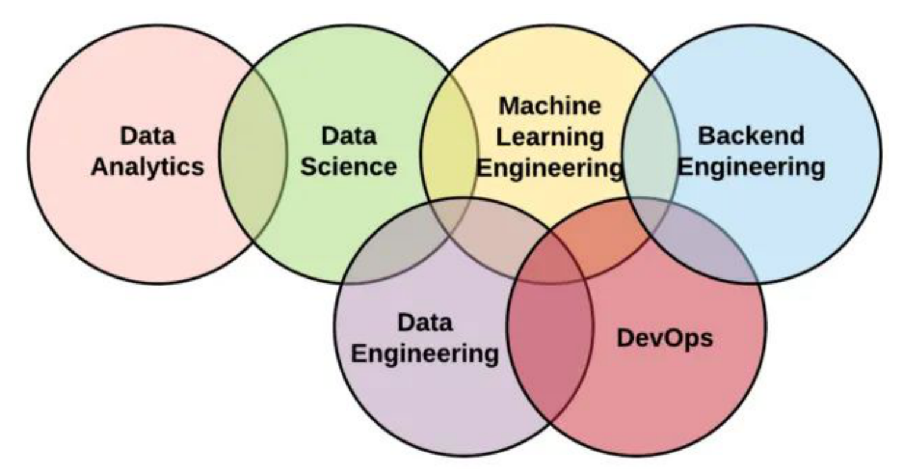

*Imagen original: Clase 1, p. 5.*

**Cómo leerlo:** cada círculo representa un área; las intersecciones muestran conocimientos y responsabilidades compartidos. La tabla siguiente explica el foco de cada rol.

| Rol | Foco principal |
| --- | --- |
| Data Analytics | Analizar datos y comunicar resultados útiles para tomar decisiones. |
| Data Engineering | Recolectar, preparar y organizar datos; construir y mantener sus pipelines. |
| Data Science | Explorar datos, construir características, entrenar y evaluar modelos. |
| Machine Learning Engineering | Integrar modelos en sistemas y llevarlos a producción. |
| Backend Engineering | Construir servicios, APIs y lógica de las aplicaciones. |
| DevOps / MLOps | Facilitar despliegues, operación y monitoreo; MLOps aplica ese trabajo a sistemas de ML. |

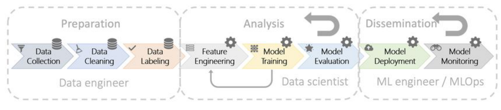

*Imagen original: Clase 1, p. 6.*

**Cómo leerlo:** seguí las flechas de izquierda a derecha. Primero se preparan datos, después se construye y evalúa el modelo y luego se despliega y monitorea. Las flechas de regreso indican revisiones.

El trabajo se organiza en tres grupos:

1. **Preparación:** recolección, limpieza y etiquetado de datos; foco del Data Engineer.
2. **Análisis:** ingeniería de características, entrenamiento y evaluación; foco del Data Scientist.
3. **Despliegue y monitoreo:** puesta en producción y seguimiento del modelo; foco del ML Engineer / MLOps.

#### Los tres pipelines de un sistema de ML

> **Idea clave:** datos, modelo y software deben funcionar como partes de un mismo sistema.

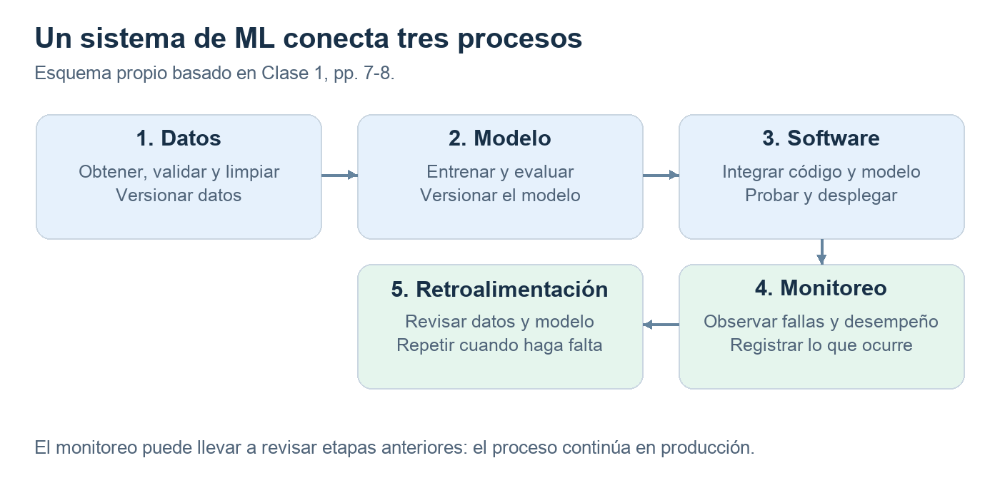

*Esquema propio basado en Clase 1, pp. 7-8.*

**Cómo leerlo:** seguí los números y las flechas. El monitoreo permite detectar la necesidad de revisar datos o modelos. El esquema simplifica las conexiones; no significa que cada proceso ocurra una sola vez.

Estos son los tres procesos:

- **Datos:** obtener datos, explorarlos, validarlos, limpiarlos y versionarlos; preparar conjuntos de entrenamiento y prueba.
- **Modelo:** construir características, ajustar hiperparámetros, entrenar, evaluar, seleccionar y empaquetar el modelo; versionarlo.
- **Software:** versionar código, construir el sistema, ejecutar pruebas de integración y desplegarlo.

Después del despliegue aparecen el **monitoreo y los registros de ejecución (logging)**. Lo observado en producción puede motivar revisiones de los datos o del modelo. El proceso tiene retroalimentación: no termina al entrenar ni al desplegar.

<a id="c1-03"></a>
### 3. CRISP-ML(Q)

> **Idea clave:** CRISP-ML(Q) conecta el problema de negocio con el desarrollo y la operación del modelo.

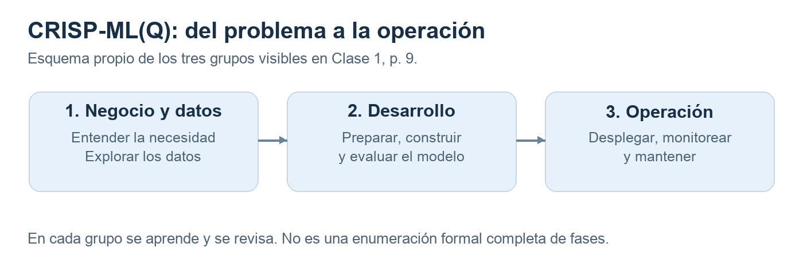

*Esquema propio de los tres grupos de Clase 1, p. 9.*

**Cómo leerlo:** las cajas muestran los grandes grupos. Evaluar y monitorear puede llevar a volver atrás; las flechas expresan el recorrido general, no un proceso rígido.

Cada grupo tiene un propósito:

| Grupo del diagrama | Qué se hace |
| --- | --- |
| Comprensión del negocio y los datos | Identificar el caso de uso, explorar los datos y revisar si permiten resolver el problema. |
| Desarrollo del modelo | Preparar datos, construir el modelo y evaluar sus resultados. |
| Operación del modelo | Desplegar, operar, monitorear y mantener el modelo. |

El proceso incluye ciclos de construir, medir, aprender y revisar. **La evaluación y el monitoreo pueden llevar a volver a etapas anteriores.**

**Aclaración de alcance:** la Q alude al aseguramiento de la calidad. La diapositiva muestra una visión general del proceso, pero no desarrolla controles concretos de calidad ni una enumeración formal completa de las fases. Este resumen conserva los tres grupos visibles, sin atribuirle detalles que no aparecen en el PDF.

<a id="c1-04"></a>
### 4. Características esenciales de un buen software

La clase enumera cuatro atributos (p. 11):

| Característica | Qué significa | Ejemplo propio |
| --- | --- | --- |
| Aceptabilidad | Ser comprensible, usable y compatible con los sistemas existentes. | Una aplicación que el usuario puede utilizar e integrar a su trabajo. |
| Confiabilidad y seguridad | Operar de manera confiable y segura, evitando daños físicos o económicos. | Un sistema que protege datos sensibles y controla situaciones de falla. |
| Eficiencia | Aprovechar los recursos; cuidar tiempos de respuesta y memoria. | Una API de predicción que responde dentro del tiempo requerido. |
| Mantenibilidad | Poder evolucionar frente a nuevas necesidades. | Cambiar una regla de negocio sin tener que rehacer todo el sistema. |

**Idea para recordar:** que el programa produzca un resultado correcto no alcanza; también importa cómo se usa, cómo opera y cómo se modifica.

<a id="c1-05"></a>
### 5. Complejidad esencial y accidental

La diferencia está en **de dónde proviene la dificultad** (p. 12).

- **Esencial:** proviene del problema que se quiere resolver. Ejemplos de la clase: reglas de negocio complejas, dependencias lógicas entre procesos y requisitos ambiguos que cambian según el contexto.
- **Accidental:** surge de herramientas, procesos o decisiones de implementación. Ejemplos: configuración complicada, herramientas mal documentadas, mala arquitectura o frameworks innecesariamente difíciles de aprender. En general puede reducirse.

**Ejemplo propio:** calcular impuestos según muchas reglas tiene complejidad esencial. Duplicar esas reglas en distintos archivos y tener un entorno difícil de configurar agrega complejidad accidental.

<a id="c1-06"></a>
### 6. Ciclo de vida del desarrollo de software

> **Idea clave:** el desarrollo continúa después de escribir y desplegar el código.

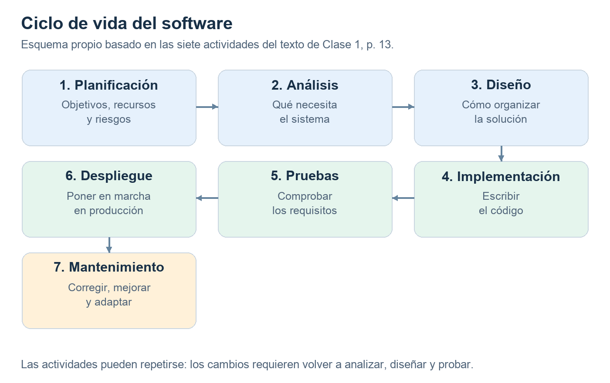

*Esquema propio basado en el texto de Clase 1, p. 13.*

**Cómo leerlo:** seguí las actividades del 1 al 7. La tabla explica qué se hace en cada una. Cuando aparecen nuevos requisitos o errores, se vuelven a realizar las actividades necesarias.

Las actividades son:

| Actividad | Propósito |
| --- | --- |
| Planificación | Definir objetivos, recursos, costos y cronogramas; anticipar riesgos. |
| Análisis | Especificar los requisitos: qué necesita el sistema. |
| Diseño | Definir la arquitectura: cómo se organizará la solución. |
| Implementación | Escribir el código. |
| Pruebas o testeo | Comprobar que se cumplen los requisitos. |
| Despliegue o deployment | Poner el sistema en funcionamiento en producción. |
| Mantenimiento | Corregir errores, mejorar la implementación y adaptarla a nuevas necesidades. |

**Distinción clave:** análisis define *qué* se necesita; diseño define *cómo* se organizará la solución; implementación la construye.

**Nota sobre el material:** el texto incluye despliegue por separado, mientras que el gráfico lateral agrupa el ciclo en seis segmentos. La tabla conserva las siete actividades del texto. Enumerarlas no implica que todo proyecto deba ejecutarlas una sola vez y de forma estrictamente lineal.

<a id="c1-07"></a>
### 7. Principios de diseño

La página 14 enumera KISS, SOLID, YAGNI y DRY. Las explicaciones siguientes desarrollan su significado para estudiar.

- **KISS (Keep it Simple):** elegir una solución simple y comprensible que resuelva la necesidad.
- **YAGNI (You Aren't Gonna Need It):** evitar construir funcionalidades para necesidades futuras que todavía no existen.
- **DRY (Don't Repeat Yourself):** evitar duplicar conocimiento o reglas que después deben mantenerse en varios lugares.

**Ejemplo propio:** si una práctica pide una función de suma, alcanza con una implementación sencilla. Agregar un sistema de plugins sin necesidad contradice KISS y YAGNI; copiar la misma regla de cálculo en varios módulos dificulta cumplir DRY.

#### SOLID

| Principio | Explicación |
| --- | --- |
| S: responsabilidad única | Un módulo o clase debe tener una responsabilidad coherente; un motivo principal para cambiar. |
| O: abierto/cerrado | Permitir extender comportamiento reduciendo la necesidad de modificar código existente. |
| L: sustitución de Liskov | Un subtipo debe poder reemplazar a su tipo base sin romper el comportamiento esperado. |
| I: segregación de interfaces | Un cliente no debe depender de operaciones que no utiliza. |
| D: inversión de dependencias | Depender de abstracciones, evitando acoplar la lógica a implementaciones concretas. |

**Ejemplo propio de responsabilidad única:** separar la lectura de un archivo, el cálculo de una predicción y el envío de un correo permite modificar cada responsabilidad con menos impacto sobre las otras.

<a id="c1-08"></a>
### 8. Fallas, deuda técnica y refactorización

#### 8.1. El software no se desgasta como el hardware

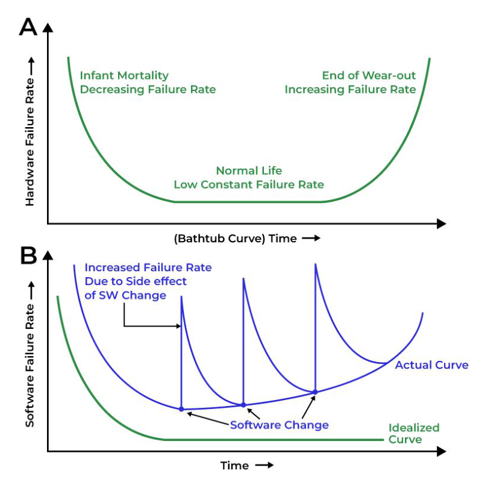

*Imagen original: Clase 1, p. 16.*

**Cómo leerlo:** arriba, el hardware tiene fallas iniciales y finales por desgaste. Abajo, los picos de software se asocian a cambios. El eje horizontal representa el tiempo; el vertical, la tasa de fallas.

La página 16 compara sus tasas de fallas:

- **Hardware:** curva de la bañera: fallas iniciales, una etapa estable y aumento final por desgaste.
- **Software:** las fallas provienen de defectos. Corregirlos puede reducirlas, pero los cambios pueden introducir defectos nuevos. Los cambios sucesivos mal gestionados pueden deteriorar la calidad.

**Lectura del gráfico:** las subidas de la curva del software representan fallas asociadas a cambios. No debe entenderse que toda versión introduce errores inevitablemente; la clase ilustra ese riesgo.

#### 8.2. Deuda técnica

Es el costo futuro que generan atajos o decisiones técnicas que facilitan una entrega inmediata pero dificultan el mantenimiento (pp. 17-19). Sus “intereses” aparecen como bugs, cambios más lentos y mayor costo de mantenimiento.

La clase menciona presión de tiempo, malas prácticas, desconocimiento y decisiones apresuradas. **No toda deuda es mala:** puede aceptarse conscientemente, siempre que se gestione antes de bloquear la evolución del sistema.

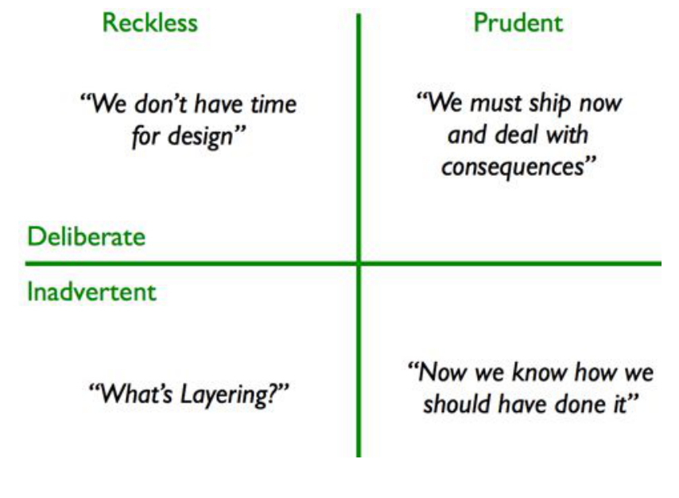

*Imagen original: Clase 1, p. 18.*

**Cómo leerlo:** las columnas separan imprudente (Reckless) de prudente (Prudent); las filas separan deliberada (Deliberate) de inadvertida (Inadvertent). La tabla traduce los cuatro casos.

La deuda se puede clasificar según dos preguntas: **¿se generó conscientemente?** y **¿se evaluaron sus consecuencias?**

|  | Imprudente | Prudente |
| --- | --- | --- |
| Deliberada | Se omite el diseño conscientemente sin evaluar bien sus consecuencias. | Se acepta un atajo para entregar y se reconoce que habrá que atender sus consecuencias. |
| Inadvertida | Se genera deuda por desconocimiento técnico. | Se descubre después, al aprender, que existía una mejor solución. |

La página 19 muestra que el impacto se extiende desde el código al producto, al equipo y al negocio: calidad, complejidad, entregas, riesgos, velocidad, satisfacción del cliente, reputación y costos.

#### 8.3. Refactorización

**Refactorizar es mejorar la estructura interna sin cambiar el comportamiento observable del software** (p. 20). Facilita su comprensión y mantenimiento y ayuda a reducir deuda técnica.

**Ejemplo propio:** extraer una regla duplicada a una función común, manteniendo los mismos resultados. Agregar una nueva función al producto es un cambio funcional, no una refactorización por sí mismo.

#### 8.4. Casos de falla

La página 21 resume dos casos:

- **Ariane 5 (1996):** reutilización de software de Ariane 4 sin pruebas adecuadas para el nuevo contexto; una conversión numérica produjo un overflow, asociado a la pérdida del cohete.
- **Therac-25 (1985-1987):** fallas en un sistema de radioterapia causaron sobredosis graves, con pacientes muertos o heridos.

La enseñanza es que las fallas de software pueden tener consecuencias materiales y humanas. La reutilización debe validarse en su nuevo contexto y la seguridad debe formar parte del diseño y de las pruebas. Estos son resúmenes de la clase, no análisis exhaustivos de los incidentes.

<a id="c1-09"></a>
### 9. Métricas de productividad y calidad

La página 25 destaca que **el objetivo es entregar valor**, y que contar líneas de código o commits puede resultar engañoso.

Las siguientes definiciones explican las métricas enumeradas en esa diapositiva:

| Métrica | Qué permite observar |
| --- | --- |
| Deployment Frequency | Frecuencia de despliegues a producción. |
| Lead Time for Changes | Tiempo desde un cambio registrado en el código hasta su llegada a producción. |
| Change Failure Rate | Proporción de cambios o despliegues que causan fallas y requieren intervención. |
| Mean Time to Restore | Tiempo medio para restablecer el servicio después de una falla. |
| MTTR: Mean Time to Recovery | Tiempo medio de recuperación; se relaciona con la restauración mencionada arriba. |
| Tasa de defectos | Cantidad de defectos respecto de una base definida, como versiones o tamaño del software. |
| Cobertura de tests | Porción del código que se ejecuta durante las pruebas, según la medida elegida. |

La clase agrupa las primeras cuatro como métricas DORA. **Aclaración para interpretar:** alta cobertura no garantiza que las pruebas sean buenas ni que el sistema esté libre de errores; tampoco una gran cantidad de commits demuestra valor entregado.

<a id="c1-10"></a>
### 10. Práctica 1: Git

#### 10.1. Qué es y cómo se conecta con la clase

Git es un **sistema de control de versiones distribuido**: permite registrar versiones y trabajar con repositorios locales que contienen el historial disponible. Facilita revisar cambios, colaborar y desarrollar en ramas.

Esto apoya la mantenibilidad y la trazabilidad del código durante su ciclo de vida. Las ramas permiten separar cambios y los tags identifican hitos o versiones.

**Dos precisiones sobre el PDF:** Git facilita fusionar trabajo, pero pueden existir conflictos que haya que resolver. Además, el historial registra lo confirmado mediante commits: los cambios sin commit no quedan automáticamente guardados en él. El respaldo remoto depende de haber publicado los cambios.

Git es la herramienta de versionado; GitHub es una plataforma que puede alojar repositorios Git.

#### 10.2. El recorrido de un cambio

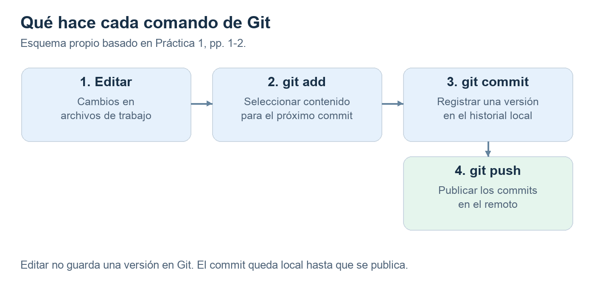

*Esquema propio basado en Práctica 1, pp. 1-2.*

**Cómo leerlo:** cada comando lleva el cambio a un estado distinto. Después de commit existe una versión local; después de push, sus commits también están en el remoto.

- **Directorio de trabajo:** archivos que editás.
- **Área de preparación (staging/index):** contenido seleccionado para el próximo commit. Si volvés a editar un archivo después de `add`, necesitás volver a agregarlo para incluir esa nueva edición.
- **Commit:** versión registrada en el historial local, con identificador, autor y mensaje.
- **Remoto:** repositorio con el que intercambiás cambios. `origin` es el nombre habitual creado por `clone`.
- **HEAD:** referencia que identifica el commit actual; normalmente apunta a la rama en la que estás trabajando.

**Diferencia central:** `add` prepara; `commit` registra localmente; `push` publica en el remoto.

#### 10.3. Configuración y creación del repositorio

Configurar la identidad que quedará registrada en los commits:

```bash
git config --global user.name "Tu Nombre"
git config --global user.email "tu.email@ejemplo.com"
```

`--global` aplica la configuración a los repositorios del usuario. Esto identifica la autoría; no configura por sí solo la autenticación en GitHub.

Para iniciar un proyecto nuevo:

```bash
cd /ruta/a/tu/proyecto
git init
```

Para obtener un proyecto existente:

```bash
git clone <URL_del_repositorio_remoto>
```

Los textos entre `<...>` son marcadores para reemplazar. `init` y `clone` son alternativas según el punto de partida; no hace falta inicializar nuevamente un repositorio clonado.

#### 10.4. Flujo básico

```bash
git status
git add nombre_del_archivo.txt
git commit -m "Describe el cambio realizado"
git push origin nombre_de_la_rama
```

`status` permite revisar qué cambió y qué está preparado. Como alternativa a agregar un archivo concreto, `git add .` prepara los cambios bajo el directorio actual; conviene revisar primero qué se va a incluir.

`push` publica commits, no modificaciones que todavía no fueron confirmadas.

#### 10.5. Ramas y actualización

| Comando del PDF | Efecto |
| --- | --- |
| `git branch` | Lista ramas locales y señala la actual. |
| `git branch new_feature` | Crea una rama sin cambiar a ella. |
| `git checkout new_feature` | Cambia a esa rama. |
| `git checkout -b new_feature` | Crea la rama y cambia a ella. |
| `git branch -d new_feature` | Intenta borrar una rama local con comprobación de integración; puede rechazar ramas con trabajo sin integrar. No permite borrar la rama actual. |
| `git pull origin nombre_de_la_rama` | Obtiene cambios del remoto e intenta integrarlos en la rama actual. |

**Aclaración:** `pull` no cambia automáticamente a la rama indicada. Antes de ejecutarlo, verificá en qué rama estás. La integración puede requerir resolver conflictos; su estrategia depende de la configuración de Git.

#### 10.6. Historial

| Comando | Para qué sirve |
| --- | --- |
| `git log` | Revisar los commits del historial. |
| `git log --oneline` | Ver una línea por commit. |
| `git log --graph --oneline --decorate` | Ver el grafo y las referencias de ramas y tags. |
| `git log -p` | Ver también los cambios de cada commit. |
| `git log --author="Tu Nombre"` | Filtrar por autor. |

#### 10.7. Deshacer cambios: distinguir sus efectos

Los comandos de la práctica actúan sobre partes diferentes del repositorio:

| Comando | Efecto |
| --- | --- |
| `git checkout -- nombre_del_archivo.txt` | Reemplaza el archivo de trabajo con su versión del área de preparación. Descarta las modificaciones de ese archivo que no estaban preparadas. |
| `git reset HEAD~1` | Retrocede la rama al commit padre y restablece el área de preparación; conserva los archivos de trabajo. Los cambios del commit retirado quedan disponibles como cambios sin preparar. |
| `git reset --hard HEAD~1` | Retrocede la rama y restablece tanto el área de preparación como los archivos versionados al commit padre. Puede hacer perder cambios locales. |

`HEAD~1` designa el primer padre del commit actual. **No son comandos equivalentes:** el reset por defecto conserva los archivos de trabajo; `--hard` los restablece. Retroceder una rama también modifica su historial, por lo que no debe confundirse con publicar una corrección a un commit ya compartido.

#### 10.8. Tags

Un tag marca un punto del historial. A diferencia de una rama, normalmente permanece asociado al mismo commit.

```bash
# Tag ligero
git tag v1.0.0

# Alternativa: tag anotado con mensaje
git tag -a v1.0.0 -m "Versión inicial"

# Listar y publicar tags
git tag
git push origin --tags
```

Las dos formas de crear `v1.0.0` son **alternativas**, no pasos consecutivos con el mismo nombre. Un push normal de una rama no garantiza que se publiquen sus tags; la práctica pide enviarlos expresamente.

#### 10.9. .gitignore

El archivo `.gitignore` define patrones para archivos que Git debe ignorar cuando todavía no están versionados. El PDF propone:

```gitignore
*.log
node_modules/
mi_archivo_secreto.env
.DS_Store
```

Sirve para excluir logs, dependencias generadas, configuraciones locales o archivos sensibles. **Aclaración importante:** agregar un archivo a `.gitignore` no elimina su seguimiento si ya estaba versionado ni lo borra del historial.

<a id="c1-11"></a>
### 11. Ejercicio de la práctica, explicado paso a paso

La consigna pide crear un repositorio, confirmar un README, trabajar en `feature-suma`, agregar una función de suma, marcar el último commit como `v0.1` y publicarlo en GitHub (práctica, p. 4).

**La guía siguiente es un ejemplo de resolución para estudiar; estos comandos no se ejecutaron en tu repositorio.** Supone que Git está instalado y que configuraste tu identidad.

**1. Crear una carpeta e iniciar Git.**

```bash
mkdir practica-git
cd practica-git
git init
```

**2. Crear `README.md`.** Por ejemplo, escribir en ese archivo:

```markdown
# Calculadora
Práctica inicial de Git: función de suma.
```

Después registrar la primera versión:

```bash
git add README.md
git commit -m "Agrega README de la calculadora"
```

**3. Crear la rama de trabajo y cambiar a ella.**

```bash
git checkout -b feature-suma
```

**4. Crear `calculadora.py` con una función de suma.**

```python
def suma(a, b):
    return a + b
```

**5. Confirmar el archivo y marcar ese commit.**

```bash
git add calculadora.py
git commit -m "Agrega función de suma"
git tag v0.1
```

**6. Conectar y publicar en GitHub.** El PDF pide pushear, pero no explica cómo configurar el remoto de un repositorio creado con `init`. Para completar el ejemplo, creá previamente un repositorio vacío en GitHub y reemplazá la URL:

```bash
git remote add origin <URL_del_repositorio_en_GitHub>
git push -u origin feature-suma
git push origin --tags
```

`remote add` es una aclaración agregada para completar la consigna. `-u` configura el seguimiento de la rama remota. La publicación requiere acceso al repositorio y autenticación configurada.

**7. Comprobar el resultado.**

```bash
git status
git log --oneline --decorate
git tag
```

En GitHub, revisar la rama `feature-suma`, el archivo `calculadora.py` y el tag `v0.1`. El tag debe apuntar al commit que agregó la suma. La consigna no pide integrar esa rama a la principal.

<a id="c1-12"></a>
### 12. Repaso para estudiar

Deberías poder explicar:

1. Por qué un sistema de IA necesita ingeniería de software además del entrenamiento del modelo.
2. Cómo se relacionan los pipelines de datos, modelo y código, y por qué hay retroalimentación.
3. Qué significan aceptabilidad, confiabilidad y seguridad, eficiencia y mantenibilidad.
4. Cómo distinguir complejidad esencial de accidental.
5. La diferencia entre análisis, diseño, implementación, pruebas, despliegue y mantenimiento.
6. Qué buscan KISS, YAGNI, DRY y cada principio SOLID.
7. Qué es la deuda técnica y por qué una refactorización conserva el comportamiento.
8. Por qué líneas de código y cantidad de commits no bastan para medir productividad.
9. La diferencia entre `add`, `commit`, `push` y `pull`.
10. La diferencia entre rama y tag, y los efectos de los comandos para descartar cambios.

<a id="c1-13"></a>
### 13. Claridad del material y puntos pendientes

Se revisaron el texto y las imágenes de los dos PDF.

- **Clase, pp. 5-9:** los diagramas permiten identificar roles, etapas y conexiones. Algunos rótulos pequeños de los esquemas de las pp. 7-8 tienen baja definición. Se incorporó un esquema en español con su estructura y conceptos legibles; no se transcribieron nombres dudosos de formatos o herramientas.
- **Clase, p. 9:** CRISP-ML(Q) aparece como esquema general, sin un desarrollo detallado de sus controles de calidad. Para profundizar ese aspecto hace falta material adicional o la explicación de clase.
- **Clase, p. 24:** contiene el título “Repaso de Git” y una viñeta vacía. No hay contenido que permita reconstruir ese repaso; se utilizó la práctica asociada.
- **Práctica, pp. 1-4:** el texto y los comandos son legibles. Se aclararon las simplificaciones sobre conflictos, historial, respaldo, `reset` y `.gitignore`, y se agregó la configuración del remoto que falta en el ejercicio.

**Pendiente si se busca mayor detalle:** confirmar con la explicación docente los rótulos pequeños de los diagramas y el tratamiento de calidad en CRISP-ML(Q). No impiden comprender los conceptos principales resumidos aquí.

[Volver al índice](#indice)

<a id="clase-2"></a>
## Clase 2: Metodologías, colaboración y entornos con Docker

**Qué vas a entender:** cómo organizar el trabajo, revisar cambios entre compañeros y ejecutar la aplicación en un entorno consistente.

**Conexión con las prácticas:** la calculadora ejercita coordinación y PRs; Docker permite describir el entorno y conectar servicios.

<details>
<summary>Fuentes y referencias [M], [PR], [G] y [D]</summary>

**Material utilizado y referencias abreviadas de esta clase:**

- **[M]** [Metodologías de Desarrollo de Software](<Clases/Clase 2 Metodologías de Desarrollo de Software.pdf>) (31 páginas).
- **[PR]** [Trabajo colaborativo: Git y PRs](<Clases/Clase 2 Practica Git PRs.pdf>) (27 páginas).
- **[G]** [Práctica de Desarrollo Colaborativo en Git](<Practicas/2. Práctica Desarrollo Colaborativo Git - MIA203.pdf>) (2 páginas).
- **[D]** [Práctica Docker](<Practicas/2. Práctica Docker.pdf>) (11 páginas).

Por ejemplo, **[M, pp. 5-6]** remite a las páginas 5 y 6 del PDF de metodologías. Las páginas se cuentan desde el comienzo de cada PDF. Los ejemplos propios y las correcciones se identifican expresamente.

</details>

<a id="c2-01"></a>
### 1. De las actividades del desarrollo a la organización del trabajo

En la [Clase 1](#c1-06) vimos qué actividades necesita un sistema: análisis, diseño, implementación, pruebas, despliegue y mantenimiento. La Clase 2 aborda **cómo organizar esas actividades entre personas y a lo largo del tiempo**.

Un proceso de desarrollo estructura el trabajo, coordina roles, hace visibles riesgos y ayuda a lograr entregas de calidad [M, p. 4]. Las metodologías y los marcos de trabajo permiten decidir cómo planificar, recibir feedback y adaptarse.

**El recorrido de la clase:**

1. Entender y priorizar la necesidad.
2. Organizar el trabajo y construir una entrega pequeña.
3. Revisar e integrar los cambios.
4. Ejecutar el sistema en un entorno conocido.
5. Recibir feedback y mejorar.

Este recorrido es una síntesis propia. Cada herramienta apoya una parte: el backlog organiza necesidades; Git registra cambios; el PR facilita su revisión; Docker describe un entorno de ejecución. Ninguna reemplaza a las demás.

<a id="c2-02"></a>
### 2. Waterfall y Agile: dos maneras de organizar el desarrollo

#### Waterfall o cascada

El material lo presenta como un modelo principalmente **lineal y secuencial**, inspirado en procesos de ingeniería tradicionales [M, pp. 5-6]. El diagrama muestra requisitos, diseño, implementación y pruebas unitarias, integración y pruebas del sistema, operación y mantenimiento.

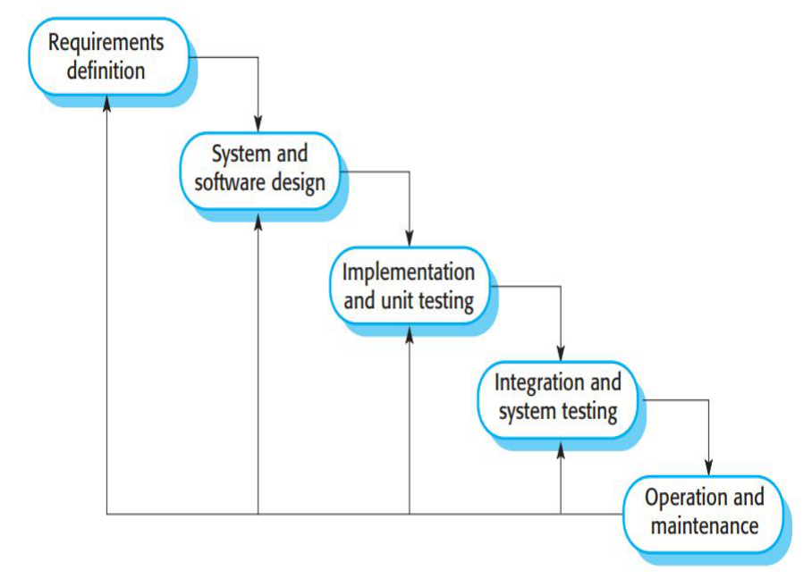

*Imagen original: Metodologías, p. 5 [M].*

**Cómo leerlo:** las etapas bajan en forma de escalera: requisitos, diseño, implementación y pruebas, integración y operación. Las flechas de regreso representan revisiones, pero el recorrido principal es secuencial.

Resulta adecuado según la clase para proyectos predecibles, con pocos cambios. Su limitación central es el costo de descubrir tarde que el producto no satisface la necesidad: si el feedback llega al final, corregir requisitos o diseño puede exigir mucho retrabajo.

#### Agile

Agile prioriza entregas pequeñas y frecuentes, colaboración con el cliente y adaptación. La clase introduce cuatro valores del Manifiesto Ágil [M, p. 7]:

| Se prioriza | Por sobre |
| --- | --- |
| Personas e interacciones | Procesos y herramientas. |
| Software funcionando | Documentación exhaustiva. |
| Colaboración con el cliente | Negociación contractual. |
| Respuesta al cambio | Seguimiento de un plan. |

**Aclaración conceptual:** priorizar no significa eliminar el elemento de la derecha. La propia clase muestra documentos de arquitectura, planificación y registros de decisiones como parte del trabajo ágil [M, p. 22].

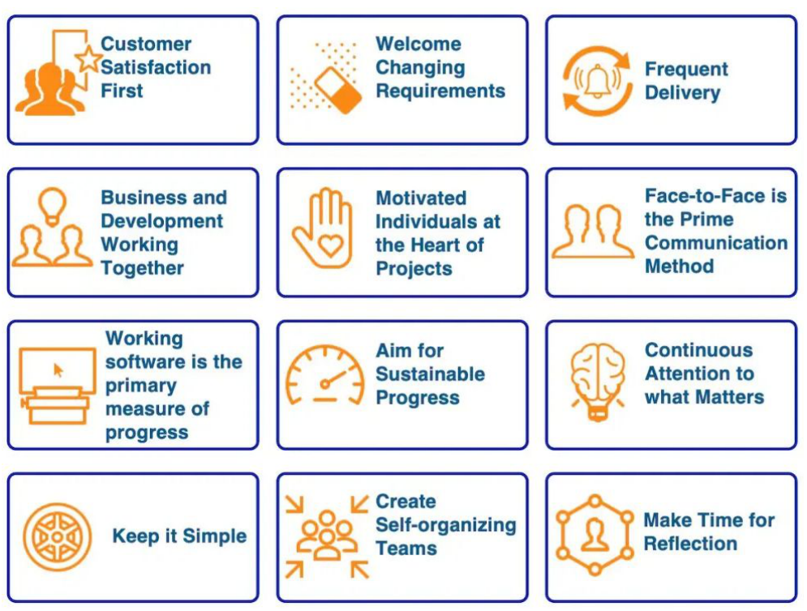

*Imagen original: Metodologías, p. 7 [M].*

**Cómo leerlo:** las tarjetas son principios complementarios, no pasos de una secuencia. El párrafo siguiente los resume en español.

La imagen de la página 7 también sintetiza doce principios: satisfacción del cliente, aceptación de cambios, entregas frecuentes, colaboración entre negocio y desarrollo, personas motivadas, comunicación directa, software funcionando como medida de progreso, ritmo sostenible, atención a la excelencia técnica, simplicidad, equipos autoorganizados y reflexión periódica. Esta es una síntesis del gráfico, no una transcripción literal del manifiesto.

#### Iterativo e incremental: conceptos relacionados, pero diferentes

La clase caracteriza Agile con ambos términos [M, pp. 8-9]:

- **Iterativo:** revisar y mejorar una solución mediante ciclos de trabajo y feedback.
- **Incremental:** agregar capacidades utilizables al producto en entregas sucesivas.

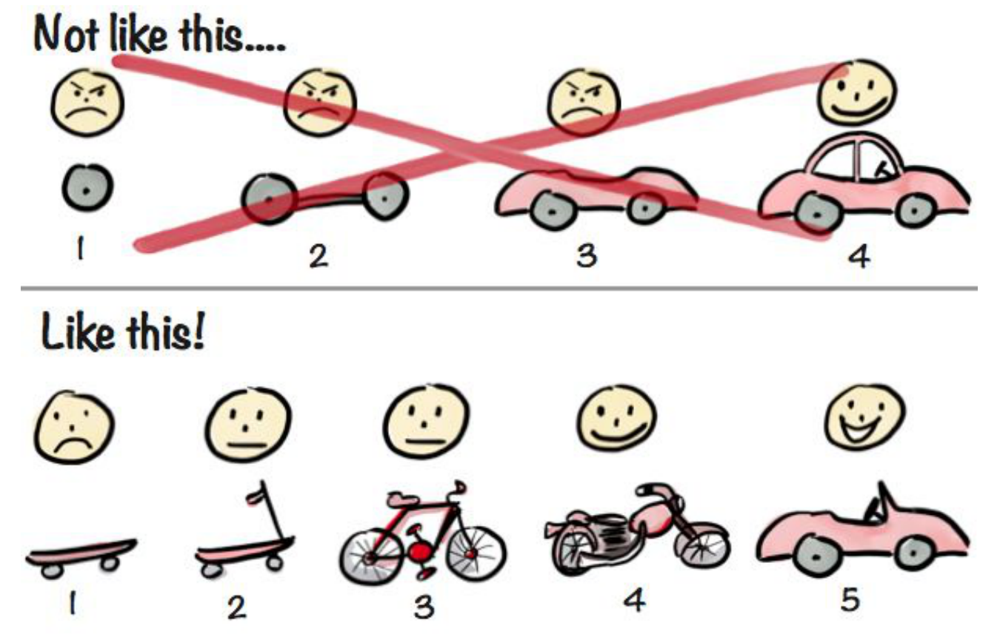

*Imagen original: Metodologías, p. 9 [M].*

**Cómo leerlo:** arriba se entregan piezas y el usuario solo obtiene transporte al final. Abajo se entrega una solución de transporte sencilla que luego mejora. Las caras representan la experiencia del usuario.

> **Idea clave:** cada incremento debe aportar utilidad y permitir aprender. La imagen ilustra ese principio; no prescribe una evolución literal para todos los productos.

**Ejemplo propio conectado con la práctica:** entregar primero una calculadora que suma, luego agregar otras operaciones y finalmente permitir guardar resultados. Cada incremento funciona y puede revisarse.

| Aspecto | Waterfall, según la clase | Enfoque Agile |
| --- | --- | --- |
| Organización | Etapas principalmente secuenciales. | Ciclos y entregas pequeñas. |
| Feedback | Riesgo de recibirlo demasiado tarde. | Comunicación y validación frecuentes. |
| Cambios | Pueden resultar costosos después de avanzar de etapa. | Se contemplan como parte del proceso. |
| Contexto | Mayor previsibilidad y estabilidad. | Necesidad de aprender y adaptarse. |

La clase añade simplicidad, integración continua y ritmo sostenible [M, p. 8]. La **integración continua** ayuda a combinar y verificar cambios con frecuencia; se retomará en el trabajo con PRs.

<a id="c2-03"></a>
### 3. Scrum: roles, artefactos y ciclo de trabajo

Scrum es un **framework o marco de trabajo** presentado como ejemplo de enfoque ágil. Organiza el desarrollo en sprints y promueve transparencia, inspección y adaptación [M, pp. 11-14]. Agile es el enfoque general; Scrum propone una estructura concreta para aplicarlo.

- **Transparencia:** hacer visible el trabajo y su estado.
- **Inspección:** revisar resultados y progreso.
- **Adaptación:** ajustar el trabajo a partir de lo aprendido.

La clase utiliza sprints de **2 a 4 semanas**. Se conserva ese rango como presentación del material, sin convertirlo en una duración obligatoria para todos los equipos.

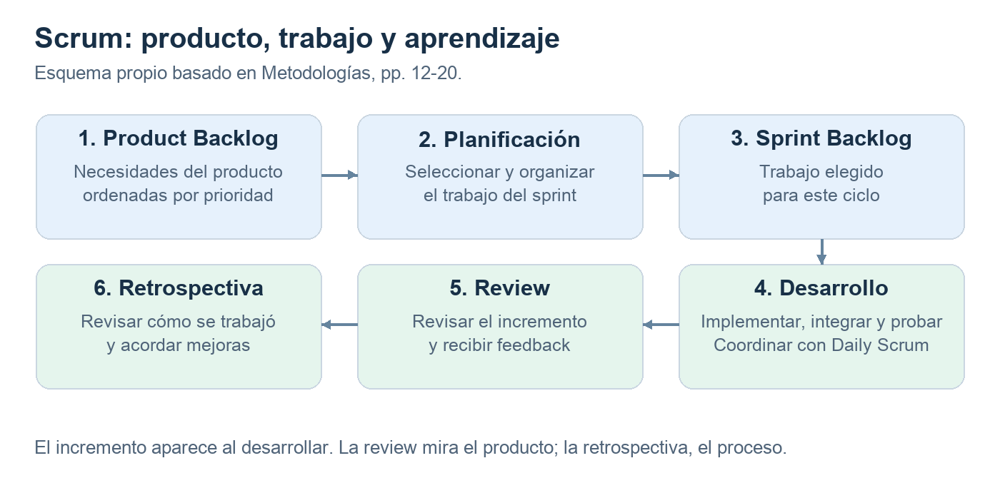

*Esquema propio basado en Metodologías, pp. 12-20 [M].*

**Cómo leerlo:** seguí las cajas numeradas. La planificación selecciona trabajo; el desarrollo produce un incremento; la review revisa el producto y la retrospectiva mejora el proceso. Lo aprendido alimenta el siguiente ciclo.

#### Roles

| Rol | Responsabilidad en la clase |
| --- | --- |
| Product Owner | Maximizar el valor del producto, representar la visión de negocio y decidir prioridades del Product Backlog. |
| Scrum Master | Facilitar la aplicación de Scrum, ayudar a remover impedimentos y promover mejora continua. |
| Dev Team | Construir el incremento, participar en estimación y planificación y mantener la calidad técnica. Es multidisciplinario y autoorganizado. |

Referencias: [M, pp. 15-17]. **Distinción para estudiar:** el Product Owner prioriza el valor; el equipo construye la solución; el Scrum Master facilita el proceso. La autoorganización requiere coordinación y responsabilidad compartida.

#### Artefactos y resultado

| Elemento | Qué representa |
| --- | --- |
| Product Backlog | Lista priorizada y evolutiva de funcionalidades y tareas del producto. Es la fuente principal de planificación. |
| Sprint Backlog | Trabajo seleccionado para el sprint y las tareas para realizarlo. Permite observar el avance. |
| Incremento | Resultado utilizable que añade valor al producto; los diagramas lo muestran como software potencialmente entregable. |

Referencias: [M, pp. 12-13 y 18-20]. El Sprint Backlog selecciona trabajo del Product Backlog y lo concreta en tareas. Conviene distinguir **lo que se necesita en el producto** de **lo que el equipo hará en el ciclo actual**.

**Ejemplo propio:** el Product Backlog puede incluir operaciones, interfaz por terminal y guardado a archivo. Un sprint puede seleccionar las operaciones y la entrada por terminal; el incremento será una calculadora ejecutable que cumpla ese alcance.

#### Eventos y recorrido del sprint

El texto y los diagramas presentan este recorrido [M, pp. 12-14 y 20]:

1. **Planificación:** revisar prioridades, seleccionar trabajo y organizar el sprint.
2. **Desarrollo:** implementar, integrar y probar; coordinarse mediante el Daily Scrum.
3. **Sprint Review:** revisar el resultado y recoger feedback sobre el producto.
4. **Retrospectiva:** revisar cómo se trabajó y acordar mejoras del proceso.
5. **Nuevo ciclo:** incorporar lo aprendido a la planificación siguiente.

**Review y retrospectiva no son equivalentes:** la review se concentra en el producto; la retrospectiva, en la forma de trabajar. Tampoco terminar un sprint significa necesariamente publicar una nueva versión: el material habla de un resultado potencialmente entregable.

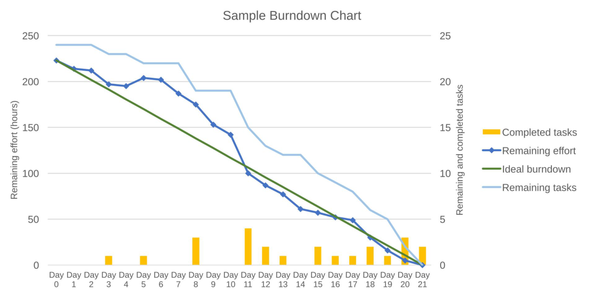

*Imagen original: Metodologías, p. 19 [M].*

**Cómo leerlo:** el eje horizontal muestra días del sprint y las curvas representan trabajo restante; una baja indica avance. La línea ideal es una referencia y las curvas reales pueden apartarse de ella. Es un ejemplo ilustrativo, no una medición del equipo de la práctica.

La página 19 incluye un **burndown chart**, un gráfico del trabajo restante a lo largo del sprint. Sirve para observar tendencias; no mide por sí solo el valor entregado ni la productividad individual.

<a id="c2-04"></a>
### 4. Seguimiento de tareas y adaptación del proceso

Una vez priorizado el trabajo, el equipo necesita ver qué está pendiente, qué está en curso y qué está bloqueado. El task tracking aporta transparencia, coordinación y visibilidad de dependencias [M, pp. 24-26].

La clase menciona Jira, Trello, ClickUp y GitHub Projects como ejemplos de herramientas [M, p. 25]. El concepto a estudiar es la organización del trabajo; la herramienta elegida lo implementa.

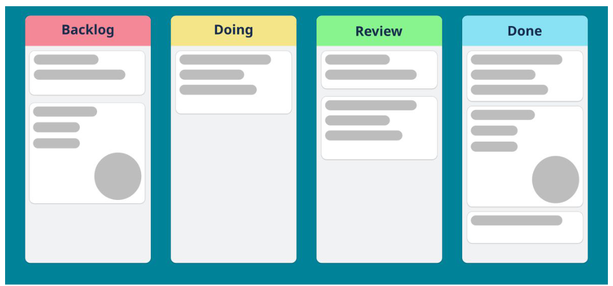

*Imagen original: Metodologías, p. 26 [M].*

**Cómo leerlo:** cada tarjeta representa trabajo y cambia de columna al avanzar. Muchas tarjetas en una columna pueden señalar acumulación. El tablero original tiene cuatro columnas; el flujo también puede separar pruebas y despliegue.

**Flujo posible:** Pendiente → En curso → Revisión/Pruebas → Despliegue → Terminado.

El **WIP limit (Work in Progress)** limita el trabajo simultáneo. Ayuda a evitar que se abran muchas tareas sin terminar las anteriores [M, p. 26].

**Ejemplo propio:** si Review tiene un límite de dos tareas y ya está lleno, el equipo puede ayudar a revisar antes de comenzar otra funcionalidad. Un tablero visualiza el flujo; por sí solo no constituye toda una metodología.

La clase recomienda tomar Agile como una caja de herramientas y adaptar las prácticas al contexto [M, pp. 21-22]. El ejemplo combina reuniones de inicio, sincronizaciones con clientes y equipo, actualizaciones diarias asincrónicas, retrospectivas, seguimiento compartido y documentación viva.

Los **ADRs (Architecture Decision Records)** registran decisiones de arquitectura y sus motivos. Se relacionan con la mantenibilidad de la Clase 1: quien modifica el sistema necesita entender no solo qué se decidió, sino por qué.

**Límite del material:** el ítem “Internal syncs con” está incompleto y “bi-weeklies” no define inequívocamente una frecuencia. Se conserva la idea de sincronización sin inventar participantes ni periodicidad.

<a id="c2-05"></a>
### 5. Aprender del trabajo y de los incidentes

#### Retrospectiva

Es una reunión para reflexionar sobre el trabajo y acordar mejoras. La clase propone realizarla al cerrar un sprint o una etapa importante [M, p. 28]. Sus preguntas incluyen:

- ¿Qué salió bien?
- ¿Qué no salió tan bien?
- ¿Qué aprendimos y qué cambios haríamos?
- ¿Qué dudas tenemos?
- ¿Por qué estamos agradecidos?

**Ejemplo propio de mejora concreta:** si los PRs grandes demoraron la revisión, acordar cambios más pequeños para el siguiente ciclo y revisar si eso ayuda.

#### Blameless post mortem

Es una revisión estructurada de un incidente, centrada en hechos y aprendizaje, partiendo de la buena fe y evitando buscar culpables individuales [M, p. 29].

| Parte | Qué documenta |
| --- | --- |
| Summary | Qué pasó, impacto y duración. |
| Leadup | Antecedentes y condiciones que llevaron al incidente. |
| Response | Cómo, cuándo y quién respondió; bloqueos encontrados. |
| Root Cause | Causas cuyo tratamiento ayudaría a evitar la repetición. |
| Recurrence | Si ocurrió antes o podría haber pasado inadvertido. |
| Corrective Actions | Acciones para prevenir o mitigar el problema. |

**Caso de la clase:** un proyecto de ASR (reconocimiento automático de voz) tuvo solapamiento entre entrenamiento y prueba, por lo que las métricas eran inválidas; el material señala un impacto de 1,5 meses. Se reportó el problema y se repitieron entrenamientos con datos limpios. Se propusieron revisar el pipeline, particionar con hash y formalizar las métricas requeridas [M, p. 30].

**Explicación del problema:** si la evaluación contiene ejemplos ya utilizados para entrenar, sus resultados pueden aparentar una capacidad de generalización que el modelo no tiene. Es un caso de contaminación de la evaluación. El PDF menciona partición con hash, pero no desarrolla su implementación ni demuestra que por sí sola evite todo solapamiento.

**Conexión con la Clase 1:** calidad de datos, pruebas y trazabilidad deben abarcar el sistema completo. La retrospectiva revisa el proceso habitual; el post mortem estudia un incidente específico.

<a id="c2-06"></a>
### 6. Git colaborativo: de una tarea a un cambio integrado

Hasta aquí vimos cómo organizar y mejorar el trabajo. El siguiente paso es convertir tareas en cambios de código que otras personas puedan revisar.

El material de PRs retoma Git como DVCS: el trabajo y el historial locales permiten realizar muchas operaciones sin depender del servidor. Las ramas son referencias a commits y permiten desarrollar líneas de trabajo separadas; pueden publicarse y luego integrarse [PR, pp. 3-4]. Los comandos básicos están en la [práctica de la Clase 1](#c1-10).

#### Issue, rama, PR y merge

| Concepto | Función |
| --- | --- |
| Issue | Describir y seguir una tarea, problema o necesidad. |
| Rama | Desarrollar una línea de cambios separada. |
| Pull Request (PR) | Proponer integrar cambios de una rama a otra y abrir un espacio de revisión. |
| Review | Examinar el código, comentar y validar la propuesta. |
| Merge | Integrar los cambios. |

Referencias: [G, pp. 1-2] y [PR, pp. 6-8]. **Un PR no es `git pull`:** el primero es una propuesta en la plataforma; el segundo obtiene e integra cambios en el repositorio local.

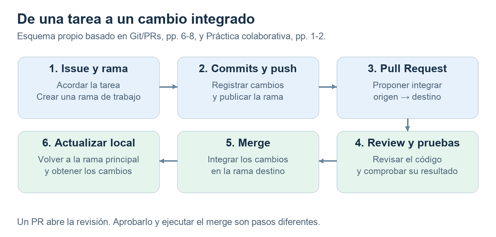

*Esquema propio basado en Git/PRs, pp. 6-8 [PR], y Práctica colaborativa, pp. 1-2 [G].*

**Cómo leerlo:** seguí los números. El push publica la rama; el PR propone integrarla; la revisión comprueba el cambio; el merge lo incorpora. Finalmente cada integrante actualiza su copia local.

Al abrir el PR se seleccionan:

- **Origen / compare:** rama que aporta los cambios.
- **Destino / base:** rama que los recibirá, por ejemplo `main`.

Su descripción debe explicar el cambio. El material recomienda abrirlo como **draft** temprano para dar visibilidad y pedir ayuda; después se prepara para revisión [PR, p. 7]. Abrir un PR no integra automáticamente el trabajo, y aprobarlo no equivale a ejecutar el merge.

#### Revisión y buenas prácticas

El PR permite comentar, pedir cambios y aprobar. También permite compartir conocimiento [PR, pp. 8 y 16]. La clase recomienda incorporar cambios de la rama base con frecuencia, dar feedback constructivo y acompañar las revisiones con integración continua.

**Guía propia para la review de la calculadora:** comprobar que cumple el issue, que las operaciones funcionan, que el código se entiende y que no rompe funcionalidades anteriores. Una revisión debe evaluar el comportamiento además de la apariencia del código.

<a id="c2-07"></a>
### 7. Conflictos: detectar, resolver y comprobar

Un conflicto aparece cuando Git no puede integrar cambios automáticamente. El ejemplo habitual del material es modificar las mismas líneas; también se muestra un conflicto `add/add`, cuando ambas ramas agregaron un archivo con contenido incompatible [PR, pp. 13-15 y 19].

`git status` informa archivos sin resolver. En un conflicto textual pueden aparecer marcas como:

```text
<<<<<<< HEAD
    print("Hola Mundo!!!")
=======
    print("Hola Mundo")
>>>>>>> rama-entrante
```

En este ejemplo de merge, `HEAD` corresponde a la versión de la rama actual y la parte inferior a la que se intenta integrar. Las marcas no son código válido. **Resolver implica decidir qué contenido final es correcto**, que puede combinar ambas versiones.

#### Ejemplo guiado de integración de `main` en una rama de trabajo

Este ejemplo usa un merge explícito para que el proceso no dependa de la estrategia configurada para `pull`. Supone que estás en tu rama de trabajo y sin cambios locales pendientes:

```bash
git status
git fetch origin
git merge origin/main
```

Si hay conflicto:

1. Revisar `git status` e identificar los archivos afectados.
2. Editarlos, decidir el resultado y eliminar las marcas del conflicto.
3. Comprobar el funcionamiento del código resultante.
4. Preparar los archivos resueltos y completar el merge:

```bash
git add main.py
git commit -m "Resuelve conflicto al integrar main"
git push
```

Aquí `git push` supone que la rama ya tiene seguimiento remoto, como después de `git push -u origin nombre_de_rama`. Si se decide cancelar un merge en curso, el material muestra `git merge --abort` [PR, p. 14].

**Relación con el PDF:** el workshop utiliza `git pull origin main` desde la rama de trabajo, resuelve `main.py`, hace commit y publica [PR, p. 19]. `pull` integra en la rama actual; no cambia a `main`. La secuencia anterior separa obtención e integración para dejar explícito qué ocurre.

**Cuidado conceptual:** resolver un conflicto textual no garantiza que dos funcionalidades sean compatibles. Hay que probar la integración aunque Git no haya reportado conflictos.

<a id="c2-08"></a>
### 8. Gitflow: una convención para organizar ramas

Gitflow es una estrategia de ramas presentada en el material [PR, pp. 21-25]. Se apoya en dos ramas duraderas y ramas específicas para cambios:

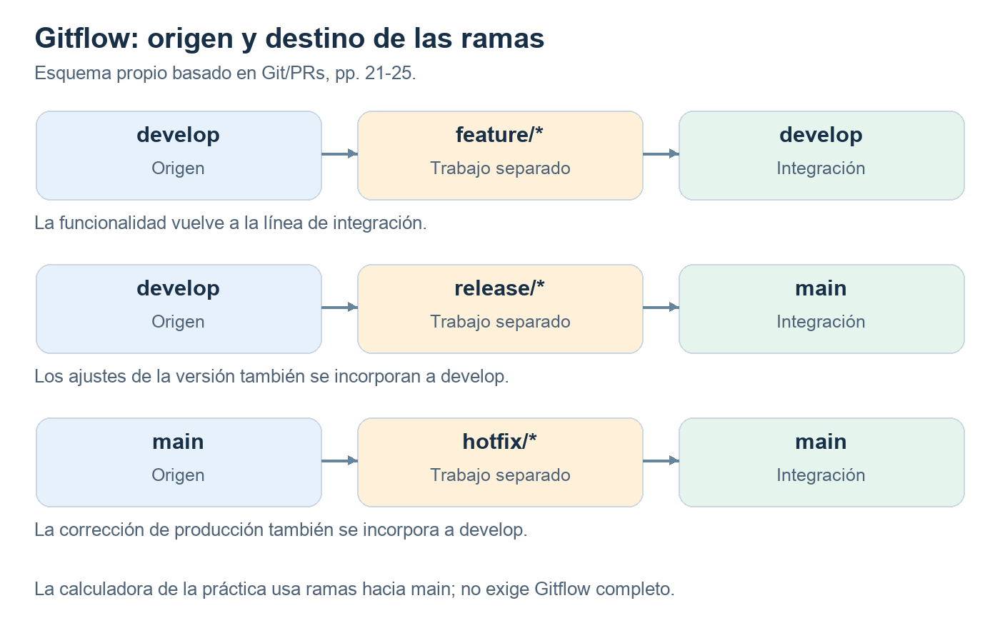

*Esquema propio basado en Git/PRs, pp. 21-25 [PR].*

**Cómo leerlo:** cada fila es un recorrido independiente. Feature sale de develop y vuelve a develop. Release y hotfix llegan a main; sus correcciones también deben incorporarse a develop.

| Rama | De dónde sale | Propósito y destino |
| --- | --- | --- |
| `main` o `master` | Rama principal. | Contiene las versiones oficiales. |
| `develop` | Línea de desarrollo. | Integra funcionalidades para versiones futuras. |
| `feature/*` | `develop`. | Desarrollar una funcionalidad; se integra en `develop`. |
| `release/*` | `develop`. | Preparar una versión, sin nuevas funcionalidades; integrar la versión en `main` y sus ajustes en `develop`. |
| `hotfix/*` | `main`. | Corregir una versión en producción; llevar la corrección a `main` y también a `develop`. |

El esquema permite ver por qué es necesario devolver las correcciones a la línea de desarrollo: de otro modo podrían perderse en la siguiente versión.

**Distinción con la práctica:** el ejercicio de la calculadora usa ramas que se integran directamente a `main` [G, p. 2]. No exige implementar Gitflow completo. Gitflow es una convención de organización, no un mecanismo obligatorio de Git.

<a id="c2-09"></a>
### 9. Práctica de desarrollo colaborativo: calculadora en pareja

La consigna es trabajar en un equipo de **dos personas** y construir un programa por terminal [G, p. 1]. Debe:

- Recibir dos números y una operación: suma, resta, multiplicación o división.
- Mostrar el resultado.
- Aceptar opcionalmente un nombre de archivo y guardar allí el resultado.

El PDF muestra `calc.py 1 2 --op suma`, con resultado `3`. Una forma de invocarlo con Python es:

```bash
python calc.py 1 2 --op suma
```

El nombre de la opción para guardar el archivo **no está especificado**; debe acordarse. Por ejemplo, `--archivo` sería una decisión propia del equipo, no un requisito literal del PDF.

#### Paso 1. Repositorio compartido e issues

Un integrante crea el repositorio en GitHub y habilita el acceso del compañero. La práctica exige **al menos tres issues** con las tareas [G, p. 1].

**Propuesta propia de división del trabajo:**

| Issue | Alcance | Criterio de aceptación propuesto |
| --- | --- | --- |
| Operaciones | Implementar el cálculo a partir de dos números y una operación. | Las cuatro operaciones devuelven el resultado esperado; se define cómo tratar división por cero. |
| Interfaz por terminal | Leer argumentos con `argparse` y mostrar el resultado. | Se reproduce el ejemplo de suma y se informa una operación inválida. |
| Guardado a archivo | Incorporar la salida opcional a un archivo. | Sin archivo se muestra el resultado; con archivo se guarda según lo acordado. |

Los criterios de error son aclaraciones propuestas para validar el comportamiento; el PDF no los detalla. Antes de trabajar en paralelo, acordar nombres de funciones, argumentos, retornos y responsabilidades para que las piezas sean compatibles.

#### Paso 2. Desarrollo por ramas y entregas pequeñas

Cada persona clona el repositorio y trabaja en una rama [G, p. 2]. Ejemplo para una funcionalidad:

```bash
git clone <URL_del_repositorio>
cd <carpeta_del_repositorio>
git checkout -b feature-operaciones

# Después de realizar y comprobar los cambios:
git add calc.py
git commit -m "Implementa operaciones de la calculadora"
git push -u origin feature-operaciones
```

Los marcadores `<...>` se reemplazan por los valores del proyecto. La otra persona utiliza su propia rama para su tarea.

La práctica permite avanzar gradualmente: comenzar con una función invocada desde el programa, y luego agregar guardado y lectura de argumentos con `argparse` [G, p. 2]. Esto conecta con el desarrollo incremental: cada paso comprobable ayuda a validar el siguiente.

#### Paso 3. PR, review, validación y merge

1. Publicar la rama y crear un PR con destino `main`.
2. Describir el cambio y referenciar el issue; el PDF propone `Closes #1` para cerrarlo al integrar el PR en la rama predeterminada.
3. Pedir al compañero que revise y pruebe el comportamiento.
4. Incorporar las correcciones y resolver conflictos si existen.
5. Integrar el PR después de la validación.
6. Actualizar la copia local de la rama principal:

```bash
git checkout main
git pull origin main
```

Referencia: [G, p. 2]. El nombre `main` se reemplaza si el repositorio utiliza otro nombre para su rama principal. Para actualizar una rama de trabajo con cambios de `main`, se usa el procedimiento de la [sección de conflictos](#c2-07), estando en esa rama de trabajo.

**Resultado esperado:** funcionalidades coordinadas, al menos tres issues, cambios registrados en ramas y PRs revisados por el compañero. La práctica combina organización de tareas, trazabilidad y validación de la integración.

<a id="c2-10"></a>
### 10. Docker: hacer explícito el entorno de ejecución

Después de integrar código, aparece otra necesidad: que pueda ejecutarse en un entorno conocido. Docker permite describir y empaquetar ese entorno, reduciendo parte de la [complejidad accidental](#c1-05) que vimos en la Clase 1.

Esta conexión es una síntesis propia: Git versiona los archivos y sus cambios; Docker construye y ejecuta un entorno a partir de archivos como el Dockerfile. Para reproducir una ejecución siguen importando las versiones de dependencias, la configuración y los datos utilizados.

#### Conceptos centrales

| Concepto | Significado |
| --- | --- |
| Imagen | Plantilla de solo lectura con archivos, dependencias y configuración para crear contenedores. |
| Contenedor | Instancia de una imagen; puede crearse, ejecutarse, detenerse y eliminarse. Posee estado propio. |
| Imagen base | Punto de partida indicado mediante `FROM`. |
| Dockerfile | Archivo de instrucciones para construir una imagen. |
| Build | Proceso de construcción que utiliza el Dockerfile y un contexto de archivos. |
| Capas | Cambios de archivos que componen la imagen y pueden reutilizarse. También existen instrucciones que establecen metadatos. |
| Registry | Servicio de almacenamiento y distribución de imágenes, como Docker Hub. |
| Tag | Etiqueta de una imagen, por ejemplo `mi-script:v1`. |

Referencias: [D, pp. 1 y 4-5]. **Una imagen puede originar varios contenedores distintos**. Eliminar uno no elimina automáticamente la imagen ni los demás.

Los contenedores comparten el kernel del entorno que los ejecuta y recursos como CPU y memoria [D, p. 4]. **Aclaración:** en Docker Desktop para Mac/Windows, los contenedores Linux se ejecutan mediante un entorno Linux virtualizado; no debe interpretarse que utilizan directamente el kernel de macOS o Windows.

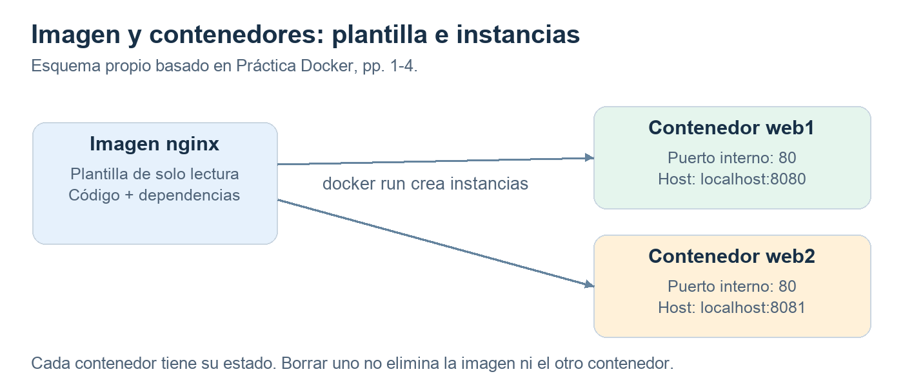

*Esquema propio basado en Práctica Docker, pp. 1-4 [D].*

**Cómo leerlo:** una misma plantilla origina dos instancias. Ambas escuchan en 80 dentro de su entorno, pero se accede desde el host por puertos diferentes: 8080 y 8081.

#### Verificación inicial y ciclo de vida

```bash
docker --version
docker info
docker run -d -p 8080:80 docker/welcome-to-docker
```

El PDF indica mantener Docker Desktop abierto en Mac/Windows [D, p. 1]. `--version` informa la versión del cliente; `info` permite comprobar la comunicación con el motor. En Linux, la práctica indica utilizar permisos adecuados, anteponiendo `sudo` si corresponde.

El ejemplo crea un contenedor y sirve una página en `http://localhost:8080`:

- `run`: crea e inicia un contenedor.
- `-d`: lo ejecuta en segundo plano.
- `-p 8080:80`: publica el puerto 80 del contenedor en el 8080 del host.
- Si la imagen no está disponible localmente, Docker intenta descargarla [D, pp. 1-2].

| Comando | Qué permite observar o hacer |
| --- | --- |
| `docker image ls` o `docker images` | Listar imágenes locales. |
| `docker ps` | Listar contenedores en ejecución. |
| `docker ps -a` | Listar también contenedores detenidos. |
| `docker logs nombre` | Consultar registros del contenedor. |
| `docker stop nombre` | Detenerlo, sin eliminarlo. |
| `docker rm nombre` | Eliminar un contenedor detenido. |
| `docker port nombre` | Consultar sus puertos publicados. |

Referencias: [D, pp. 2-5]. **Detener no es borrar:** un contenedor detenido continúa apareciendo con `ps -a`. Borrar el contenedor elimina su estado local, salvo datos conservados fuera de él.

#### Puertos, aislamiento y `localhost`

La práctica crea dos contenedores con Nginx [D, pp. 2-4]. Pueden escuchar internamente en el puerto 80 porque tienen entornos de red separados. No pueden publicar ambos el mismo puerto del host sobre la misma dirección.

```bash
docker run -d --name web1 -p 8080:80 nginx
docker run -d --name web2 -p 8081:80 nginx
```

| Acceso desde el host | Destino |
| --- | --- |
| `http://localhost:8080` | Puerto 80 de `web1`. |
| `http://localhost:8081` | Puerto 80 de `web2`. |

Estos comandos suponen puertos libres y nombres de contenedor disponibles. Si antes ejecutaste la bienvenida en 8080, detenela para liberar ese puerto.

**`localhost` depende de dónde se use:** en tu computadora se refiere al host; dentro de `web1`, al propio contenedor. No identifica automáticamente a otro servicio.

**Corrección del PDF, p. 4:** donde dice `rm -f web1 web2`, el comando para eliminar esos contenedores es:

```bash
docker rm -f web1 web2
```

`-f` fuerza la eliminación, incluso si están ejecutándose. `rm` sin `docker` es un comando de archivos del sistema y no realiza esa operación sobre contenedores.

<a id="c2-11"></a>
### 11. Construir una imagen: Dockerfile y caché

La práctica pide una carpeta `mi-docker-app`, un `requirements.txt` y un `Dockerfile` [D, p. 5]. El Dockerfile también copia `script.py`, **pero el PDF no define su contenido**. Para que el ejemplo quede completo, se propone este archivo propio:

```python
# script.py
print("Hola desde Docker")
```

`requirements.txt`, según la práctica:

```text
redis==5.0.3
```

La dependencia instala el cliente Python de Redis; no instala ni inicia por sí sola un servidor Redis. El script propuesto solo ilustra la ejecución.

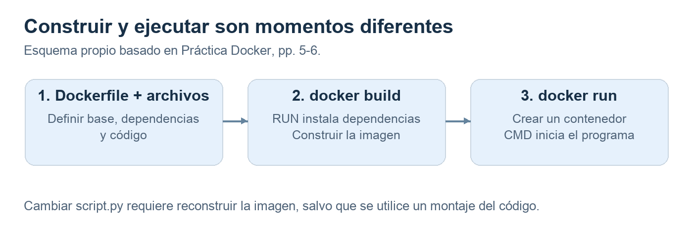

*Esquema propio basado en Práctica Docker, pp. 5-6 [D].*

**Cómo leerlo:** build prepara la imagen y ejecuta RUN. Más tarde, run crea el contenedor y su comando CMD inicia el programa. Construir y ejecutar son operaciones distintas.

Dockerfile del material:

```dockerfile
FROM python:3.13-slim
WORKDIR /app
COPY requirements.txt .
RUN pip install --no-cache-dir -r requirements.txt
COPY script.py .
CMD ["python", "script.py"]
```

| Instrucción | Efecto |
| --- | --- |
| `FROM` | Selecciona la imagen base. |
| `WORKDIR` | Establece el directorio de trabajo. |
| `COPY` | Copia archivos del contexto a la imagen. |
| `RUN` | Ejecuta un comando durante la construcción. |
| `CMD` | Define el comando predeterminado al iniciar un contenedor. |

**Diferencia clave:** `RUN` instala dependencias durante el build; `CMD` inicia el programa al ejecutar el contenedor.

Desde la carpeta del proyecto:

```bash
docker build -t mi-script:v1 .
docker run mi-script:v1
docker image ls
```

`-t` asigna nombre y tag; el punto final indica el directorio actual como contexto [D, p. 5]. Construir genera una imagen; `run` crea un contenedor de ella.

#### Por qué importa el orden del Dockerfile

La práctica instala dependencias antes de copiar el script. Si solo cambia `script.py`, Docker puede reutilizar los pasos anteriores y evitar reinstalar dependencias [D, p. 6]. Si cambia `requirements.txt`, ese paso y los posteriores deben reconstruirse.

**Aclaración:** `--no-cache-dir` corresponde a pip y su caché de descargas; no desactiva la caché de construcción de Docker.

La imagen construida es inmutable. Editar un archivo local no modifica la imagen anterior: hay que construir otra o proporcionar el archivo mediante un montaje, como veremos enseguida.

**Precisión sobre tags:** `latest` es la etiqueta predeterminada cuando se omite el tag, no una garantía universal de versión más reciente. Un tag puede reasignarse a otra imagen; es una etiqueta, no un identificador inmutable. Véase [documentación oficial de imágenes y tags](https://docs.docker.com/get-started/docker-concepts/building-images/build-tag-and-publish-an-image/).

<a id="c2-12"></a>
### 12. Persistencia: bind mounts y volúmenes

La capa de escritura de un contenedor conserva cambios mientras el contenedor exista; **detenerlo no los elimina**. Al borrar el contenedor, los archivos guardados solo en esa capa se pierden. Para conservar o compartir datos, la práctica introduce montajes [D, pp. 6-7].

| Mecanismo | Quién administra el almacenamiento | Uso ilustrado |
| --- | --- | --- |
| Bind mount | Se utiliza una ruta concreta del host. | Editar código local y verlo dentro del contenedor. |
| Volumen nombrado | Docker administra el almacenamiento. | Conservar datos entre contenedores. |

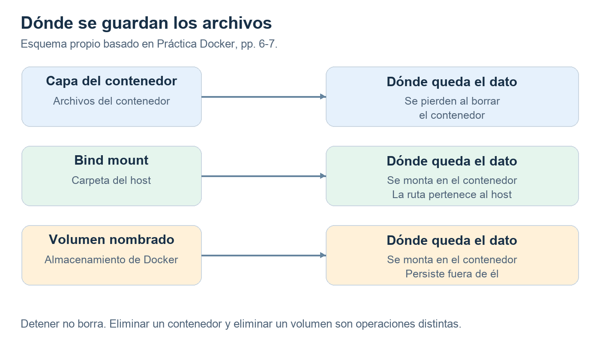

*Esquema propio basado en Práctica Docker, pp. 6-7 [D].*

**Cómo leerlo:** cada fila muestra una forma de guardar archivos. La capa del contenedor depende de que este exista; un bind mount utiliza una carpeta del host; un volumen conserva datos administrados por Docker.

#### Bind mount del código

Ejemplo para una terminal de macOS/Linux, ajustado con comillas para rutas con espacios:

```bash
docker run --rm -v "$(pwd):/app" mi-script:v1
```

Monta el directorio actual sobre `/app`. Al modificar `script.py` en esa carpeta y repetir el comando, se ejecuta el archivo actualizado sin reconstruir la imagen [D, p. 6].

**Aclaración:** el montaje oculta el contenido previo de la imagen en `/app` mientras está montado. Tampoco reinstala dependencias si cambian los requisitos; para eso hay que actualizar el entorno. La sintaxis de rutas cambia según la terminal; el ejemplo de Windows del PDF debe interpretarse según el shell utilizado.

#### Volumen nombrado

La práctica demuestra persistencia con dos contenedores temporales:

```bash
docker volume create mis_datos
docker volume ls

docker run --rm -v mis_datos:/datos alpine sh -c "echo 'Guardado en el volumen' > /datos/mensaje.txt"
docker run --rm -v mis_datos:/datos alpine cat /datos/mensaje.txt
```

El primero escribe y se elimina al terminar. El segundo monta el mismo volumen y puede leer el archivo [D, pp. 6-7]. **El volumen permanece aunque esos contenedores se eliminen.**

`--rm` elimina automáticamente el contenedor al finalizar; no elimina ese volumen nombrado. Para borrar el volumen, cuando ya no se necesiten sus datos y no esté referenciado por contenedores:

```bash
docker volume rm mis_datos
```

La práctica propone montar datos pesados, como pesos de modelos, en tiempo de ejecución [D, p. 7]. Esto separa el entorno de la aplicación de los datos utilizados, conectando con la distinción entre pipelines de código, modelos y datos de la Clase 1.

<a id="c2-13"></a>
### 13. Docker Compose: servicios, configuración y disponibilidad

Si el sistema necesita varios servicios, ejecutar manualmente muchos `docker run` dificulta coordinar configuración, redes y almacenamiento. Compose permite definirlos en un archivo YAML versionable [D, pp. 7-8].

**Diferencia fundamental:** el Dockerfile describe cómo construir una imagen; Compose describe cómo ejecutar y conectar servicios. La práctica propone separar responsabilidades en contenedores diferentes, por ejemplo aplicación y base de datos.

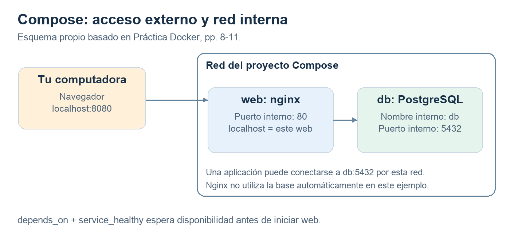

*Esquema propio basado en Práctica Docker, pp. 8-11 [D].*

**Cómo leerlo:** desde el navegador se entra por localhost:8080. En la red interna se identifica la base como db:5432. La flecha web → db muestra una conexión posible; Nginx no la establece automáticamente.

#### Ejemplo del material, organizado y con comillas corregidas

El siguiente `compose.yaml` combina los servicios de la práctica, su healthcheck y la configuración por `.env` [D, pp. 8-11]:

```yaml
services:
  web:
    image: nginx:latest
    ports:
      - "8080:80"
    depends_on:
      db:
        condition: service_healthy

  db:
    image: postgres:18
    environment:
      POSTGRES_PASSWORD: "${DB_PASSWORD}"
      POSTGRES_USER: example
      POSTGRES_DB: exampledb
    healthcheck:
      test: ["CMD-SHELL", "pg_isready -U example -d exampledb"]
      interval: 10s
      timeout: 5s
      retries: 5
      start_period: 10s
```

En `.env`, para este ejemplo didáctico:

```dotenv
DB_PASSWORD=clave_de_practica
```

Compose sustituye `${DB_PASSWORD}` por su valor. El archivo `.env` debe mantenerse fuera del versionado si contiene secretos, mediante `.gitignore`; no deja de ser texto plano por utilizarlo. Se conecta con la [aclaración de `.gitignore` de la Clase 1](#c1-10).

| Campo | Qué define |
| --- | --- |
| `services` | Servicios de la aplicación. |
| `web` y `db` | Nombres de servicios, utilizados también para identificarlos en la red interna. |
| `image` | Imagen de cada servicio. |
| `ports` | Publicación de puertos hacia el host. |
| `environment` | Variables dentro del contenedor. |
| `depends_on` | Dependencia de inicio entre servicios. |
| `healthcheck` | Comprobación periódica del estado del servicio. |

**Corrección sobre PostgreSQL:** `POSTGRES_USER: example` define el superusuario inicial; `POSTGRES_PASSWORD` configura su contraseña y `POSTGRES_DB` la base inicial. No debe interpretarse como crear siempre un usuario adicional al superusuario `postgres`. Estas variables de inicialización se aplican sobre un directorio de datos vacío. Véase [documentación de la imagen oficial de PostgreSQL](https://hub.docker.com/_/postgres).

#### Iniciado no significa disponible

`depends_on` en su forma simple organiza el inicio, pero que el contenedor esté ejecutándose no garantiza que la base ya pueda aceptar conexiones [D, p. 10]. En el ejemplo, `condition: service_healthy` espera a que el healthcheck de `db` informe estado saludable.

- `test`: comando de comprobación; `pg_isready` consulta si PostgreSQL acepta conexiones.
- `interval: 10s`: intervalo entre comprobaciones.
- `timeout: 5s`: tiempo máximo de una comprobación.
- `retries: 5`: fallos consecutivos antes de marcar el estado como no saludable.
- `start_period: 10s`: período inicial de gracia para los fallos.

**Límite del chequeo:** disponibilidad para aceptar conexiones no verifica toda la lógica de la aplicación. Este healthcheck tampoco implica que Docker reinicie automáticamente un servicio si pasa a estado no saludable.

#### Comunicación entre servicios

Compose crea por defecto una red para el proyecto. Los servicios pueden comunicarse usando su nombre: una aplicación que necesite PostgreSQL usaría **`db` y el puerto interno 5432**, no `localhost` [D, p. 11].

No hace falta publicar el puerto de la base al host para que otro servicio de esa red pueda conectarse. Desde el host, en cambio, el acceso requiere un puerto publicado.

**Aclaración del ejemplo:** Nginx no consulta PostgreSQL automáticamente. Los dos servicios ilustran red, configuración y orden de inicio; el YAML no implementa una aplicación que utilice la base de datos.

#### Comandos del ciclo de vida

Ejecutar desde la carpeta que contiene `compose.yaml`, con el puerto 8080 libre:

| Comando | Efecto |
| --- | --- |
| `docker compose up` | Crea o actualiza e inicia los servicios; muestra sus logs en la terminal. |
| `docker compose up -d` | Los inicia en segundo plano. |
| `docker compose ps` | Muestra el estado de los contenedores del proyecto. |
| `docker compose stop` | Detiene los contenedores sin eliminarlos. |
| `docker compose start` | Inicia contenedores existentes detenidos. |
| `docker compose rm` | Elimina contenedores detenidos del proyecto. |
| `docker compose down` | Detiene y elimina los contenedores y las redes del proyecto; no borra los volúmenes por defecto. |

Referencia: [D, p. 9]. **Corrección:** el PDF dice que `down` elimina “volúmenes temporales”, pero los volúmenes anónimos tampoco se eliminan por defecto. Además, al no tener nombre estable, un `up` posterior no los recupera automáticamente. Para eliminar volúmenes declarados y anónimos asociados existe `down -v`, que elimina datos; no equivale a detener servicios. Véase [referencia oficial de `docker compose down`](https://docs.docker.com/reference/cli/docker/compose/down/).

El YAML anterior no declara un volumen nombrado para la base. Para diseñar persistencia de datos de negocio, debe definirse un montaje explícito adecuado; este ejemplo se limita al alcance didáctico del PDF.

<a id="c2-14"></a>
### 14. Integración de los temas y repaso

**Ejemplo propio que conecta toda la clase:**

1. Se acuerda que la calculadora necesita una salida a archivo y se prioriza esa necesidad.
2. Se describe en un issue y se selecciona para una entrega pequeña.
3. Una persona implementa en una rama y registra cambios con commits.
4. La otra revisa el PR y comprueba que las operaciones anteriores siguen funcionando.
5. Se resuelven incompatibilidades y se integra el cambio.
6. El equipo describe el entorno con un Dockerfile; si necesita servicios adicionales, utiliza Compose.
7. La entrega recibe feedback y el equipo acuerda mejoras en una retrospectiva.

El vínculo con la Clase 1 es directo: estas prácticas ayudan a gestionar complejidad, trazabilidad, pruebas y mantenimiento. Git y Docker facilitan el trabajo, pero la calidad también requiere requisitos claros, decisiones de diseño y validación.

#### Preguntas para estudiar

1. ¿Qué organiza un proceso de desarrollo y cómo se diferencia del ciclo de vida?
2. ¿Qué distingue desarrollo iterativo de incremental?
3. ¿Por qué los valores de Agile no significan abandonar documentación o planificación?
4. ¿Qué responsabilidades tienen Product Owner, Scrum Master y Dev Team?
5. ¿En qué se diferencian Product Backlog, Sprint Backlog e incremento?
6. ¿Qué se revisa en una Sprint Review y qué en una retrospectiva?
7. ¿Qué aporta un WIP limit y cómo se utiliza un post mortem sin buscar culpables?
8. ¿Qué distingue issue, rama, commit, push, PR, review y merge?
9. ¿Cómo se resuelve un conflicto y por qué hay que probar aunque el merge sea automático?
10. ¿Para qué existen `develop`, `release` y `hotfix` en Gitflow?
11. ¿Cuál es la diferencia entre imagen, contenedor, Dockerfile y Compose?
12. ¿Qué significa `8080:80` y a qué se refiere `localhost` dentro de un contenedor?
13. ¿Por qué el orden del Dockerfile permite reutilizar la caché?
14. ¿Cuándo reconstruir una imagen y cuándo usar un bind mount?
15. ¿Qué persiste al detener o borrar un contenedor? ¿Qué diferencia hay entre bind mount y volumen?
16. ¿Por qué `depends_on` simple no alcanza para esperar disponibilidad y qué comprueba un healthcheck?

<a id="c2-15"></a>
### 15. Claridad del material y precisiones

Se revisaron el texto y las páginas renderizadas de los cuatro PDF. Los contenidos principales son legibles.

| Material | Observación y tratamiento en el resumen |
| --- | --- |
| [M, p. 22] | “Internal syncs con” está incompleto; no se inventaron los participantes. “Bi-weeklies” tiene una frecuencia ambigua; no se fijó una periodicidad. |
| [M, p. 19] | El burndown se explica conceptualmente; sus valores pequeños no se utilizan para inferir resultados de un proyecto real. |
| [PR, pp. 7-8 y 11] | Las capturas ilustran creación y revisión de PRs. Algunos textos pequeños tienen baja definición y la interfaz corresponde a un workshop de 2022; se incorporó un esquema del flujo sin depender de la ubicación exacta de botones. |
| [PR, p. 10] | Se muestra `git push` sin detallar el seguimiento remoto; la guía usa `git push -u origin rama` para la primera publicación. |
| [D, p. 4] | Se corrigió `rm -f web1 web2` a `docker rm -f web1 web2`. |
| [D, p. 5] | Falta el contenido de `script.py`; se agregó un ejemplo propio identificado como tal. |
| [D, pp. 8-9] | Se reemplazaron comillas tipográficas del YAML y se precisó el rol de las variables de PostgreSQL. |
| [D, p. 9] | Se corrigió el alcance de `docker compose down` sobre volúmenes. |
| [G, p. 1] | No se especifica el nombre de la opción para guardar el archivo; se indicó que el equipo debe acordarlo. |

Las correcciones sobre PostgreSQL, tags y `compose down` se apoyan en documentación oficial enlazada junto a cada explicación. Los ejemplos son guías de estudio; **no se ejecutaron los ejercicios ni se crearon repositorios, PRs o contenedores**.

[Volver al índice](#indice)

---

<a id="clase-3"></a>
## Clase 3: Desarrollo moderno, asistencia de IA y pipelines CI/CD

**Qué vas a entender:** cómo coordinar desarrollo y operación, comprobar cambios automáticamente y entregar versiones con menor riesgo. También cómo incorporar IA al desarrollo conservando especificación, revisión y evidencia de funcionamiento.

**Conexión con las clases anteriores:** el PR de la Clase 2 incorpora ahora controles automáticos; el entorno Docker puede convertirse en un artefacto construido por el pipeline. Las pruebas y la mantenibilidad de la Clase 1 pasan a formar parte del trabajo cotidiano.

<details>
<summary>Fuentes y referencias [DM], [IA] y [P3]</summary>

- **[DM]** [Desarrollo moderno de software](<Clases/Clase 3 Desarrollo Moderno de Software MIA203.pdf>) (44 páginas).
- **[IA]** [Desarrollo asistido por IA](<Clases/Clase 3 Desarrollo Asistido por IA.pdf>) (11 páginas).
- **[P3]** [Práctica 3: Pipelines CI/CD](<Practicas/3. Pipelines CI CD MIA203.pdf>) (7 páginas).

Las páginas se cuentan desde el comienzo de cada PDF. Las explicaciones de términos y los ejemplos propios complementan el material. Las correcciones de GitHub Actions se identifican y enlazan a documentación oficial.

</details>

<a id="c3-01"></a>
### 1. De integrar código a operar un sistema

En la Clase 2, el equipo implementaba una tarea, revisaba el PR y hacía merge. Eso todavía deja preguntas: **¿el cambio pasó las pruebas?, ¿qué versión ejecutamos?, ¿cómo llega al usuario?, ¿cómo detectamos una falla?**

El desarrollo moderno conecta todo el recorrido: código versionado, comprobaciones automáticas, preparación de versiones, despliegue y monitoreo. Automatizar las tareas repetitivas deja a las personas más tiempo para diseñar, investigar y decidir [DM, pp. 6-9].

#### Los entornos de trabajo

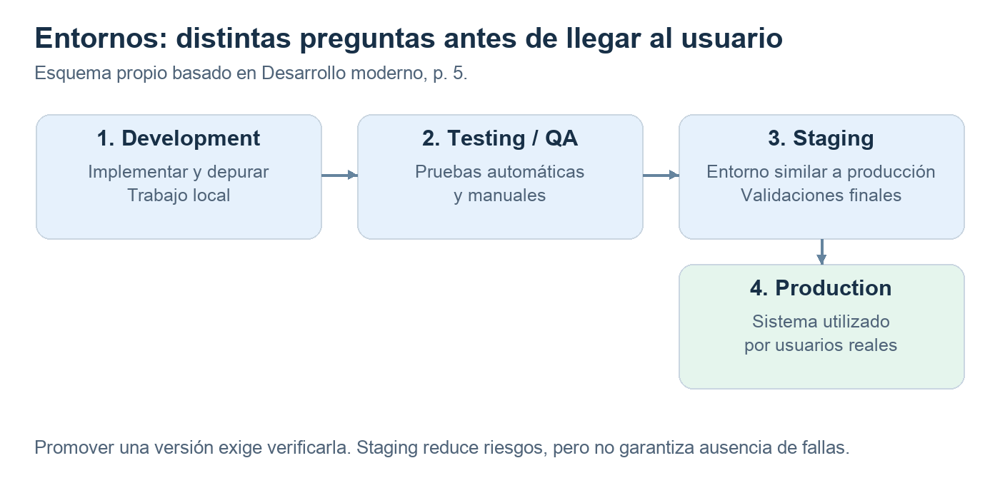

*Esquema propio basado en Desarrollo moderno, p. 5 [DM].*

**Cómo leerlo:** seguí los números. Cada entorno permite responder preguntas distintas antes de exponer una versión al usuario.

| Entorno | Para qué se usa | Ejemplo propio |
| --- | --- | --- |
| Development | Programar y depurar; los cambios pueden estar incompletos. | Ejecutar la calculadora localmente mientras se agrega una operación. |
| Testing / QA | Ejecutar pruebas automáticas y manuales. | Verificar resultados y errores de entrada. QA significa aseguramiento de calidad. |
| Staging | Validación final en condiciones similares a producción. Puede incluir pruebas de carga o de seguridad. | Probar una API con la configuración prevista antes de habilitarla. |
| Production | Sistema que utilizan los usuarios reales. | API disponible para clientes. |

**Aclaración de la diapositiva:** las frases “debe funcionar siempre” expresan la exigencia de confiabilidad, no una garantía de cero fallas. Staging reduce riesgos, pero no reproduce perfectamente toda situación de producción.

El ambiente local también puede diferir del runner de CI. Por eso conviene hacer explícitas versiones, dependencias y configuración, como vimos con [Docker](#c2-10).

<a id="c3-02"></a>
### 2. DevOps: responsabilidad compartida y feedback rápido

**DevOps es una cultura de colaboración entre desarrollo (Dev) y operación (Ops)**. Busca superar los silos: equipos que trabajan aislados y se transfieren problemas sin compartir objetivos [DM, pp. 6-8].

La clase señala que los procesos manuales, la comunicación deficiente y los ajustes particulares de cada entorno retrasan entregas y generan inestabilidad. DevOps busca mejorar tiempo de entrega, calidad, confiabilidad, alineación con el negocio y riesgo operativo.

| Principio | Qué implica en el trabajo |
| --- | --- |
| Responsabilidad compartida | Desarrollo y operación participan en la calidad del producto desde su construcción hasta su funcionamiento. |
| Feedback rápido | Detectar problemas pronto y usar lo observado para mejorar. |
| Automatización | Automatizar build, pruebas, entrega y configuración de infraestructura cuando corresponda. |
| Cambios pequeños y frecuentes | Integrar y entregar lotes reducidos, más fáciles de revisar y corregir. |
| Cultura y confianza | Comunicar problemas, aprender de fallas y mejorar continuamente. |

Referencias: [DM, pp. 8-9]. **Build** es la preparación de un resultado ejecutable o distribuible; puede incluir compilación, empaquetado y construcción de una imagen. No todos los proyectos necesitan compilar.

**Ejemplo propio:** si una versión falla por una dependencia que solo estaba instalada en la computadora del desarrollador, la solución compartida es declarar esa dependencia y verificarla automáticamente. Esto conecta con la [complejidad accidental](#c1-05) y los [post mortems sin búsqueda de culpables](#c2-05).

#### Patrones de organización

Las páginas 10 y 44 muestran tres enfoques con ventajas y costos:

| Patrón del material | Idea | Dificultad señalada |
| --- | --- | --- |
| Dev & Ops Collaboration | Desarrollo y operación colaboran directamente y comparten objetivos. | Requiere coordinación intensa y competencias compartidas; puede ser difícil de escalar y estandarizar. |
| Embedded Infra DevOps | Un equipo de plataforma ofrece infraestructura; el producto incorpora capacidades para gestionar operación, configuración y monitoreo. | Necesita una plataforma madura y límites de responsabilidad claros. |
| DevOps as Shared Service | Un servicio compartido impulsa prácticas, automatización y herramientas para varios equipos. | Facilita estandarización, pero el producto puede conservar dependencias y menor autonomía. |

Esta tabla sintetiza el texto de las imágenes. No propone una estructura universal: el contexto y el flujo de trabajo importan.

#### Antipatrones: cambiar el nombre no cambia la colaboración

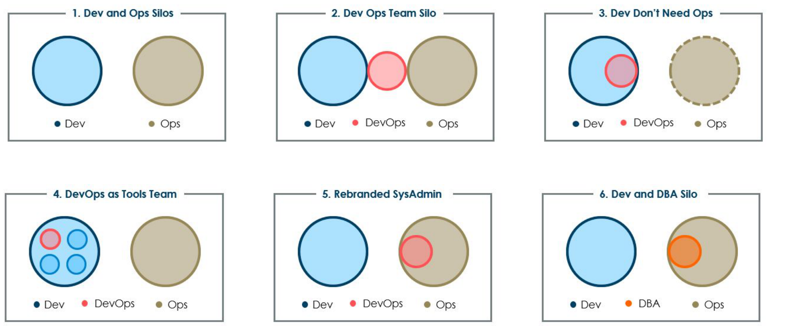

*Imagen original: Desarrollo moderno, p. 43 [DM].*

**Cómo leerlo:** los círculos representan equipos; su separación muestra silos. La imagen permite comparar estructuras que conservan barreras pese a utilizar el nombre DevOps.

Las siguientes explicaciones interpretan los rótulos del gráfico:

1. **Dev and Ops Silos:** desarrollo y operación siguen separados.
2. **DevOps Team Silo:** se agrega un tercer equipo aislado, en lugar de mejorar el trabajo compartido.
3. **Dev Don't Need Ops:** desarrollo desestima las necesidades de operación.
4. **DevOps as Tools Team:** se reduce DevOps a administrar herramientas.
5. **Rebranded SysAdmin:** se cambia el nombre del administrador de sistemas sin transformar responsabilidades o colaboración.
6. **Dev and DBA Silo:** se mantiene una barrera con la administración de bases de datos; DBA significa Database Administrator.

> **Idea clave:** instalar herramientas o crear un equipo llamado DevOps no garantiza responsabilidad compartida.

<a id="c3-03"></a>
### 3. Team Topologies: equipos e interacciones

Team Topologies es un marco para organizar equipos y sus relaciones de modo que el trabajo fluya con mayor autonomía y menos bloqueos [DM, pp. 40-42]. Se ubica aquí, junto a DevOps, aunque en el PDF aparece como una sección complementaria al final.

#### Cuatro tipos de equipos

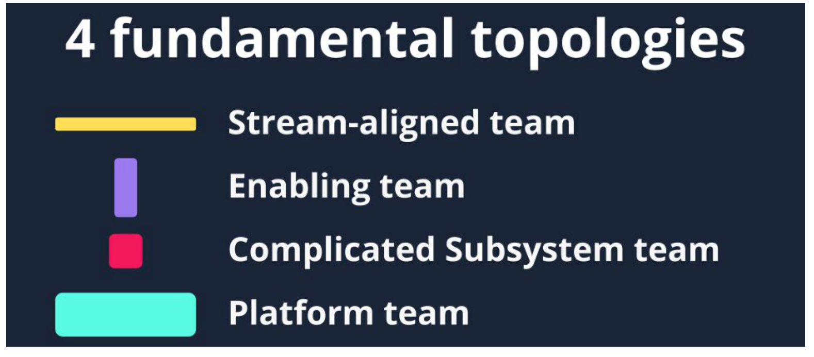

*Imagen original: Desarrollo moderno, p. 41 [DM].*

**Cómo leerlo:** cada forma representa un tipo de equipo; no son cuatro etapas que deba recorrer un proyecto.

| Tipo | Explicación complementaria | Ejemplo propio |
| --- | --- | --- |
| Stream-aligned | Se orienta a un flujo de valor del negocio y entrega su resultado. | Equipo responsable de un servicio de recomendaciones. |
| Enabling | Ayuda a otros equipos a superar obstáculos y adquirir capacidades. | Acompañar la adopción de pruebas o CI. |
| Complicated Subsystem | Se ocupa de un subsistema que requiere especialización profunda. | Un motor de optimización complejo. |
| Platform | Proporciona un producto interno que facilita la entrega de otros equipos. | Entornos y herramientas de despliegue disponibles para los equipos de producto. |

La diapositiva enumera los tipos; estas definiciones se complementan con los [conceptos oficiales de Team Topologies](https://teamtopologies.com/key-concepts).

#### Tres modos de interacción

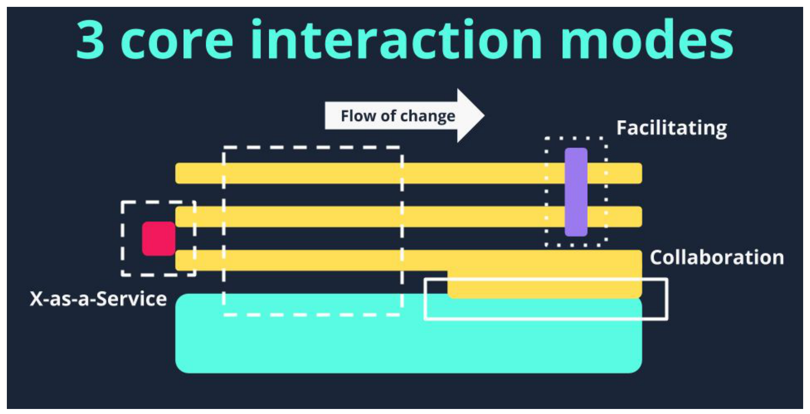

*Imagen original: Desarrollo moderno, p. 42 [DM].*

**Cómo leerlo:** las bandas representan equipos y la flecha superior el flujo de cambio. Las zonas marcadas muestran formas de relacionarse.

- **Collaboration:** equipos trabajan juntos para descubrir o resolver un problema.
- **X-as-a-Service:** un equipo consume una capacidad ofrecida como servicio por otro, con una interfaz clara.
- **Facilitating:** un equipo ayuda a otro a aprender o resolver obstáculos.

Referencia: [DM, pp. 40-42], con definiciones complementadas por los conceptos oficiales enlazados arriba. **La distinción importante es entre qué responsabilidad tiene un equipo y cómo interactúa con los demás.**

<a id="c3-04"></a>
### 4. CI: integrar y comprobar cambios continuamente

La **integración continua (Continuous Integration, CI)** consiste en integrar cambios con frecuencia y ejecutar automáticamente su construcción y pruebas [DM, pp. 16-18]. Busca evitar una integración grande y tardía, difícil de diagnosticar.

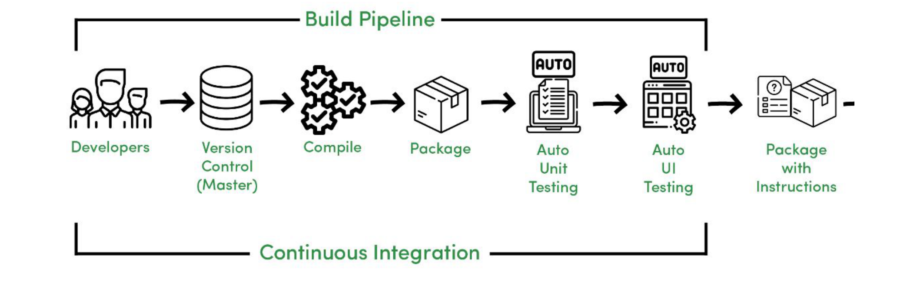

*Imagen original: Desarrollo moderno, p. 16 [DM].*

**Cómo leerlo:** el código llega al control de versiones; se prepara y empaqueta; las pruebas automáticas verifican el resultado. “Compile” aplica cuando el lenguaje o proyecto requiere compilación. El pipeline concreto de Python de la práctica será más pequeño.

La clase propone:

- Construir y probar cada cambio relevante.
- Obtener un resultado visible para cada cambio.
- Corregir rápidamente los tests fallidos.
- Mantener un conjunto equilibrado de pruebas.

**Beneficios:** menos tiempo perdido integrando, detección temprana de defectos, menor riesgo de retrasos y más confianza para refactorizar [DM, pp. 17-18]. Se relaciona con la [refactorización de la Clase 1](#c1-08): conservar comportamiento resulta más fácil de comprobar si existen pruebas.

**CI no significa desplegar:** un cambio puede pasar sus tests y todavía esperar una decisión de entrega. Tener un servidor que corre tests tampoco reemplaza la práctica de integrar cambios pequeños y frecuentes.

**Ejemplo propio:** cada PR de la calculadora ejecuta sus pruebas. Si una modificación hace que la resta sume, CI lo muestra antes de integrar ese código en `main`.

<a id="c3-05"></a>
### 5. Pirámide de pruebas: qué comprobar y a qué nivel

La pirámide ayuda a diseñar un conjunto equilibrado de tests, con muchas comprobaciones pequeñas y otras que verifican la integración del sistema [DM, p. 19].

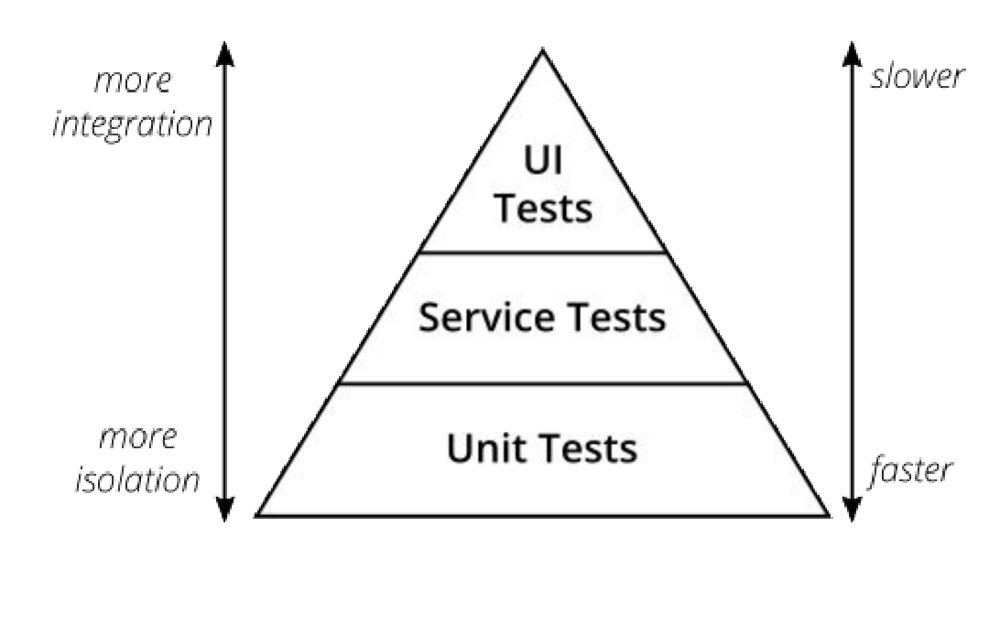

*Imagen original: Desarrollo moderno, p. 19 [DM].*

**Cómo leerlo:** la base representa pruebas más aisladas y generalmente rápidas; hacia arriba aumenta la integración y suele disminuir la velocidad. La anchura sugiere una mayor cantidad de pruebas en la base, sin fijar porcentajes obligatorios.

| Nivel del gráfico | Qué comprueba | Ejemplo propio |
| --- | --- | --- |
| Unit tests | Unidades pequeñas de comportamiento. | `subtract(5, 3)` devuelve `2`. |
| Service tests | Comportamiento de servicios y sus conexiones, según el alcance del test. | Una API valida la entrada y llama al componente de cálculo. |
| UI tests | Comportamiento a través de la interfaz de usuario. | Ingresar números, elegir operación y ver el resultado. |

Un test aislado facilita identificar qué falló. Una prueba con más componentes permite detectar errores de interacción, pero suele requerir más preparación. **No alcanza con un solo nivel:** una función correcta puede estar mal conectada a una API o a una interfaz.

La pirámide es una guía de equilibrio, no una prohibición de pruebas de sistema. La práctica utiliza tests unitarios y no implementa una aplicación con UI.

<a id="c3-06"></a>
### 6. Linters, formato, seguridad y hooks locales

Además de comprobar resultados, conviene detectar problemas de código antes de integrar [DM, pp. 20-21].

| Herramienta mencionada | Propósito |
| --- | --- |
| `pylint` | Analizar código y detectar problemas y desvíos de convenciones. |
| `black` | Dar formato consistente al código. |
| `bandit` | Buscar patrones potencialmente inseguros en código Python. |
| `isort` | Organizar imports según reglas. |

**Distinción:** un formatter cambia la presentación; un test comprueba comportamiento; un linter analiza problemas del código. Una revisión de seguridad automatizada aporta señales, pero no demuestra por sí sola que el sistema sea seguro.

#### Pre-commit hooks

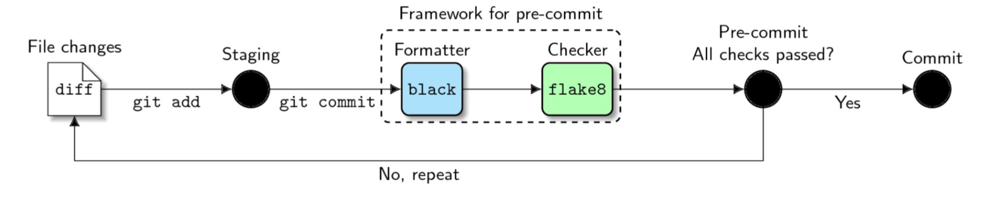

*Imagen original: Desarrollo moderno, p. 21 [DM].*

**Cómo leerlo:** después de preparar los archivos, el intento de commit activa chequeos locales. Si no pasan, se corrige y se repite; si pasan, se registra el commit. El gráfico usa `black` y `flake8` como ejemplos.

Un hook de pre-commit es una acción configurada para ejecutarse antes de completar el commit. **No se activa simplemente por usar Git:** hay que instalar o configurar los hooks. El framework denominado `pre-commit` puede ayudar a gestionarlos; el PDF no desarrolla esa configuración.

El chequeo local da feedback temprano, pero **no sustituye al CI compartido**. Las comprobaciones importantes también deben ejecutarse en el pipeline para verificar el cambio publicado.

<a id="c3-07"></a>
### 7. CI, Continuous Delivery y Continuous Deployment

Las siglas CD se usan para dos conceptos relacionados. Conviene distinguirlos para interpretar la clase y la práctica:

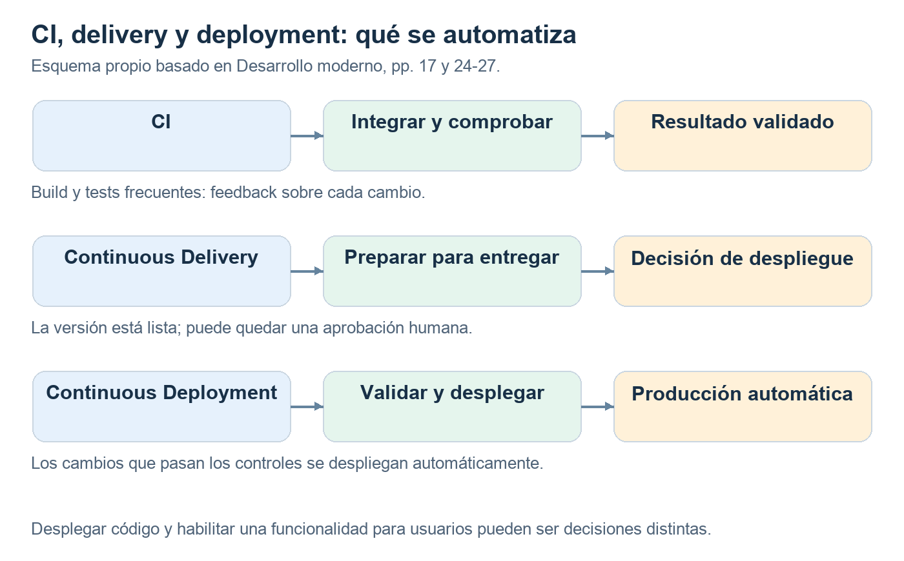

*Esquema propio basado en Desarrollo moderno, pp. 17 y 24-27 [DM]. La distinción de deployment complementa las menciones del material.*

**Cómo leerlo:** cada fila responde una pregunta diferente: ¿el cambio se integra correctamente?, ¿la versión está lista para entregar?, ¿se despliega automáticamente?

| Concepto | Resultado esperado |
| --- | --- |
| Continuous Integration | Cambios integrados y comprobados frecuentemente. |
| Continuous Delivery | Software siempre preparado para una entrega a producción cuando se decida realizarla. Puede conservar una aprobación humana. |
| Continuous Deployment | Los cambios que superan los controles se despliegan automáticamente a producción. |

La clase define **delivery** como estar listo para desplegar a demanda: cambios pequeños y seguros, validación rápida con usuarios y menor dependencia de grandes lanzamientos [DM, pp. 24-25]. La decisión de publicar puede responder a razones de negocio.

**Nota sobre las imágenes:** algunos diagramas rotulan “Continuous Deployment” aunque el bloque se titula “Continuous Delivery” [DM, pp. 11 y 23]. El resumen distingue ambos términos en lugar de tratarlos como sinónimos.

#### Deployment y release

- **Deployment:** instalar o ejecutar una versión en un entorno.
- **Release:** poner un cambio o funcionalidad a disposición de sus usuarios.

La clase subraya que pueden separarse [DM, p. 27]. **Ejemplo propio:** se despliega código con una funcionalidad apagada por una flag; se habilita para los usuarios después. Así, desplegar no obliga a exponer inmediatamente el cambio.

En la práctica aparece otra acepción concreta: **GitHub Release**, una publicación asociada a un tag con notas y posibles archivos adjuntos. Crear esa publicación no equivale a ejecutar la aplicación en producción.

<a id="c3-08"></a>
### 8. GitOps y mapa completo del pipeline

El gráfico de GitOps conecta infraestructura declarada como código, revisión en Git, CI, aprobación, CD y despliegue [DM, p. 26]. **IaC (Infrastructure as Code)** significa describir infraestructura mediante archivos versionables, en lugar de depender solo de cambios manuales.

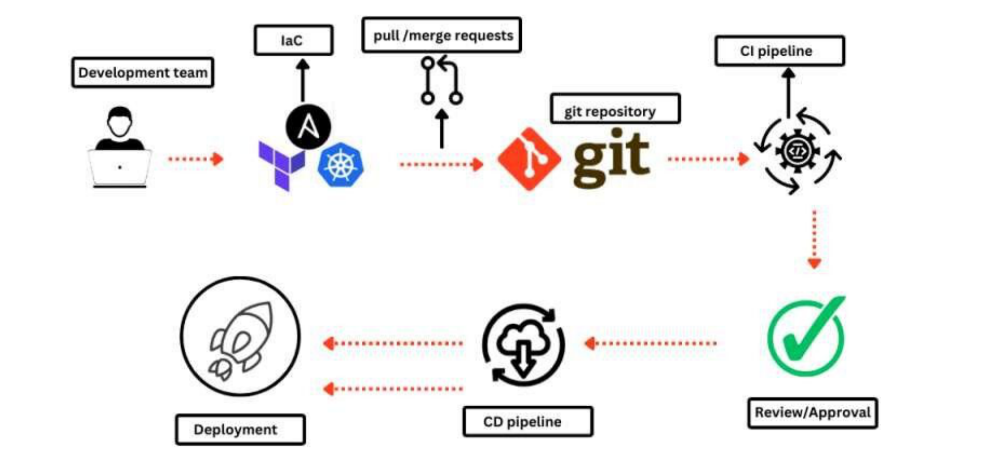

*Imagen original: Desarrollo moderno, p. 26 [DM].*

**Cómo leerlo:** seguí las flechas: el equipo modifica definiciones, propone cambios mediante PR, los guarda en Git, ejecuta comprobaciones y luego entrega. El esquema tiene una instancia de revisión/aprobación antes del pipeline de CD.

El concepto central que aporta la figura es **hacer trazables y revisables los cambios de configuración e infraestructura**. El PDF muestra un workflow general, pero no explica un controlador de reconciliación ni enseña a implementar un sistema completo de GitOps. No conviene reducir todos los enfoques GitOps a este dibujo.

#### Leer los diagramas grandes por bloques

<details>
<summary>Ver los dos mapas originales de desarrollo, seguridad, infraestructura y monitoreo</summary>

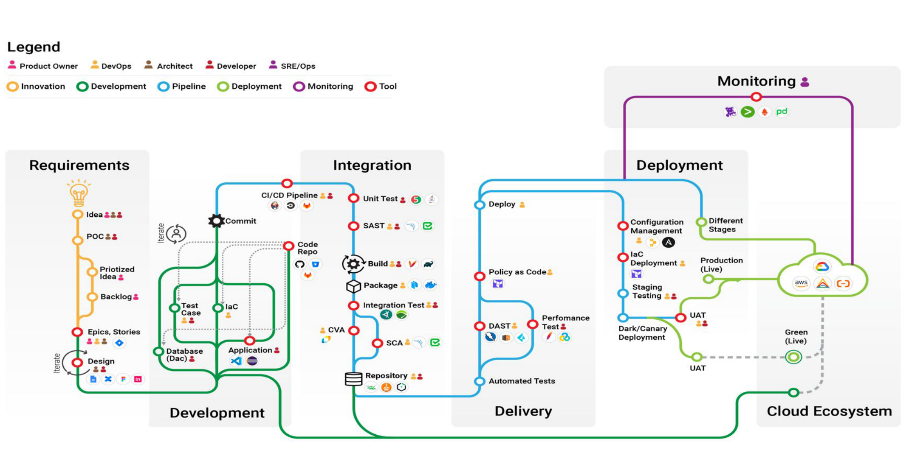

*Imagen original: Desarrollo moderno, p. 13 [DM].*

**Cómo leerlo:** primero identificá los bloques grandes: requisitos → desarrollo → integración → entrega → despliegue → monitoreo. Después observá las conexiones de regreso. Los colores agrupan recorridos; los íconos son ejemplos de herramientas, no una lista obligatoria para todos los proyectos.

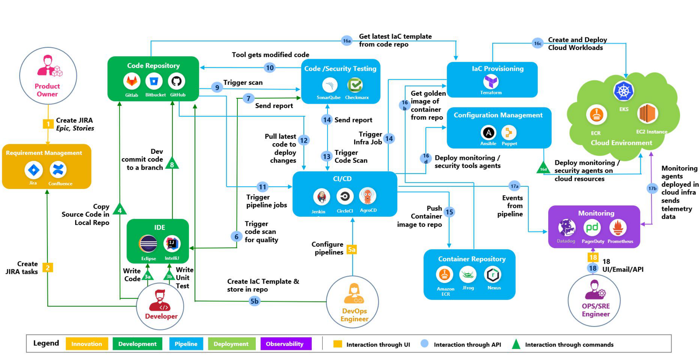

*Imagen original: Desarrollo moderno, p. 14 [DM].*

**Cómo leerlo:** el Product Owner aporta necesidades; el desarrollador modifica código y tests; el repositorio dispara comprobaciones; los pipelines preparan imágenes e infraestructura; operación recibe información de monitoreo. Las líneas describen interacciones, no una secuencia única que deba seguirse completa.

Algunos logos y rótulos son pequeños. Se conserva la imagen ampliable y se explica su arquitectura general; no se reconstruyen detalles dudosos.

</details>

| Bloque | Qué sucede |
| --- | --- |
| Requisitos | Idea, prueba de concepto (POC), prioridades, backlog e historias. |
| Desarrollo | Código de aplicación, casos de prueba y definiciones de infraestructura. |
| Integración | Build, empaquetado, pruebas y análisis automatizado. |
| Entrega | Verificaciones de aceptación, rendimiento y configuración de despliegue. |
| Despliegue | Promoción de versiones en entornos y asignación de tráfico. |
| Monitoreo | Métricas y señales de ejecución que permiten responder y mejorar. |

Referencias: [DM, pp. 13-14]. Los términos visibles incluyen **SAST** (análisis estático de seguridad), **DAST** (pruebas de seguridad sobre una aplicación en ejecución), **SCA** (análisis de componentes y dependencias) y **UAT** (pruebas de aceptación de usuarios). Estas definiciones aclaran rótulos; el PDF no desarrolla cada técnica. “CVA” no se expande inequívocamente en el material y no se interpreta aquí.

Los ejemplos de herramientas aparecen por función: repositorios, IDEs, CI/CD, registro de contenedores, aprovisionamiento, configuración y monitoreo. **Lo que se debe comprender es el propósito y la conexión de los bloques**, no memorizar todos los logos.

<a id="c3-09"></a>
### 9. Estrategias para desplegar y habilitar cambios

La elección depende del riesgo tolerable, los usuarios y la arquitectura. Se pueden combinar estrategias [DM, pp. 27-37]. **Rollback** significa volver a una versión o comportamiento anterior; su posibilidad depende también de la compatibilidad de datos y configuración.

#### Big bang, canary, blue-green y rolling

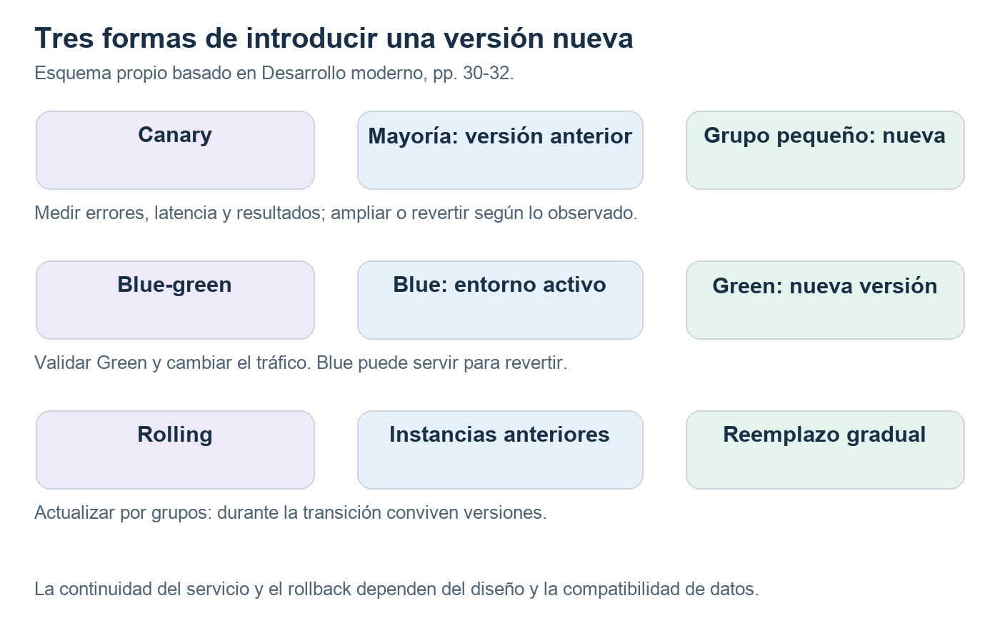

*Esquema propio basado en Desarrollo moderno, pp. 30-32 [DM].*

**Cómo leerlo:** cada fila representa una estrategia diferente. Canary divide exposición a usuarios; blue-green mantiene dos entornos; rolling reemplaza instancias gradualmente.

| Estrategia | Cómo funciona | Qué observar |
| --- | --- | --- |
| Big bang | Todos los usuarios reciben el cambio al mismo tiempo. | Es simple, pero una falla puede afectar a todos. |
| Canary | Se expone primero a un grupo pequeño y se amplía según resultados. | Errores, latencia y KPIs de negocio; limitar el alcance de una falla. |
| Blue-green | Se prepara el entorno nuevo, se valida y se cambia el tráfico desde el activo. | Capacidad para mantener dos entornos y posibilidad real de regresar al anterior. |
| Rolling updates | Se actualizan servidores o pods por grupos. | Compatibilidad durante la convivencia de versiones y cuidado al revertir. |

Referencias: [DM, pp. 29-32]. Las diapositivas presentan blue-green y rolling como despliegues sin downtime. **Precisión:** son formas de buscar continuidad; conseguirla exige capacidad, comprobaciones de disponibilidad y compatibilidad. No es una garantía automática.

**Ejemplo propio de canary:** habilitar una nueva API al 5 % de los usuarios, observar si empeoran errores o latencia y decidir si ampliar o revertir. El porcentaje es ilustrativo.

#### Feature toggles o flags

Permiten desplegar código y mantener una capacidad apagada hasta activarla [DM, p. 33]. Facilitan trabajar con una línea principal e incorporar capacidades incompletas sin exponerlas; esto se relaciona con **trunk-based development**, integración frecuente a una rama principal.

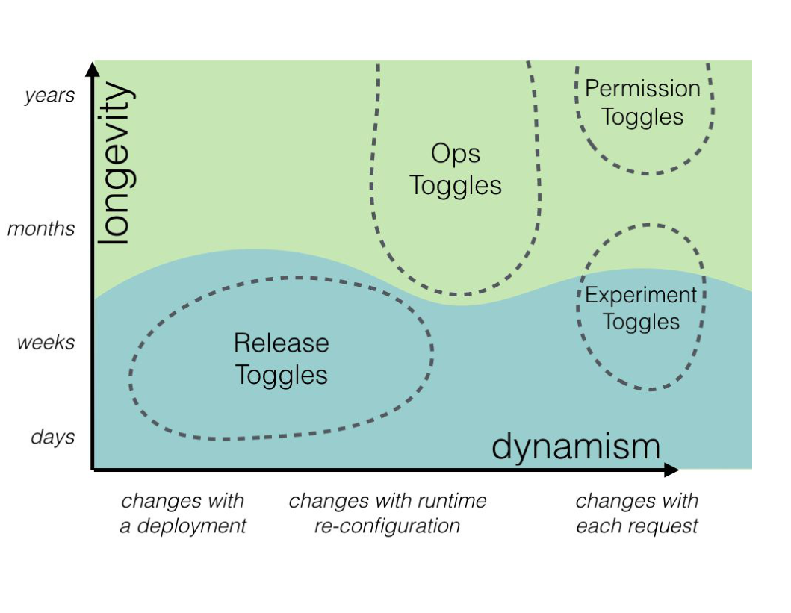

*Imagen original: Desarrollo moderno, p. 33 [DM].*

**Cómo leerlo:** el eje vertical muestra duración, desde días hasta años; el horizontal, cuándo cambia una flag. Las categorías ilustran flags para lanzamientos, experimentos, operación y permisos.

Una flag puede controlarse por despliegue, configuración en ejecución o petición. **La deuda de flags** surge al acumular condiciones y variantes que ya no se necesitan. Como en la [deuda técnica](#c1-08), conviene gestionarlas y retirar las temporales.

#### A/B testing y dark launches

- **A/B testing:** comparar variantes para aprender sobre comportamiento de usuarios y resultados del producto. Necesita métricas y un diseño de comparación [DM, p. 34]. No se limita a comprobar que el servidor no falla.
- **Dark launch:** ejecutar una capacidad en producción sin mostrarla al usuario para observar comportamiento, especialmente rendimiento con carga real [DM, p. 35]. No necesariamente compara preferencias entre variantes.

**Distinción:** canary limita riesgo de exposición; A/B busca evidencia sobre variantes; dark launch permite observar algo que permanece invisible. Pueden combinarse con flags.

#### Comparación orientativa de la diapositiva

| Estrategia | Riesgo | Velocidad | Rollback | Caso de uso del material |
| --- | --- | --- | --- | --- |
| Big bang | Alto | Rápida | Difícil | Aplicaciones pequeñas. |
| Canary | Bajo | Media | Fácil | Sistemas a gran escala. |
| Blue-green | Bajo | Rápida | Fácil | Servicios críticos. |
| Rolling | Medio | Media | Difícil | Aplicaciones cloud-native. |
| Feature toggles | Bajo | Rápida | Fácil | Experimentación continua. |
| A/B testing | Bajo | Lenta | No aplica en la tabla | Validación de producto. |
| Dark launches | Bajo | Rápida | Fácil | Pruebas de rendimiento. |

Fuente: [DM, p. 37]. Es una comparación didáctica, **no una clasificación universal ni una garantía de rollback fácil**. La simplicidad de apagar una flag no deshace automáticamente escrituras o migraciones realizadas. En A/B, “no aplica” es el valor de la tabla, no la imposibilidad de detener un experimento.

<a id="c3-10"></a>
### 10. Desarrollo asistido por IA: capacidad de acción y responsabilidad

La IA puede explicar código, implementar tareas, investigar errores y proponer pruebas. **El equipo sigue definiendo qué construir y comprobando el resultado** [IA, p. 2].

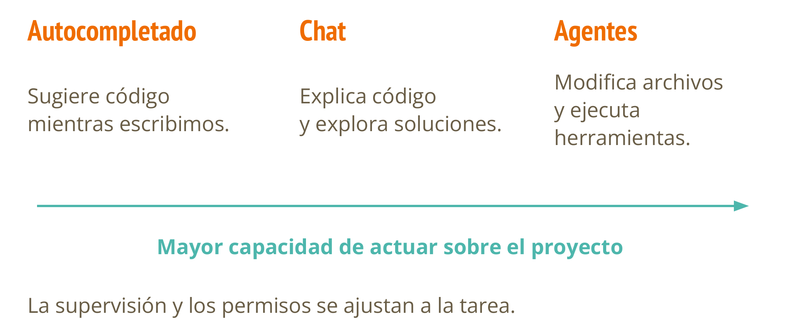

*Imagen original: Desarrollo asistido por IA, p. 4 [IA].*

**Cómo leerlo:** de izquierda a derecha aumenta la capacidad de actuar. Eso cambia la supervisión y los permisos necesarios; no establece una jerarquía de calidad.

| Forma de trabajo | Qué aporta | Qué se revisa |
| --- | --- | --- |
| Autocompletado | Sugiere código mientras se escribe. | Si la sugerencia es correcta y se ajusta al contexto. |
| Chat | Explica código y explora soluciones. | Si sus supuestos y propuestas son válidos. |
| Agentes | Modifican archivos y ejecutan herramientas. | Cambios, comandos, resultados y alcance de sus acciones. |

Referencias: [IA, pp. 2-4]. La página 3 muestra GitHub Copilot, Claude Code y Codex como opciones ilustrativas. No compara capacidades, precios ni configura esas herramientas; este apunte tampoco intenta convertir esa imagen en una recomendación de producto.

El aumento de capacidad de acción debe acompañarse de contexto pertinente y permisos acordes a la tarea. **Generar código más rápido no elimina la necesidad de entenderlo.**

<a id="c3-11"></a>
### 11. Spec Driven Development: especificar antes de delegar

La especificación define **qué comportamiento se espera y cómo comprobarlo** [IA, p. 5]. Una tarea clara debe describir alcance, restricciones, ejemplos y criterios de aceptación.

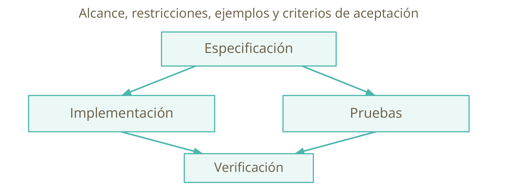

*Imagen original: Desarrollo asistido por IA, p. 5 [IA].*

**Cómo leerlo:** implementación y pruebas parten de la misma necesidad especificada. Verificar consiste en contrastar ambos con el comportamiento esperado.

| Parte de una spec | Pregunta que responde |
| --- | --- |
| Alcance | ¿Qué debe cambiar y qué queda fuera de la tarea? |
| Comportamiento | ¿Qué debe hacer el sistema? |
| Restricciones | ¿Qué condiciones hay que respetar? |
| Ejemplos | ¿Qué resultados esperamos para entradas concretas? |
| Criterios de aceptación | ¿Qué evidencia permite aceptar el cambio? |

**Ejemplo propio conectado con la práctica:**

```text
Tarea: implementar subtract(a, b) en app.py.
Comportamiento: devolver a - b, conservando el orden de los operandos.
Restricciones: mantener la firma y no agregar dependencias.
Ejemplos: subtract(5, 3) == 2; subtract(3, 5) == -2.
Aceptación: esos casos y la suite existente deben pasar.
Fuera de alcance: modificar add, multiply o los workflows.
```

La especificación evita aceptar un cambio solo porque parece razonable. **Si el resultado falla, puede haber un error de implementación o una necesidad mal especificada:** el feedback también permite aclarar la spec [IA, p. 7].

<a id="c3-12"></a>
### 12. Contexto, ciclo de trabajo y validación con IA

Una spec aislada puede ser insuficiente: hay que ubicarla en el proyecto [IA, p. 6].

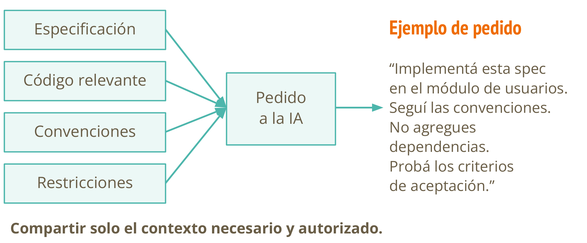

*Imagen original: Desarrollo asistido por IA, p. 6 [IA].*

**Cómo leerlo:** los cuatro insumos delimitan el pedido. El ejemplo de la derecha pide respetar convenciones, evitar dependencias nuevas y comprobar aceptación.

Conviene compartir el módulo involucrado, las interfaces relevantes, convenciones y restricciones. El material pide **contexto necesario y autorizado**, sin secretos. Dar más archivos no siempre aclara la tarea.

#### Ciclo de desarrollo

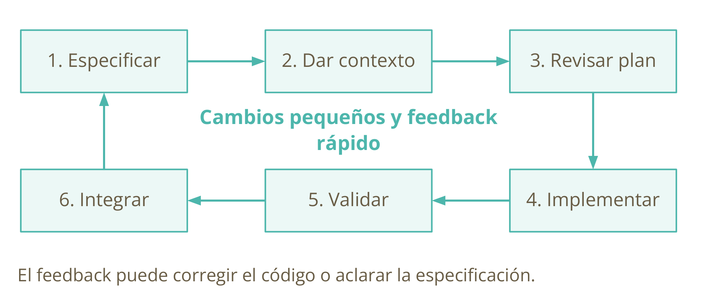

*Imagen original: Desarrollo asistido por IA, p. 7 [IA].*

**Cómo leerlo:** seguí los pasos 1 a 6. La vuelta al inicio representa feedback que puede ajustar código o especificación.

1. **Especificar:** definir resultado y aceptación.
2. **Dar contexto:** ubicar la tarea y sus restricciones.
3. **Revisar plan:** comprobar que la propuesta responde a la necesidad y al alcance.
4. **Implementar:** realizar cambios pequeños.
5. **Validar:** revisar código y ejecutar comprobaciones.
6. **Integrar:** incorporar el cambio mediante el flujo del equipo.

#### La IA pasa por los mismos controles

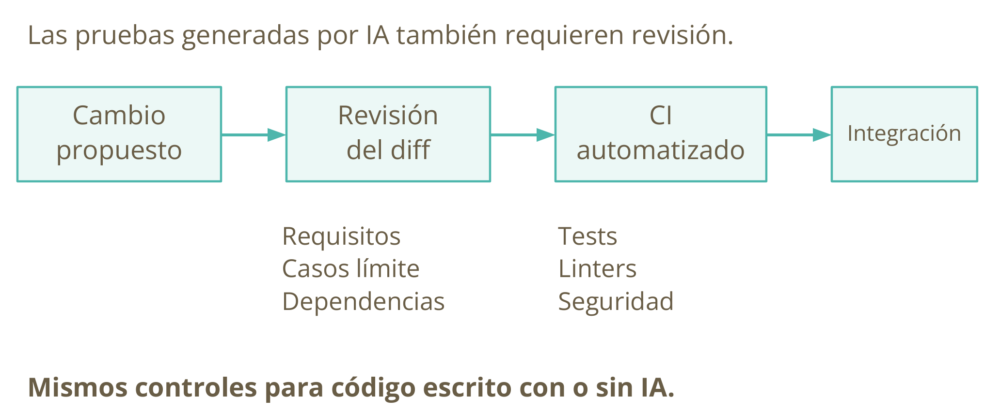

*Imagen original: Desarrollo asistido por IA, p. 8 [IA].*

**Cómo leerlo:** el cambio propuesto se revisa y comprueba antes de integrar. El diff permite observar exactamente qué se agregó, modificó o eliminó.

La revisión mira requisitos, casos límite y dependencias; CI automatiza tests, linters y verificaciones de seguridad. **Los tests generados por IA también se revisan:** podrían repetir el mismo error que el código en lugar de contrastarlo con la necesidad [IA, p. 8].

**Ejemplo propio:** si el código de `subtract` suma y la prueba también espera una suma, ambos pueden coincidir y el test pasar. Revisar contra la spec detecta que esa coincidencia no prueba el comportamiento correcto.

#### Riesgos y controles del material

| Riesgo | Control |
| --- | --- |
| Código incorrecto | Pruebas y casos límite. |
| API inexistente | Verificar la documentación oficial. |
| Cambios fuera de alcance | Acotar la tarea y revisar el diff. |
| Información sensible | Contexto autorizado y ausencia de secretos. |
| Acciones sobre sistemas | Revisar permisos y comandos. |

Fuente: [IA, p. 9]. La síntesis de la página 10 combina especificación clara, contexto relevante, cambios pequeños y validación. **La evidencia para aceptar un cambio** debe incluir correspondencia con la spec, revisión de sus efectos y resultados de comprobación; el texto generado o la confianza de quien lo propone no bastan.

<a id="c3-13"></a>
### 13. Práctica 3: entender GitHub Actions antes de escribir YAML

La práctica utiliza GitHub Actions para ejecutar tests y crear releases [P3, pp. 1-2]. Requiere Git/GitHub, Python, nociones de tests y acceso a un repositorio.

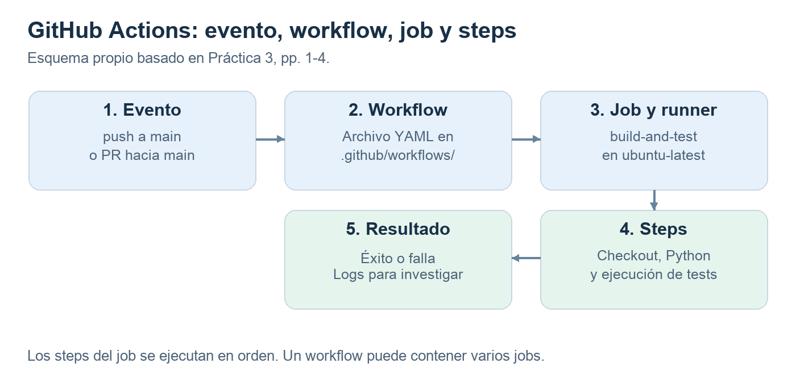

*Esquema propio basado en Práctica 3, pp. 1-4 [P3].*

**Cómo leerlo:** el evento inicia un workflow; este define jobs; cada job ejecuta steps en un runner y devuelve resultados y logs.

| Término | Significado |
| --- | --- |
| Workflow | Flujo automatizado definido en un archivo YAML bajo `.github/workflows/`. |
| Evento / trigger | Actividad que dispara una ejecución, por ejemplo push o PR. |
| Job | Conjunto de pasos ejecutados en un runner. |
| Runner | Entorno donde se ejecuta el job. |
| Step | Acción o comando dentro del job. |
| `uses` | Invoca una acción reutilizable. |
| `run` | Ejecuta comandos. |
| `with` | Proporciona parámetros a una acción. |

El PDF pide explorar una plantilla de Python en **Actions** antes de configurarla: identificar eventos, jobs y tareas [P3, pp. 1-2]. Una plantilla es un punto de partida, no una prueba de que coincide con los requisitos del proyecto.

En el ejemplo, los steps van en orden dentro del job. Si hubiera varios jobs, sus dependencias deberían declararse cuando se necesita una secuencia; no se debe asumir que se ejecutan uno después del otro por su posición en el archivo.

**Nota de costos:** el PDF indica que alcanza con el plan gratuito para la práctica. Los límites dependen del plan y los runners; no se toma esa nota como una regla universal sobre consumo en cualquier repositorio.

<a id="c3-14"></a>
### 14. Práctica de CI: código, tests y workflow

**Objetivo observable:** ejecutar pruebas cuando hay un push a `main` o un PR cuyo destino es `main` [P3, pp. 2-4]. La siguiente guía reproduce el ejercicio con pequeñas aclaraciones identificadas. Los archivos pertenecen al repositorio de práctica, no al apunte.

#### Paso 1. Preparar y comprobar el código local

Crear `app.py`:

```python
def add(a, b):
    return a + b


def subtract(a, b):
    return a - b


def multiply(a, b):
    return a * b
```

Crear `test_app.py`:

```python
import unittest
from app import add, subtract, multiply


class TestApp(unittest.TestCase):
    def test_add(self):
        self.assertEqual(add(1, 2), 3)
        self.assertEqual(add(-1, 1), 0)
        self.assertEqual(add(-1, -1), -2)

    def test_subtract(self):
        self.assertEqual(subtract(5, 3), 2)
        self.assertEqual(subtract(3, 5), -2)
        self.assertEqual(subtract(10, 0), 10)

    def test_multiply(self):
        self.assertEqual(multiply(2, 3), 6)
        self.assertEqual(multiply(-1, 5), -5)
        self.assertEqual(multiply(0, 10), 0)


if __name__ == "__main__":
    unittest.main()
```

Ejecutar desde la carpeta de esos archivos:

```bash
python -m unittest test_app.py
```

Referencias: [P3, pp. 2-3]. `assertEqual` compara el resultado con el esperado. Son **tres métodos de test con nueve aserciones**, no nueve métodos de test. Los casos incluyen números negativos y cero, pero no cubren toda entrada imaginable.

Después, registrar el código:

```bash
git add app.py test_app.py
git commit -m "Agrega operaciones y pruebas unitarias"
```

La práctica usa `unittest`, que pertenece a la biblioteca estándar de Python. No requiere instalar pytest ni otras dependencias para este ejemplo.

#### Paso 2. Configurar CI

Crear `.github/workflows/ci_pipeline.yml`:

```yaml
name: CI Pipeline

on:
  push:
    branches: [main]
  pull_request:
    branches: [main]

permissions:
  contents: read

jobs:
  build-and-test:
    runs-on: ubuntu-latest
    steps:
      - name: Checkout code
        uses: actions/checkout@v4
      - name: Set up Python
        uses: actions/setup-python@v5
        with:
          python-version: '3.13'
      - name: Run unit tests
        run: python -m unittest test_app.py
```

**Relación con el PDF:** se conservan las acciones del material (`checkout@v4`, `setup-python@v5`). Se agrega permiso de lectura explícito, se fija Python 3.13 en lugar de `3.x` y se omite actualizar pip, porque el ejemplo no tiene dependencias externas. Son ajustes del apunte para que el ejemplo sea más explícito; no representan una actualización exhaustiva de todas las versiones de acciones [P3, pp. 3-4].

| Parte | Qué ocurre |
| --- | --- |
| `push.branches: [main]` | Ejecuta el workflow cuando se publica un cambio en `main`. |
| `pull_request.branches: [main]` | Selecciona PRs por la rama **destino**, no por el nombre de la rama de trabajo. |
| `runs-on: ubuntu-latest` | Ejecuta el job en un runner hospedado de Ubuntu. |
| Checkout | Obtiene código del repositorio para el job. |
| Setup Python | Prepara la versión seleccionada. |
| Run unit tests | Ejecuta pruebas; una falla produce un resultado no exitoso. |

Los eventos y filtros se explican en la [referencia oficial de workflows](https://docs.github.com/en/actions/reference/workflows-and-actions/workflow-syntax). En particular, `pull_request` también permite reejecutar el chequeo al publicar nuevos commits en un PR abierto.

Publicar el workflow desde `main`, suponiendo remoto configurado y esa rama existente:

```bash
git add .github/workflows/ci_pipeline.yml
git commit -m "Configura CI para main y pull requests"
git push origin main
```

#### Paso 3. Ver la evidencia en Actions

Abrir **Actions**, seleccionar “CI Pipeline” y revisar el job y sus logs. Comprobar que checkout, preparación de Python y tests terminaron correctamente [P3, p. 4]. El resultado importa más que la mera existencia del archivo YAML.

**Límite:** este job se llama `build-and-test`, pero su ejemplo mínimo ejecuta tests; no construye una imagen Docker ni publica un paquete.

#### Paso 4. Provocar y corregir una regresión

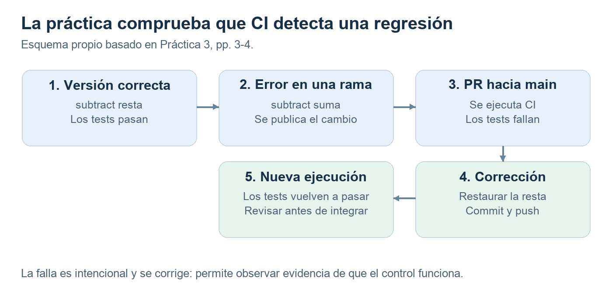

*Esquema propio basado en Práctica 3, p. 4 [P3].*

**Cómo leerlo:** el error se introduce deliberadamente en una rama para ver el control fallar; después se corrige y el mismo PR recibe un resultado nuevo.

1. Crear una rama de práctica, por ejemplo `prueba-ci`.
2. Cambiar temporalmente `subtract` para devolver `a + b`.
3. Hacer commit y push de esa rama.
4. Abrir un PR hacia `main` y observar el test de resta fallido.
5. Restaurar `return a - b`, registrar y publicar la corrección.
6. Revisar que CI se ejecute nuevamente y pase.

**Qué se aprende:** el cambio roto llega a la revisión, los tests dan evidencia del defecto y la corrección se comprueba antes del merge.

**Precisión:** que CI falle no bloquea por sí solo toda integración. Para exigir su éxito antes de un merge, el repositorio debe configurar ese chequeo como requerido mediante las reglas correspondientes. No se configura automáticamente al agregar el YAML.

<a id="c3-15"></a>
### 15. Práctica de releases: alcance y corrección del workflow

La práctica llama a esta parte “Continuous Deployment”, pero su acción concreta es **crear una publicación GitHub Release al publicar un tag** [P3, pp. 5-6]. Sirve para automatizar un hito de entrega; no realiza un despliegue productivo.

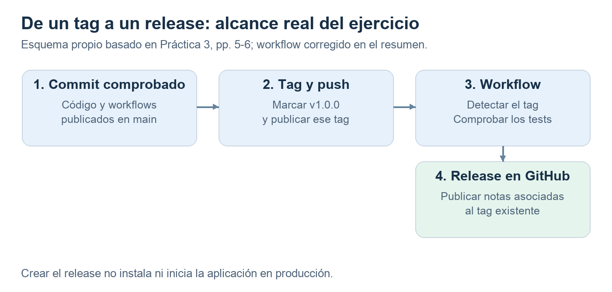

*Esquema propio basado en Práctica 3, pp. 5-6 [P3], con las correcciones de esta sección.*

**Cómo leerlo:** se marca un commit, se publica el tag y se ejecuta la automatización. El resultado visible está en Releases; no es un servicio en ejecución.

#### Qué corregir en el YAML del PDF

| Punto del material | Corrección o precisión |
| --- | --- |
| `on: create: tags:` | `create` no ofrece ese filtro de tags. Para seleccionar tags publicados se utiliza `push` con `tags`. |
| `actions/create-release@v1` | Su repositorio está archivado. El ejemplo de abajo utiliza GitHub CLI para publicar el release. |
| Token sin permisos explícitos | Se declara `contents: write` para permitir la publicación. |
| Patrón `v*.*.*` | Selecciona nombres con esa estructura de puntos; no valida por sí solo que sean versiones semánticas numéricas. |
| Releases independiente de CI | El ejemplo corregido vuelve a probar el commit del tag antes de publicarlo. El prefijo `v` no demuestra que ese commit fue validado. |

El evento y el filtro se verificaron en las referencias oficiales de [eventos](https://docs.github.com/en/actions/reference/workflows-and-actions/events-that-trigger-workflows) y [sintaxis](https://docs.github.com/en/actions/reference/workflows-and-actions/workflow-syntax). El estado de la acción se puede consultar en [actions/create-release](https://github.com/actions/create-release).

#### Ejemplo corregido y explicado

Crear `.github/workflows/cd_release.yml`:

```yaml
name: CD Release Pipeline

on:
  push:
    tags:
      - 'v*.*.*'

permissions:
  contents: write

jobs:
  create-github-release:
    runs-on: ubuntu-latest
    steps:
      - name: Checkout tagged code
        uses: actions/checkout@v4
      - name: Set up Python
        uses: actions/setup-python@v5
        with:
          python-version: '3.13'
      - name: Verify tagged code
        run: python -m unittest test_app.py
      - name: Create release
        env:
          GH_TOKEN: ${{ secrets.GITHUB_TOKEN }}
          GH_REPO: ${{ github.repository }}
          RELEASE_TAG: ${{ github.ref_name }}
        run: |
          gh release create "$RELEASE_TAG" --verify-tag \
            --title "Release $RELEASE_TAG" \
            --notes "Versión publicada automáticamente después de verificar los tests."
```

Esta es una **adaptación del apunte**, no el YAML literal del PDF. Se usa `gh release create`, documentado en el [manual oficial de GitHub CLI](https://cli.github.com/manual/gh_release_create), y se asume el runner hospedado de Ubuntu con `gh` disponible.

- `push.tags`: responde a la publicación del tag.
- Checkout: obtiene el código del commit etiquetado.
- Verify tagged code: comprueba esa versión; si falla, no se continúa al step de publicación.
- `GH_TOKEN`: permite autenticar la operación con el token del workflow.
- `GH_REPO`: identifica el repositorio.
- `RELEASE_TAG`: toma el nombre del tag del evento.
- `--verify-tag`: exige que el tag exista en el remoto, evitando crearlo implícitamente por este comando.
- `--title` y `--notes`: definen título y descripción.

El comando publica un release normal, sin las opciones de draft o prerelease. Crear otra vez un release para el mismo tag puede fallar; para esta práctica se usa un tag nuevo. El workflow no incorpora empaquetado, adjuntos ni despliegue.

#### Cómo probar el flujo

1. Confirmar que el código correcto y ambos workflows estén publicados en `main`.
2. Ejecutar los tests locales y revisar el resultado de CI.
3. Desde el commit que se quiere marcar, crear y publicar el tag:

```bash
git tag -a v1.0.0 -m "Primera versión estable"
git push origin v1.0.0
```

4. Revisar “CD Release Pipeline” en Actions.
5. Comprobar el release asociado a `v1.0.0` en Releases [P3, p. 6].

**Tag y release no son lo mismo:** el tag identifica un punto del historial; el release agrega una publicación a ese punto. La práctica separa la publicación del tag del push de ramas, igual que en la [Clase 1](#c1-10).

<a id="c3-16"></a>
### 16. Token, configuración y respuestas de la práctica

**`GITHUB_TOKEN`** es el token proporcionado al workflow para operar sobre el repositorio según sus permisos. No se necesita escribir una contraseña personal en el YAML. Los permisos se ajustan a la tarea: lectura para CI; escritura de contenido para el ejemplo de release. Véase [autenticación oficial con GITHUB_TOKEN](https://docs.github.com/en/actions/tutorials/authenticate-with-github_token).

**Configuración sensible:** usar secretos del repositorio o del entorno correspondiente y evitar guardarlos en código o imprimirlos en logs. El nombre de una variable de entorno no la vuelve secreta por sí mismo. Esto conecta con las [restricciones de contexto para IA](#c3-12) y con `.gitignore` de la Clase 1.

#### Respuestas a las preguntas de análisis

| Pregunta de la práctica | Respuesta |
| --- | --- |
| ¿Qué elementos tiene el workflow? | Nombre, eventos, jobs, runner y steps; en estos ejemplos también se declaran permisos y parámetros. |
| ¿Qué eventos disparan CI? | Push a `main` y actividad del PR con destino `main`, como apertura y publicación de nuevos commits. |
| ¿Qué trabajos realiza CI? | Obtiene código, prepara Python y ejecuta tests; otros proyectos agregan dependencias, build y más controles. |
| ¿Qué dispara releases en el ejemplo corregido? | Un push de tag que coincide con `v*.*.*`. |
| ¿Qué ventaja tiene automatizar releases? | Repetir el proceso con menos tareas manuales y vincular la publicación a una versión concreta. |
| ¿Cómo extenderlo a producción? | Preparar un artefacto, desplegarlo a un entorno definido, comprobar su disponibilidad y establecer monitoreo y reversión. Crear un release no hace esos pasos. |
| ¿Para qué sirve el token? | Autenticar acciones permitidas sobre el repositorio, como publicar releases. |
| ¿Cómo pasar contraseñas? | Mediante secretos y permisos adecuados, sin incluir valores sensibles en archivos versionados. |

Referencias: preguntas de [P3, pp. 2 y 6], con respuestas derivadas de los workflows explicados.

#### Extensiones opcionales del PDF

- **Notificaciones:** informar resultados del workflow por canales acordados.
- **Cobertura:** medir qué parte del código ejecutan los tests, recordando que cobertura no prueba calidad por sí sola.
- **Despliegue PaaS/IaaS:** incorporar un destino de ejecución y sus verificaciones. PaaS ofrece una plataforma para ejecutar aplicaciones; IaaS proporciona recursos de infraestructura.
- **Contenedores:** construir y distribuir una imagen Docker, conectando el pipeline con la Clase 2.

Fuente: [P3, p. 7]. Son propuestas de ampliación, no pasos implementados en el ejemplo mínimo.

<a id="c3-17"></a>
### 17. Integración de la clase y preguntas de repaso

**Ejemplo propio que une todos los temas:**

1. El equipo prioriza una operación nueva para la calculadora y define aceptación.
2. Una persona o una IA implementa un cambio pequeño con contexto y restricciones claros.
3. Se revisa el diff y se publican los commits en una rama.
4. Un PR ejecuta CI; el equipo revisa tanto código como tests.
5. Se integra la versión comprobada y se marca con un tag.
6. El workflow publica el release; un pipeline ampliado podría preparar y desplegar una imagen.
7. Se habilita el cambio según la estrategia elegida y se monitorea.
8. El feedback mejora el código, la especificación o el proceso del equipo.

**Separaciones que conviene recordar:**

| No confundir | Diferencia |
| --- | --- |
| DevOps y herramienta | DevOps implica cultura y responsabilidades; una herramienta apoya esas prácticas. |
| CI y deployment | Comprobar código no implica desplegarlo. |
| Delivery y deployment continuo | Estar listo para entregar no exige que cada cambio llegue automáticamente a producción. |
| Deployment y habilitación | Código instalado puede permanecer oculto mediante flags. |
| Tag y GitHub Release | Referencia a un commit y publicación asociada a esa referencia. |
| Test que pasa y requisito correcto | La prueba también debe estar bien diseñada y corresponder a la necesidad. |
| Código humano y generado por IA | Ambos requieren revisión y evidencia de funcionamiento. |

#### Preguntas para estudiar

1. ¿Qué busca cada entorno y por qué staging no elimina todo riesgo?
2. ¿Qué significa responsabilidad compartida en DevOps?
3. ¿Por qué los seis antipatrones conservan barreras?
4. ¿Qué distingue los cuatro tipos de equipos y los tres modos de interacción?
5. ¿Por qué integrar temprano reduce problemas y facilita refactorizar?
6. ¿Qué niveles muestra la pirámide y por qué se necesitan diferentes clases de tests?
7. ¿Qué distingue un formatter, un linter, un hook y el CI del repositorio?
8. ¿Cómo se diferencian CI, delivery y deployment continuo?
9. ¿Cómo funciona canary frente a blue-green y rolling?
10. ¿Qué permiten flags, A/B testing y dark launches?
11. ¿Qué debe contener una spec y qué contexto necesita una IA?
12. ¿Por qué también hay que revisar los tests que propone la IA?
13. ¿Qué distingue evento, workflow, job, runner y step?
14. ¿Qué demuestra el fallo intencional de `subtract` y cómo se comprueba su corrección?
15. ¿Qué correcciones necesita el workflow de releases del PDF?
16. ¿Qué falta para convertir la publicación de releases en un despliegue productivo?

<a id="c3-18"></a>
### 18. Claridad del material y límites de este resumen

Se revisaron el texto y las páginas renderizadas de los tres PDF. Los conceptos y el código principal son legibles. Se incorporaron imágenes reales y esquemas con sus fuentes junto a cada explicación.

| Material | Observación y tratamiento |
| --- | --- |
| [DM, pp. 10 y 44] | El patrón organizativo se repite; se explica una sola vez. |
| [DM, pp. 13-14] | Los mapas tienen numerosos logos y rótulos pequeños. Se incluyen ampliables en un bloque desplegable y se explican sus componentes principales. No se interpreta “CVA” sin definición clara. |
| [DM, pp. 24-25] | La definición de delivery está repetida; se resume una sola vez. |
| [DM, pp. 11 y 23] | Imágenes rotuladas deployment aparecen en el bloque de delivery; se aclaró la distinción. |
| [DM, pp. 31-32 y 37] | Continuidad, riesgo y facilidad de rollback son simplificaciones didácticas; se indicaron sus condiciones y límites. |
| [DM, pp. 41-43] | El contenido está dentro de imágenes; se incorporó y explicó, sin depender de extracción textual. |
| [IA, p. 3] | Logos de herramientas sin comparación detallada; se mencionan como ejemplos del PDF. |
| [P3, pp. 3-4] | El YAML queda dividido entre páginas. Se presenta un bloque completo con ajustes explícitos. |
| [P3, pp. 5-6] | Se corrigieron el filtro de tags, la acción archivada y los permisos; se agregó una comprobación del commit etiquetado. |
| [P3, pp. 1 y 5] | La práctica habla de deployment, pero solo publica releases; se describe su alcance real. |

**Verificación del apunte:** los ejemplos de Python y la regresión intencional se comprobaron localmente en una carpeta temporal. Los workflows se revisaron como ejemplos; no se ejecutaron en GitHub ni se creó una publicación o un despliegue real.

[Volver al índice](#indice)

---

<a id="clase-4"></a>
## Clase 4: Arquitectura de software y patrones aplicados a facturación

**Qué vas a entender:** cómo repartir responsabilidades, elegir formas de organizar un sistema y utilizar patrones de diseño cuando resuelven un problema concreto. La práctica lleva esas decisiones a un sistema de descuentos e impuestos.

**Conexión con las clases anteriores:** la arquitectura condiciona qué se puede modificar, probar y entregar de forma independiente. Los principios de la Clase 1, la colaboración de la Clase 2 y la automatización de la Clase 3 dependen de límites y contratos bien definidos.

<details>
<summary>Fuentes y referencias [ARQ] y [P4]</summary>

- **[ARQ]** [Clase 4: Arquitectura de Software](<Clases/Clase 4 Arquitectura de Software.pdf>) (42 páginas).
- **[P4]** [Práctica 4: Patrones de Diseño](<Practicas/4. Patrones de Diseño MIA203.pdf>) (3 páginas).

Las referencias cuentan las páginas desde el comienzo del PDF. Los esquemas propios, las interpretaciones de diagramas y los ejemplos se identifican. Las correcciones de métricas y las introducciones complementarias a C4 y DDD tienen enlaces junto a sus explicaciones.

</details>

<a id="c4-01"></a>
### 1. Arquitectura: decisiones que dan forma al sistema

La arquitectura es el **conjunto de decisiones de diseño que define los componentes de un sistema y sus interacciones**. Proporciona una visión y un vocabulario compartidos entre desarrollo y las personas interesadas en el producto [ARQ, p. 4].

**Ejemplo propio:** en facturación, decidir separar lectura de JSON, cálculo y escritura de resultados es una decisión estructural. Elegir qué impuestos corresponden a cada categoría es una regla del dominio. La arquitectura debe permitir expresar y cambiar esas reglas sin mezclar todas las responsabilidades.

#### Las cinco ideas de la clase

| Idea | Qué implica |
| --- | --- |
| Todo es un trade-off | Una ventaja tiene costos: distribuir puede dar autonomía, pero añade red y coordinación. |
| No hay una solución universal | Un estilo adecuado para un sistema puede ser innecesariamente complejo para otro. |
| Hay arquitectura aunque no se diseñe | El código termina teniendo componentes y dependencias, incluso si surgieron sin planificación. |
| El porqué importa más que el cómo | Hay que justificar la decisión por requisitos y restricciones, no solo describir la tecnología. |
| Optimizar para el cambio | Organizar el sistema para que los cambios previstos puedan realizarse con impacto controlado. |

Fuente: [ARQ, p. 5]. El **trade-off** es un compromiso entre cualidades en tensión, como simplicidad, rendimiento, autonomía y costo operativo.

Esto conecta con los [ADRs de la Clase 2](#c2-04): registrar el motivo de una decisión permite revisarla cuando cambia el contexto. Optimizar para el cambio tampoco exige anticipar toda necesidad imaginable: se mantiene el criterio [KISS y YAGNI](#c1-07).

<a id="c4-02"></a>
### 2. Cohesión, acoplamiento y niveles de decisión

La clase busca **reducir acoplamiento y aumentar cohesión** para facilitar autonomía, pruebas y evolución [ARQ, p. 6].

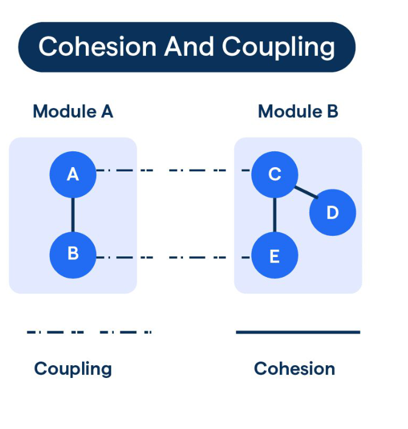

*Imagen original: Arquitectura, p. 6 [ARQ].*

**Cómo leerlo:** las líneas internas agrupan elementos de una misma responsabilidad; las conexiones entre módulos muestran dependencias. La figura distingue dos conceptos, no proporciona una fórmula para medirlos.

- **Cohesión:** cuánto se relacionan las responsabilidades dentro de un módulo. Un módulo de descuentos con reglas coherentes tiene un propósito reconocible.
- **Acoplamiento:** cuánto depende un módulo de otro. Si el cálculo solo funciona leyendo archivos con un formato particular, queda acoplado a esa entrada.

**Ejemplo propio:** una función de impuestos que recibe un ítem puede probarse en memoria. Si también abre JSON, escribe resultados y llama a una API, probar la regla exige preparar muchas cosas ajenas al cálculo.

> **Idea clave:** separar responsabilidades permite cambiar una parte sin conocer todos los detalles de las demás. No significa eliminar toda dependencia, sino hacerla explícita y controlada.

#### Estilo, patrón arquitectónico y patrón de diseño

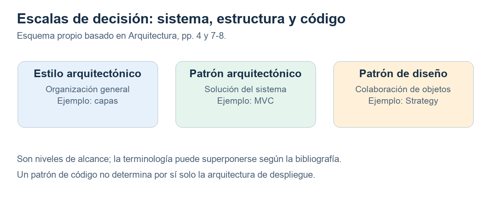

*Esquema propio basado en Arquitectura, pp. 4 y 7-8 [ARQ].*

**Cómo leerlo:** las cajas comparan alcances. No son tres pasos obligatorios ni categorías completamente excluyentes.

| Concepto | Alcance | Ejemplos del material |
| --- | --- | --- |
| Estilo arquitectónico | Organización general y filosofía estructural del sistema. | Capas, microkernel, SOA. |
| Patrón arquitectónico | Solución de alto nivel que orienta la implementación del sistema. | MVC, microservicios, message bus. |
| Patrón de diseño | Solución reutilizable a un problema de colaboración y estructura del código. | Singleton, Observer, Strategy. |

Fuente: [ARQ, pp. 7-8]. **Precisión terminológica:** la bibliografía puede usar estilo y patrón con solapamientos; la propia clase presenta microservicios en distintos niveles. Lo importante es aclarar qué problema y escala se está discutiendo.

Usar Strategy para descuentos no convierte automáticamente al programa en microservicios. Un patrón de objetos y una organización de despliegue son decisiones diferentes.

<a id="c4-03"></a>
### 3. Partición técnica, partición por dominio y distribución

Antes de elegir tecnologías, hay que decidir **por dónde dividir el sistema** [ARQ, p. 10].

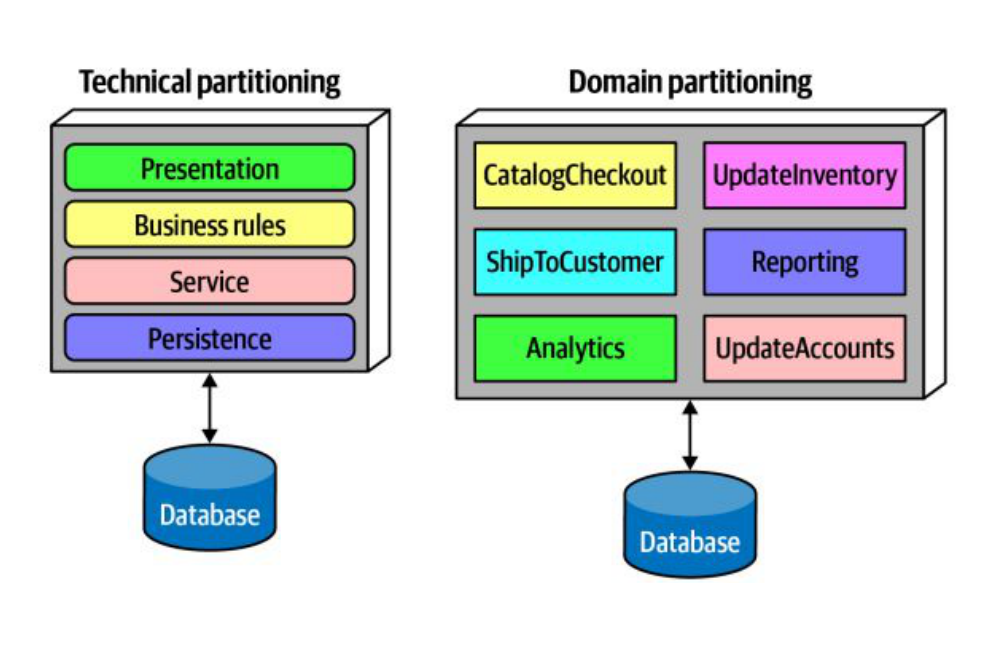

*Imagen original: Arquitectura, p. 10 [ARQ].*

**Cómo leerlo:** a la izquierda se agrupan responsabilidades técnicas; a la derecha, capacidades del negocio. Ambas figuras muestran una base de datos: partir por dominio no exige por sí solo bases separadas.

| Partición | Se organiza por | Ejemplo propio |
| --- | --- | --- |
| Técnica | Cómo funciona el software. | Presentación, reglas de negocio, servicios y persistencia. |
| Por dominio | Qué hace para el negocio. | Facturación, inventario y envíos. |

La partición por dominio puede alinearse mejor con la evolución del negocio y la responsabilidad de equipos. Un módulo de facturación, a su vez, puede separar internamente entrada, cálculo y salida. **Las dos perspectivas pueden combinarse.**

#### Monolítico frente a distribuido

La página 12 agrupa capas, pipeline y microkernel como estilos monolíticos, y service-based, event-driven y microservicios como distribuidos.

- **Monolítico:** en su forma habitual, el sistema se construye y despliega como una unidad. Puede tener módulos internos bien separados.
- **Distribuido:** varias unidades de ejecución se comunican, normalmente por una red. Aparecen latencia, fallas parciales y coordinación.

**Aclaración:** esa agrupación es una guía del material, no una restricción universal. Un pipeline puede ejecutarse dentro de un proceso o distribuir etapas; separar módulos no exige separar procesos.

Un monolito modular puede ser más adecuado que una red de servicios para una práctica pequeña. Más servicios no equivalen a mejor arquitectura: hay que justificar el costo adicional.

<a id="c4-04"></a>
### 4. Capas, pipeline y microkernel

Estos estilos organizan responsabilidades de distintas maneras [ARQ, pp. 14-17].

#### Layered: arquitectura en capas

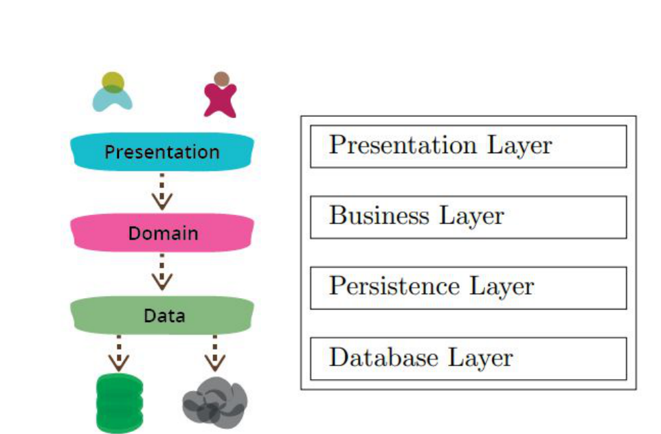

*Imagen original: Arquitectura, p. 14 [ARQ].*

**Cómo leerlo:** cada capa tiene una responsabilidad y utiliza capacidades de capas inferiores. Las flechas muestran una dirección de dependencias.

La clase destaca separación de responsabilidades, dependencias unidireccionales y prevención de referencias circulares. Esto simplifica pruebas y evolución **si se respetan los límites**; el dibujo por sí solo no impide que el código cree un ciclo.

**Ejemplo propio:** la interfaz de facturación recibe datos; la capa de negocio calcula; la persistencia guarda resultados. Las reglas no deberían depender de detalles de pantalla o nombres de archivos.

**Costo posible:** pasar por muchas capas puede agregar indirección. Si una capa no aporta responsabilidad clara, solo puede complicar la lectura.

#### Pipeline: transformación por etapas

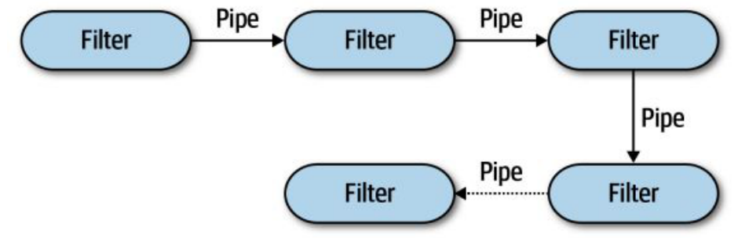

*Imagen original: Arquitectura, p. 15 [ARQ].*

**Cómo leerlo:** cada filter procesa la entrada y pasa un resultado al siguiente por un pipe. El foco es el flujo de datos.

La clase lo relaciona con procesamiento por lotes o streams, ETL y medios. Las etapas pueden ser reutilizables y algunas implementaciones permiten paralelismo o despliegue separado.

- **Back-pressure:** una etapa lenta obliga a limitar o gestionar el ritmo de las anteriores.
- **Monitoreo:** hay que observar cuellos de botella y fallas de etapas.
- **Transacciones globales:** coordinar una operación indivisible entre etapas puede ser difícil.

**Distinción con la Clase 3:** un pipeline de datos transforma información; un pipeline CI/CD prepara y verifica cambios de software. Comparten la idea de etapas, pero resuelven problemas distintos.

#### Microkernel: núcleo y extensiones

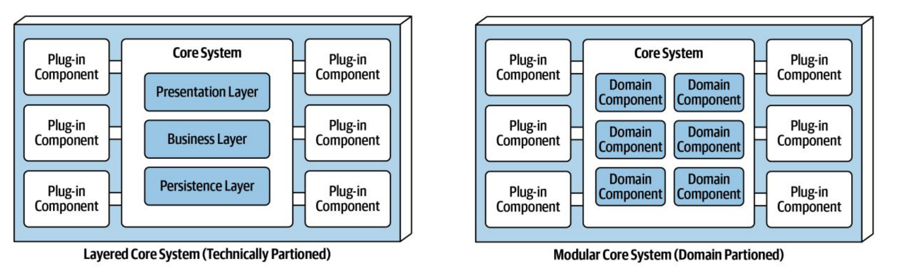

*Imagen original: Arquitectura, p. 17 [ARQ].*

**Cómo leerlo:** los plugins se conectan a un núcleo estable. La izquierda divide el núcleo técnicamente; la derecha lo divide por componentes de dominio.

El sistema conserva funciones centrales y agrega capacidades mediante componentes independientes o plugins [ARQ, p. 16]. **Ejemplo propio:** una plataforma conserva su lógica común y permite incorporar exportadores de reportes.

El contrato entre núcleo y plugin es crítico: hay que definir operaciones, entradas, errores y compatibilidad de versiones. La extensibilidad agrega flexibilidad, pero también trabajo de diseño y mantenimiento de contratos.

<a id="c4-05"></a>
### 5. Servicios, eventos y microservicios

Al distribuir un sistema se gana capacidad de evolucionar partes por separado, pero aparece complejidad que antes era local [ARQ, pp. 19-23].

#### Service-based

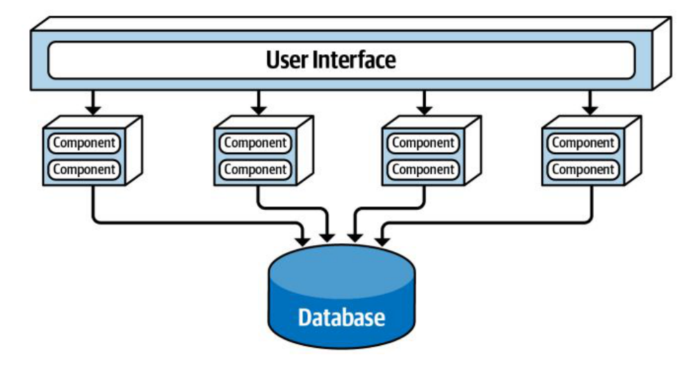

*Imagen original: Arquitectura, p. 19 [ARQ].*

**Cómo leerlo:** la interfaz utiliza servicios y el ejemplo comparte una base de datos. Es un esquema concreto, no la obligación de compartir almacenamiento en toda arquitectura de servicios.

El material describe servicios independientes y reutilizables que utilizan protocolos de red. Requieren diseño robusto, seguridad y gobernanza: acuerdos sobre interfaces, responsabilidades y evolución.

La red añade latencia y nuevas fallas posibles. También puede existir acoplamiento mediante datos compartidos, aunque el código esté separado.

#### Event-driven: reaccionar a hechos

Los componentes producen eventos y reaccionan a ellos, en lugar de coordinar todo mediante llamadas directas [ARQ, p. 20]. **Un evento describe un hecho ocurrido**, por ejemplo `FacturaEmitida`.

**Ejemplo propio:** al emitirse una factura, otro componente registra una estadística y otro prepara una notificación. El productor no necesita ejecutar personalmente toda esa lógica.

La clase señala procesamiento asincrónico, escalabilidad y uso en sistemas con respuestas a eventos. Sus costos incluyen depuración más compleja y **consistencia eventual**: los componentes pueden actualizar su visión en distintos momentos.

##### Broker y mediator no son lo mismo

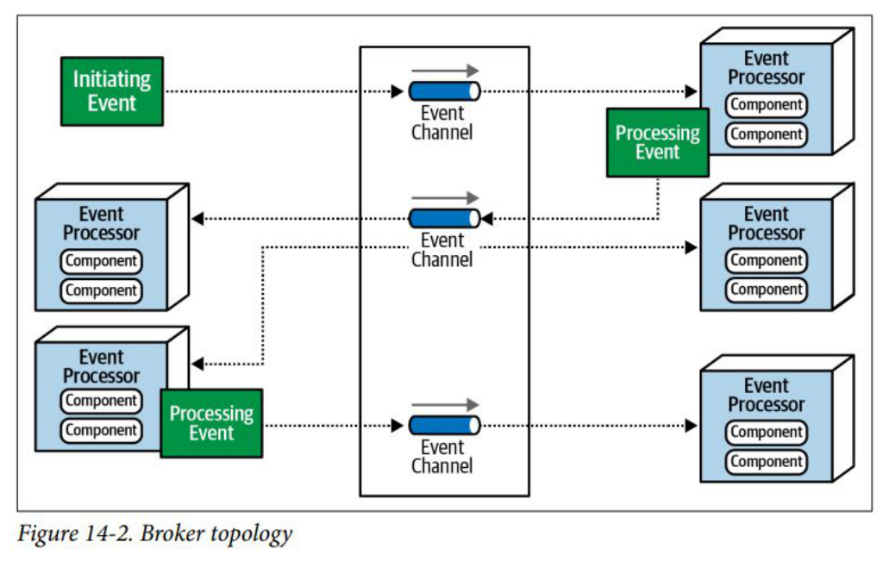

*Imagen original: Arquitectura, p. 21 [ARQ].*

**Cómo leerlo:** los eventos circulan por canales entre procesadores. No aparece un componente central que dicte todo el workflow.

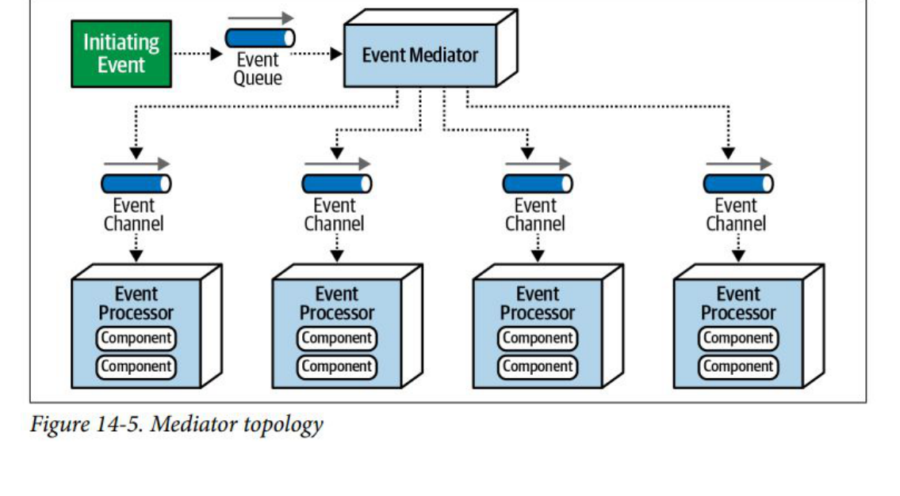

*Imagen original: Arquitectura, p. 22 [ARQ].*

**Cómo leerlo:** el evento llega a un mediador que coordina acciones a través de canales. El coordinador vuelve visible el flujo completo.

| Topología | Ventaja del material | Costo |
| --- | --- | --- |
| Broker | Menos coordinación central; potencial de escalabilidad y tolerancia a fallas. | El recorrido completo puede ser difícil de seguir. |
| Mediator | Mayor control del workflow y de errores. | Dependencia del coordinador y posible costo de rendimiento. |

**Precisión:** esas ventajas dependen de la implementación. Usar un broker no garantiza que nunca se pierdan o repitan eventos. Como consideración adicional de diseño, conviene definir qué ocurre con duplicados, reintentos y fallas parciales; el PDF no desarrolla esos mecanismos.

#### Microservicios


*Imagen original: Arquitectura, p. 23 [ARQ].*

**Cómo leerlo:** la capa de acceso se conecta a servicios con módulos y almacenamiento propios. Seguí una petición y observá que consultar varias capacidades implica comunicación entre componentes.

La clase describe servicios pequeños e independientes alrededor de un **bounded context**, con sus datos y dependencias. Un bounded context delimita dónde un modelo y sus términos tienen significado consistente; conecta con [DDD](#c4-10).

Beneficios buscados: escalado de partes, autonomía y entrega continua. Costos: coordinación, rendimiento afectado por red, depuración y consistencia de datos.

**Idea clave:** dividir por capacidades coherentes importa más que reducir indiscriminadamente el tamaño de cada servicio. La autonomía también depende de contratos y del trabajo de equipos, como vimos en [Team Topologies](#c3-03).

<a id="c4-06"></a>
### 6. Familias de patrones arquitectónicos

La página 25 contiene una clasificación visual que no aparece en la extracción textual del PDF.


*Imagen original: Arquitectura, p. 25 [ARQ].*

**Cómo leerlo:** son familias y ejemplos, no etapas de un sistema. Cada familia destaca una forma de organizar procesamiento o interacción.

| Familia del gráfico | Ejemplos visibles | Explicación complementaria |
| --- | --- | --- |
| Independent Components | Procesos comunicantes y sistemas de eventos; invocación implícita o explícita. | Componentes con ejecución propia se coordinan mediante comunicación. |
| Data Flow | Batch sequential; pipes and filters. | Los datos atraviesan transformaciones. |
| Data-Centered | Repository; blackboard. | El intercambio se organiza alrededor de datos compartidos. Blackboard utiliza un espacio común de conocimiento parcial. |
| Virtual Machine | Interpreter; rule-based system. | El procesamiento se expresa mediante instrucciones o reglas interpretadas. |
| Call/Return | Programa y subrutinas; orientación a objetos; capas. | La interacción se organiza mediante llamadas y resultados. |

Estas explicaciones aclaran la clasificación; la clase no desarrolla implementaciones de todos los ejemplos.

<details>
<summary>Ver el mapa panorámico de estilos de la página 9</summary>


*Imagen original: Arquitectura, p. 9 [ARQ].*

**Cómo leerlo:** el centro y los sectores agrupan estilos; las ilustraciones externas muestran ejemplos. Es una vista general, no una jerarquía obligatoria. Sus rótulos pequeños tienen baja definición: se usa como orientación visual y no se reconstruyen términos dudosos. Los estilos desarrollados por la clase se explican en las secciones anteriores.

</details>

> **Para elegir:** empezar por requisitos y restricciones, comparar beneficios y costos, y documentar el motivo. Elegir por el nombre más novedoso contradice el enfoque de la clase.

<a id="c4-07"></a>
### 7. Patrones de diseño: categorías y problemas que resuelven

Un patrón de diseño aporta una solución reutilizable a un problema recurrente del código. No es una biblioteca que se instala ni un requisito para agregar clases por sí mismo [ARQ, pp. 7 y 27].

| Categoría | Qué organiza | Catálogo enumerado en la clase |
| --- | --- | --- |
| Creacionales | Cómo se crean objetos. | Abstract Factory, Builder, Factory Method, Prototype, Singleton. |
| Estructurales | Cómo se componen clases y objetos. | Adapter, Bridge, Composite, Decorator, Facade, Flyweight, Proxy. |
| De comportamiento | Cómo colaboran objetos y distribuyen acciones. | Chain of Responsibility, Command, Interpreter, Iterator, Mediator, Memento, Observer, State, Strategy, Template Method, Visitor. |

Fuente: [ARQ, p. 27]. El material enumera ese catálogo, pero desarrolla **Singleton, Chain of Responsibility, State, Strategy y Template Method**. El apunte profundiza esos cinco y conecta los últimos dos enfoques relevantes con la práctica.

**No confundir niveles:** el patrón de objetos Mediator pertenece al catálogo de diseño; la topología mediador de eventos organiza un sistema. Comparten una idea de coordinación, pero no tienen el mismo alcance.

<a id="c4-08"></a>
### 8. Singleton, Chain of Responsibility y State

#### Singleton: una instancia compartida

- **Problema:** se requiere una única instancia de una clase en un ámbito definido.
- **Solución:** controlar su creación y dar acceso a esa instancia.
- **Ventaja:** acceso sencillo a un recurso compartido.
- **Costo:** dependencias ocultas y dificultades de pruebas [ARQ, p. 28].

La clase menciona configuración y logging como ejemplos. **No todo logger o configuración requiere implementar un Singleton.** Si se pasa explícitamente la dependencia al objeto que la usa, puede ser más sencillo sustituirla durante tests.

También hay que definir el ámbito: una instancia por proceso no significa una única instancia para todos los servicios de una aplicación distribuida.

#### Chain of Responsibility: una solicitud pasa por handlers

- **Problema:** lógica de manejo rígida y demasiado acoplada.
- **Solución:** conectar handlers y pasar la solicitud hasta que alguno la atienda.
- **Ventaja:** modificar o reorganizar manejadores con flexibilidad.
- **Costo:** orden importante y posibilidad de que nadie atienda la solicitud [ARQ, p. 29].

**Ejemplo propio:** varios handlers pueden intentar resolver una petición según su tipo. Se necesita una política para solicitudes sin manejo y para errores.

En la práctica de impuestos aparece una variante importante: **pueden corresponder varios gravámenes al mismo ítem**. Una cadena que se detiene tras el primer impuesto sería incorrecta; este punto se retoma en [la comparación de alternativas](#c4-13).

#### State: comportamiento según el estado del objeto

- **Problema:** muchos condicionales dependen del estado actual.
- **Solución:** encapsular comportamientos y transiciones propios de cada estado.
- **Ventaja:** lógica más clara y localizada.
- **Costo:** más clases y relaciones que mantener [ARQ, p. 30].


*Imagen original: Arquitectura, p. 31 [ARQ].*

**Cómo leerlo:** cada nodo es un estado de un documento; las flechas son transiciones. Un usuario envía a moderación, un administrador aprueba, una revisión rechazada vuelve a borrador y una publicación expirada también puede volver. El gráfico incluye publicación directa por administrador.

El diagrama de la página 30 complementa esto con un documento que delega operaciones como publicar o mostrar contenido a su estado actual. **Estado y transición deben respetar reglas:** agregar clases no define por sí solo qué acciones están permitidas.

<a id="c4-09"></a>
### 9. Strategy y Template Method: variar algoritmos con claridad

#### Strategy

- **Problema:** alternativas de un algoritmo quedan dispersas entre muchos condicionales.
- **Solución:** encapsular variantes detrás de una operación común y elegir cuál usar.
- **Ventaja:** cambiar una política sin reescribir el código que la utiliza.
- **Costo:** más objetos o configuración [ARQ, p. 32].

La clase menciona estrategias de ordenamiento y muestra un navegador que selecciona formas de construir una ruta. **En facturación:** el calculador pide el monto de descuento a una estrategia sin conocer todos sus tipos.

Esto aplica el principio [abierto/cerrado de SOLID](#c1-07): incorporar otra política puede requerir agregarla y registrarla, conservando el algoritmo principal.

#### Template Method

- **Problema:** varios algoritmos comparten una estructura, pero algunos pasos cambian.
- **Solución:** la clase base fija la secuencia y las subclases definen partes específicas.
- **Ventaja:** reutilizar el esqueleto del algoritmo.
- **Costo:** acoplamiento por herencia [ARQ, pp. 33-34].


*Imagen original: Arquitectura, p. 33 [ARQ].*

**Cómo leerlo:** el método de la clase base organiza la secuencia; las subclases completan o redefinen pasos. La figura de la página 34 ejemplifica procesamiento de DOC, CSV y PDF que comparte un flujo de extracción, análisis y reporte.

#### La diferencia que conviene recordar


*Esquema propio basado en Arquitectura, pp. 32-34 [ARQ].*

**Cómo leerlo:** cada fila es una alternativa. Strategy recibe una política; Template Method hereda una secuencia y define pasos variables.

| Pregunta | Strategy | Template Method |
| --- | --- | --- |
| ¿Qué cambia? | La política o algoritmo elegido. | Pasos dentro de una estructura común. |
| Mecanismo principal | Composición y delegación. | Herencia y especialización. |
| Ejemplo propio | Descuento estudiantil o Black Friday. | Lectores con el mismo flujo, pero extracción distinta. |

**State frente a Strategy:** ambos pueden delegar a objetos distintos. En State, el comportamiento depende del estado y sus transiciones; en Strategy, de una política intercambiable. La intención del patrón importa más que la similitud del dibujo.

<a id="c4-10"></a>
### 10. DDD y C4: modelar el negocio y comunicar la estructura

Estos son temas complementarios: la clase menciona C4 y bibliografía de DDD en la página 37 y define DDD en la página 42.

#### Domain-Driven Design

DDD centra el desarrollo en el **dominio de negocio y su lógica** [ARQ, p. 42]. Antes de diseñar clases, conviene entender términos, reglas y límites del problema.

**Ejemplo propio:** en la práctica, ítem, factura, descuento y gravamen son conceptos del dominio. JSON y archivos son detalles de entrada y salida. Modelar esas reglas por separado ayuda a cambiar formatos sin alterar el negocio.

Como complemento, DDD utiliza límites de contexto para mantener significados coherentes. “Producto” puede significar cosas diferentes para inventario y facturación; no hace falta forzar un único modelo para todo. Véanse las explicaciones de [DDD](https://martinfowler.com/bliki/DomainDrivenDesign.html) y [Bounded Context](https://martinfowler.com/bliki/BoundedContext.html) de Martin Fowler.

**DDD no exige microservicios:** modelar el dominio y distribuir procesos son decisiones distintas.

#### C4: distintos niveles de zoom

La clase lo propone para representar sistemas, sin desarrollar sus niveles. La siguiente tabla es una introducción complementaria basada en el [sitio oficial de C4](https://c4model.com/introduction):

| Nivel | Qué muestra | Ejemplo propio |
| --- | --- | --- |
| Contexto | Sistema, usuarios y sistemas externos. | Quién usa facturación y con qué otros sistemas se relaciona. |
| Contenedores | Aplicaciones y almacenes de datos dentro del sistema. | Aplicación de facturación y almacenamiento. |
| Componentes | Partes internas de una aplicación. | Entrada JSON, calculador y políticas. |
| Código | Estructura de implementación de un componente. | Clases y contratos del calculador. |

**Container en C4 no significa necesariamente contenedor Docker.** Son niveles de comunicación: no todo destinatario necesita leer un diagrama de clases ni todo detalle debe aparecer en la vista general.

<a id="c4-11"></a>
### 11. Métricas: fallas, recuperación y entrega

Las métricas permiten observar resultados del diseño y de la operación. Retoman las [métricas de la Clase 1](#c1-09) y la [operación de la Clase 3](#c3-01).

#### Corregir las siglas del material

Las páginas 39-40 tienen errores: “MTBF: between repair” y “MTTF: to recovery” no son expansiones correctas.

| Sigla | Significado aclarado |
| --- | --- |
| MTBF | Mean Time Between Failures: tiempo medio de operación entre fallas, utilizado para sistemas reparables. |
| MTTF | Mean Time To Failure: tiempo medio hasta la falla; clásicamente aplicado a componentes no reparables. |
| MTTR | Puede referirse a reparación, recuperación, respuesta o resolución, según la convención utilizada. Hay que explicitar qué intervalo se mide. |

Las correcciones se apoyan en las definiciones de [MTBF](https://www.ibm.com/think/topics/mtbf), [MTTF](https://www.ibm.com/think/topics/mttf) y la [comparación de MTTR y MTBF](https://www.ibm.com/think/topics/mttr-vs-mtbf) de IBM.


*Esquema propio para aclarar Arquitectura, pp. 39-40 [ARQ].*

**Cómo leerlo:** la respuesta inicial y la recuperación del servicio son intervalos diferentes. Además, restablecer el servicio puede ocurrir antes de resolver definitivamente la causa del incidente.

**Ejemplo propio:** dos incidentes tardan 10 y 30 minutos en recuperar servicio; el promedio de recuperación es 20 minutos. Ese promedio no informa cuánto se tardó en responder ni la gravedad de cada incidente.

En el cálculo habitual de MTBF se divide tiempo total de operación por número de fallas. Un promedio no garantiza que la próxima falla ocurra después de ese tiempo. No hay que confundir indiscriminadamente horas operativas con todo el tiempo de calendario.

#### DORA: velocidad junto a estabilidad


*Imagen original: Arquitectura, p. 41 [ARQ].*

**Cómo leerlo:** las filas comparan frecuencia de despliegue, tiempo de cambios, restauración del servicio y proporción de cambios fallidos. Las columnas son grupos de la tabla del material, no calificaciones universales para cualquier equipo.

La intención es observar **flujo y confiabilidad conjuntamente**: entregar más rápido sirve si también se controla el impacto de fallas y la recuperación. El cuadro no indica en la diapositiva un período del estudio; se conserva como material de clase, sin presentarlo como los umbrales actuales de DORA.

El bloque de agenda menciona antipatrones, pero no desarrolla un catálogo adicional de antipatrones arquitectónicos. No se atribuye al PDF contenido que no aparece.

<a id="c4-12"></a>
### 12. Práctica: reglas del sistema de facturación

La práctica pide una solución completa en Python con tests, separando lógica de descuentos e impuestos para facilitar cambios [P4, p. 1]. Se permite usar IA, pero exige comprender y verificar el código.

**El problema no es solo calcular un número:** hay que poder agregar políticas sin reescribir el programa principal y probarlas sin depender de archivos.

#### Entrada y salida

Una entrada válida de ejemplo propio, usando categorías de la consigna:

```json
{
  "items": [
    {"id": 1, "product_category": "food_item", "price": 100.0},
    {"id": 2, "product_category": "cellphone", "price": 100.0}
  ],
  "discount": "student"
}
```

La entrada original del PDF usa `category_a` y `category_b`, pero la lista posterior establece otras categorías. **Se sustituyeron esos nombres genéricos para evitar un ejemplo incompatible con la consigna.**

| Campo de entrada | Función |
| --- | --- |
| `items` | Lista de ítems. |
| `id` | Identificador del ítem. |
| `product_category` | Categoría que determina qué impuestos aplican. |
| `price` | Precio. |
| `discount` | Código de descuento; el campo vacío indica ninguno. |

Fuente: [P4, pp. 1-2]. El PDF no determina si “vacío” significa `""`, ausencia del campo o `null`; hay que acordarlo y validarlo.

La salida debe incluir:

| Campo de salida | Significado |
| --- | --- |
| `subtotal` | Suma de precios antes de descuentos e impuestos. |
| `applied_discount` | **Monto**, no porcentaje, del descuento. |
| `item_taxes` | Impuesto total de cada ítem, asociado a su `id`. |
| `total_taxes` | Suma de los impuestos por ítem. |
| `final_total` | Subtotal menos descuento más impuestos. |

#### Descuentos

| Código | Tasa del enunciado |
| --- | --- |
| Vacío | 0 %. |
| `student` | 10 %. |
| `black_friday` | 30 %. |

#### Impuestos por categoría

| Categoría | IVA 20 % | Importación 30 % | Suma de tasas si usan la misma base |
| --- | --- | --- | --- |
| `food_item` | No | No | 0 %. |
| `cellphone` | Sí | Sí | 50 %. |
| `computer` | Sí | Sí | 50 %. |
| `car` | Sí | No | 20 %. |
| `imported_car` | Sí | Sí | 50 %. |

Fuente: [P4, p. 2]. Las tasas y categorías pertenecen al **ejercicio didáctico**. La última columna supone impuestos independientes sobre una misma base; el PDF no explica composición o bases alternativas.

#### Decisiones que el PDF no fija

Antes de implementar se deben documentar:

- Si el impuesto usa el precio original o el precio con descuento.
- Si dos impuestos se suman sobre la misma base o uno afecta la base del otro.
- Cómo se distribuye un descuento global si los impuestos se calculan por ítem después de él.
- Qué se hace con descuentos o categorías desconocidos.
- Tratamiento de precios negativos, identificadores repetidos y entrada inválida.
- Política de redondeo y representación de dinero.

**Supuesto del ejemplo siguiente:** un descuento sobre el subtotal; IVA e importación independientes sobre el precio original; tasas acumulativas; sin composición de gravámenes. Se elige para explicar el diseño, no como regla explícita del PDF.

<a id="c4-13"></a>
### 13. Diseño propuesto: aislar entrada, cálculo y políticas


*Esquema propio para Práctica 4, pp. 1-3 [P4].*

**Cómo leerlo:** el adaptador transforma la entrada; el calculador recibe datos del dominio; la salida vuelve a transformarse. El cálculo no necesita abrir archivos.

Una propuesta de responsabilidades es:

| Parte | Responsabilidad |
| --- | --- |
| Adaptador JSON | Leer, validar estructura, convertir datos y escribir resultados. |
| Ítem | Representar identificador, categoría y precio. |
| Política de descuento | Calcular monto de descuento. |
| Regla de impuesto | Decidir si aplica a un ítem y calcular su monto. |
| Calculador de factura | Coordinar subtotal, descuento, impuestos y total. |
| Configuración | Elegir las políticas disponibles y asociarlas a códigos. |

#### Strategy como propuesta principal


*Diagrama propio para Práctica 4. Es una propuesta, no una estructura impuesta por el PDF.*

**Cómo leerlo:** el adaptador usa el calculador; este trabaja con ítems y contratos de cálculo. Las implementaciones concretas proporcionan las políticas. Las flechas inferiores muestran implementación del contrato y las superiores, uso; es notación didáctica, no UML estricto.

La consigna recomienda Strategy [P4, p. 3]. El calculador delega en una política de descuento y utiliza una colección de reglas tributarias. Para cambiar la tasa estudiantil no hace falta reescribir la suma de impuestos.

**Strategy no exige una clase por categoría.** Una regla parametrizada por tasa y conjunto de categorías puede expresar IVA; otra puede expresar importación. Si varias estrategias solo cambian una tasa, una misma clase configurable puede representarlas. Agregar clases se justifica por diferencias de comportamiento, no por cada valor de entrada.

#### Alternativa: Chain of Responsibility


*Esquema propio para explicar la alternativa de Práctica 4, p. 3 [P4].*

**Cómo leerlo:** el ítem genera dos importes y debe continuar después del primero. Una cadena que detiene el recorrido al aplicar IVA omitiría importación.

| Alternativa | Ventaja | Costo |
| --- | --- | --- |
| Estrategias y colección de reglas | Aplicación y suma explícitas; reglas fáciles de probar por separado. | Requiere configurar políticas y decidir cómo combinarlas. |
| Cadena acumulativa | Permite extender, ordenar o intercalar handlers. | Hay que definir continuidad, acumulación, errores y efectos del orden. |

La descripción básica de Chain en clase termina cuando un handler atiende la solicitud. **Para esta práctica habría que adaptar esa política de recorrido** si deben aplicar varios impuestos. No alcanza con utilizar el nombre del patrón.

Una lista de reglas independientes suele ser suficiente para la acumulación del ejemplo. Una cadena puede tener más sentido si existe un flujo de validaciones o transformaciones cuyo orden importa. La elección debe justificarse.

<a id="c4-14"></a>
### 14. Ejemplo numérico y núcleo Python para estudiar

#### Un resultado calculado paso a paso

Considerar cinco ítems de precio 100 cada uno, uno por cada categoría, con descuento `student`. Bajo el supuesto de impuestos sobre el precio original:

| Paso | Cálculo | Resultado |
| --- | --- | --- |
| Subtotal | 5 × 100 | 500. |
| Descuento | 500 × 10 % | 50. |
| Impuesto `food_item` | 0 | 0. |
| Impuesto `cellphone` | 20 + 30 | 50. |
| Impuesto `computer` | 20 + 30 | 50. |
| Impuesto `car` | 20 | 20. |
| Impuesto `imported_car` | 20 + 30 | 50. |
| Impuestos totales | 0 + 50 + 50 + 20 + 50 | 170. |
| Total final | 500 − 50 + 170 | **620.** |

La salida para identificadores 1 a 5 sería:

```json
{
  "subtotal": 500.0,
  "applied_discount": 50.0,
  "item_taxes": [
    {"id": 1, "tax": 0.0},
    {"id": 2, "tax": 50.0},
    {"id": 3, "tax": 50.0},
    {"id": 4, "tax": 20.0},
    {"id": 5, "tax": 50.0}
  ],
  "total_taxes": 170.0,
  "final_total": 620.0
}
```

**Por qué importa el supuesto:** si se aplicara el 10 % a cada precio antes de gravarlo, los impuestos serían 153 y el total 603. Esa segunda salida es consistente con otra base, pero el PDF no decide entre ambas. Los tests deben verificar la política acordada, no ocultar esa ambigüedad.

#### Un ejemplo del núcleo, con dependencias explícitas

<details>
<summary>Ver código Python del cálculo y explicación de su alcance</summary>

Este ejemplo propio representa el núcleo para estudiar las políticas. **No es el programa completo solicitado por la práctica:** falta el adaptador de archivos JSON y su validación. El propósito es mostrar cómo probar las reglas en memoria.

```python
from dataclasses import dataclass
from decimal import Decimal
from typing import Protocol, Sequence

ZERO = Decimal("0")


@dataclass(frozen=True)
class Item:
    id: int
    category: str
    price: Decimal


class Discount(Protocol):
    def amount(self, subtotal: Decimal) -> Decimal:
        ...


class Tax(Protocol):
    def amount(self, item: Item) -> Decimal:
        ...


@dataclass(frozen=True)
class PercentageDiscount:
    rate: Decimal

    def amount(self, subtotal: Decimal) -> Decimal:
        return subtotal * self.rate


@dataclass(frozen=True)
class CategoryTax:
    rate: Decimal
    categories: frozenset[str]

    def amount(self, item: Item) -> Decimal:
        if item.category in self.categories:
            return item.price * self.rate
        return ZERO


def calculate_invoice(
    items: Sequence[Item], discount: Discount, taxes: Sequence[Tax]
) -> dict:
    subtotal = sum((item.price for item in items), ZERO)
    applied_discount = discount.amount(subtotal)
    item_taxes = [
        {
            "id": item.id,
            "tax": sum((tax.amount(item) for tax in taxes), ZERO),
        }
        for item in items
    ]
    total_taxes = sum((row["tax"] for row in item_taxes), ZERO)
    return {
        "subtotal": subtotal,
        "applied_discount": applied_discount,
        "item_taxes": item_taxes,
        "total_taxes": total_taxes,
        "final_total": subtotal - applied_discount + total_taxes,
    }


DISCOUNTS = {
    "": PercentageDiscount(Decimal("0")),
    "student": PercentageDiscount(Decimal("0.10")),
    "black_friday": PercentageDiscount(Decimal("0.30")),
}
TAXES = (
    CategoryTax(
        Decimal("0.20"),
        frozenset({"cellphone", "computer", "car", "imported_car"}),
    ),
    CategoryTax(
        Decimal("0.30"),
        frozenset({"cellphone", "computer", "imported_car"}),
    ),
)
```

- `Protocol` describe el contrato: operaciones que una política debe ofrecer. No obliga a una clase concreta ni implementa automáticamente validación de entrada.
- `PercentageDiscount` representa distintas tasas sin duplicar el algoritmo.
- `CategoryTax` combina tasa y categorías aplicables.
- El calculador recibe sus dependencias; no conoce archivos ni los códigos del JSON.
- La suma recorre **todas** las reglas de impuestos, permitiendo IVA más importación.
- `Decimal` evita depender de la representación binaria de decimales de `float`. Se construye desde texto, por ejemplo `Decimal("100.00")`.

**Límites:** el ejemplo asume ítems y tasas válidos. Una categoría desconocida podría devolver impuesto cero si el adaptador no la rechaza; por eso hay que validar las categorías permitidas. Tampoco se define redondeo a centavos. El resultado contiene `Decimal`, que requiere una política de conversión al serializar JSON: no debe suponerse que `json.dumps` lo convierte automáticamente.

</details>

#### Cómo avanzar hasta la solución completa

1. Acordar las bases de cálculo y los casos inválidos.
2. Implementar y probar ítems, descuentos y reglas de impuestos.
3. Integrar el calculador y comprobar ejemplos completos.
4. Crear el adaptador JSON con validación de campos y categorías.
5. Definir redondeo y conversión de importes a la representación de salida.
6. Agregar lectura y escritura desde la ejecución del programa.
7. Ejecutar tests locales, revisar cambios y automatizarlos con CI.
8. Documentar decisiones, alternativas y límites.

Esto sigue el enfoque de [especificación y validación con IA](#c3-11): se puede pedir ayuda para un módulo, pero las bases de cálculo y los resultados esperados deben permanecer explícitos.

<a id="c4-15"></a>
### 15. Tests y respuestas a las preguntas de la práctica

La práctica exige un conjunto de tests [P4, p. 1]. Separar cálculo y archivos permite comprobar las reglas sin ejecutar el programa completo.

#### Qué conviene verificar

| Grupo | Casos y evidencia |
| --- | --- |
| Descuentos | Ninguno, `student`, `black_friday`; importe cero y subtotal positivo. |
| Impuestos | Las cinco categorías, especialmente acumulación de IVA e importación. |
| Factura completa | Subtotal, descuento, impuestos por ítem, suma de impuestos y total. |
| Casos límite | Lista vacía y precios cero, según el contrato acordado. |
| Entradas inválidas | Categorías o descuentos desconocidos, campos faltantes y tipos incorrectos. |
| Dinero | Regla de redondeo y serialización, una vez definida. |
| Extensión | Agregar política sin reescribir el cálculo principal. |

Esta es una propuesta de cobertura, no una lista textual impuesta por el PDF. **No basta con probar solo `final_total`:** dos errores pueden compensarse y ocultar impuestos o descuentos incorrectos.

Ejemplo de test sobre el núcleo anterior:

```python
import unittest
from decimal import Decimal
from invoice_core import Item, CategoryTax, TAXES


class TestTaxes(unittest.TestCase):
    def test_imported_item_accumulates_both_taxes(self):
        item = Item(1, "cellphone", Decimal("100"))
        result = sum((tax.amount(item) for tax in TAXES), Decimal("0"))
        self.assertEqual(result, Decimal("50"))

    def test_tax_can_be_configured_for_new_categories(self):
        rule = CategoryTax(
            Decimal("0.05"), frozenset({"car", "imported_car"})
        )
        self.assertEqual(
            rule.amount(Item(1, "car", Decimal("100"))), Decimal("5")
        )
        self.assertEqual(
            rule.amount(Item(2, "food_item", Decimal("100"))), Decimal("0")
        )
```

Es un ejemplo propio: supone que el núcleo se guardó como `invoice_core.py`. Los importes dependen de la base original adoptada para el ejemplo.

#### Respuestas a las seis preguntas del PDF

| Pregunta [P4, p. 3] | Respuesta para la propuesta del apunte |
| --- | --- |
| ¿Cómo agregar 15 % para jubilados? | Registrar otro `PercentageDiscount` con tasa `0.15` y agregar tests. Crear una clase distinta solo si cambia el comportamiento, no únicamente la tasa. |
| ¿Cómo agregar un impuesto para dos categorías? | Incorporar otra regla parametrizada por tasa y esas categorías; el calculador ya suma todas las reglas. Definir la base si difiere. |
| ¿Por qué Strategy no requiere una clase por categoría? | Una política puede aplicar a varias categorías y parametrizarse. La categoría es un dato; el patrón separa comportamientos. |
| ¿Qué aporta y qué cuesta una Chain? | Flexibilidad de orden y extensión; a cambio, hay que asegurar acumulación, continuidad y manejo de errores. |
| ¿Qué cambia si cambia el formato JSON? | El adaptador y sus tests; la lógica del dominio puede mantenerse si conserva su contrato. |
| ¿Cómo probar sin leer archivos? | Construir ítems y políticas en memoria, invocar sus operaciones y comparar resultados. |

#### Documentar para poder revisar

La página 1 señala que, en una actividad similar de entrega obligatoria, habría que explicar diseño, patrón, alternativas descartadas, criterios y resultados de tests, límites y un diagrama de clases. **No afirma que esta práctica sea por sí misma esa entrega obligatoria.**

Como guía útil, la propuesta anterior ya separa decisiones, estructura y evidencia. También deben declararse las bases tributarias asumidas y los límites del ejemplo, porque son centrales para interpretar los resultados.

<a id="c4-16"></a>
### 16. Cómo se conectan las cuatro clases

El recorrido completo del apunte puede leerse como cuatro preguntas que se complementan:

| Clase | Pregunta principal | Aplicación en facturación |
| --- | --- | --- |
| [1. Fundamentos](#clase-1) | ¿Qué hace que el software sea confiable y mantenible? | Requisitos claros, reglas comprensibles, pruebas y control de versiones. |
| [2. Metodologías y colaboración](#clase-2) | ¿Cómo organiza el equipo el trabajo y lo revisa? | Issues para descuentos/impuestos, ramas pequeñas, PRs y un entorno conocido. |
| [3. Desarrollo moderno e IA](#clase-3) | ¿Cómo comprobar y entregar cambios con evidencia? | Specs, revisión del diff, CI de tests y versiones identificables. |
| [4. Arquitectura y patrones](#clase-4) | ¿Cómo organizar responsabilidades para cambiar con menos impacto? | Adaptador separado, cálculo probado y políticas intercambiables. |

**Ejemplo propio de evolución:** se pide un descuento para jubilados. El equipo define su comportamiento, crea una tarea, incorpora una política, comprueba el cálculo y publica el cambio revisado. Una buena estructura permite cambiar esa regla sin rehacer lectura de JSON o impuestos.

La arquitectura no reemplaza las otras prácticas: las vuelve más efectivas. Y los patrones no valen por cantidad; valen si ayudan a resolver la necesidad sin agregar complejidad injustificada.

#### Preguntas para estudiar

1. ¿Qué decisiones define la arquitectura y por qué hay trade-offs?
2. ¿Cómo se distinguen cohesión y acoplamiento?
3. ¿Qué cambia al partir por responsabilidad técnica o por dominio?
4. ¿Por qué un monolito puede ser modular y un sistema distribuido estar muy acoplado?
5. ¿Qué problemas resuelven capas, pipeline y microkernel?
6. ¿Qué distingue broker y mediator en una arquitectura de eventos?
7. ¿Qué autonomía buscan microservicios y qué costos introducen?
8. ¿Qué escala tienen estilo, patrón arquitectónico y patrón de diseño?
9. ¿Qué resuelve cada uno de los cinco patrones desarrollados en clase?
10. ¿En qué se diferencian State, Strategy y Template Method?
11. ¿Cómo conectan DDD, bounded contexts y división del negocio?
12. ¿Qué niveles presenta C4 y por qué no todo container es Docker?
13. ¿Qué errores de siglas tienen las diapositivas de métricas?
14. ¿Por qué el sistema de facturación debe definir su base de impuestos?
15. ¿Cómo acumular varios gravámenes sin omitir ninguno?
16. ¿Qué se modifica al agregar un descuento y qué al cambiar JSON?
17. ¿Qué pruebas demuestran tanto reglas aisladas como integración?

<a id="c4-17"></a>
### 17. Claridad del material y verificación

Se revisaron el texto y las páginas renderizadas de ambos PDF. Se incorporaron imágenes reales y esquemas propios con explicación de lectura.

| Material | Observación y tratamiento |
| --- | --- |
| [ARQ, pp. 7-8 y 12] | Hay solapamientos de terminología y una agrupación didáctica de estilos. Se distingue el nivel de decisión sin tratar las categorías como universales. |
| [ARQ, p. 9] | Mapa panorámico con texto pequeño y parte inferior poco clara. Se incluye como orientación; no se reconstruyen nombres dudosos. |
| [ARQ, p. 25] | La clasificación está dentro de una imagen. Se incorporó y explicó cada familia visible. |
| [ARQ, pp. 30 y 34] | Algunos detalles pequeños de diagramas de clases tienen baja definición. Se explica la estructura y se usan las figuras legibles para estados y método plantilla. |
| [ARQ, pp. 39-40] | Se corrigieron las expansiones de MTBF y MTTF; se distingue el intervalo que puede significar MTTR. |
| [ARQ, p. 41] | La tabla DORA no identifica período en la diapositiva. No se presenta como umbrales universales o actuales. |
| [P4, p. 1] | El JSON inicial usa categorías genéricas incompatibles con la lista posterior. Los ejemplos del resumen usan las categorías enumeradas. |
| [P4, pp. 1-2] | No se especifican todas las bases de cálculo, entradas inválidas o redondeos. Se distinguen reglas explícitas y supuestos propios. |
| [P4, p. 3] | La alternativa Chain necesita definir continuidad para acumular impuestos; no debe detenerse en el primer gravamen. |

**Verificación del apunte:** el núcleo Python, los ejemplos numéricos y las pruebas ilustrativas se comprobaron en una carpeta temporal. Esto verifica los ejemplos bajo sus supuestos; no constituye una implementación entregada del programa completo de archivos JSON.

[Volver al índice](#indice)

---

<a id="clase-5"></a>
## Clase 5: Redes, protocolos y APIs

**Qué vas a entender:** qué sucede cuando una aplicación se comunica con otra, cómo distinguir las responsabilidades de cada capa y cómo investigar una falla sin confundir red, transporte y aplicación.

**Conexión con las prácticas:** observar paquetes permite reconocer las capas; los comandos ayudan a aislar problemas; la API de archivos permite construir un servicio que recibe solicitudes HTTP y conserva datos.

<details>
<summary>Fuentes y criterio de lectura de la Clase 5</summary>

Se revisaron las 34 páginas de la clase y las 5 páginas de las dos prácticas, mediante extracción de texto y revisión de las páginas renderizadas. Los números de página corresponden al orden del PDF.

| Referencia | Material |
| --- | --- |
| RED | [Clase 5: Introducción a las redes de computadoras](<Clases/Clase 5 - Introduccion a las redes de computadoras.pdf>), 34 páginas. |
| CAP | [Algunas pruebas prácticas sobre redes](<Practicas/Algunas pruebas prácticas sobre redes.pdf>), 1 página. |
| API | [Práctica de redes](<Practicas/Práctica de redes.pdf>), 4 páginas. |

Las explicaciones desarrollan el material para estudiar. **Ejemplo propio** y **propuesta** identifican decisiones agregadas al apunte. Las precisiones técnicas enlazan documentación oficial y estándares; no se atribuyen al docente. Los comandos son instrucciones de estudio: no se ejecutaron capturas, consultas a servicios ni despliegues para redactar esta clase.

</details>

<a id="c5-01"></a>
### 1. Qué es una red y por qué importa en IA

Una red permite que equipos intercambien datos mediante enlaces y reglas compartidas, llamadas **protocolos**. Para que ese intercambio sea útil, importan el destino, el formato, el tiempo de entrega y el tratamiento de errores. La existencia de una red no garantiza que cada mensaje llegue: depende de sus componentes y de los protocolos utilizados [RED, pp. 4-5].

En un sistema de IA, el modelo suele comunicarse con otras partes:

| Situación de la clase | Para qué interviene la red | Qué importa especialmente |
| --- | --- | --- |
| Inferencia mediante una API | Enviar una entrada y recibir una predicción. | Tiempo de respuesta, disponibilidad y protección de los datos. |
| Pipelines de datos | Mover datos entre fuentes, almacenamiento y procesamiento. | Capacidad de transferencia, integridad y recuperación de fallas. |
| Entrenamiento distribuido | Intercambiar información entre nodos de un clúster. | Latencia y tasa de transferencia de las interconexiones. |
| Aprendizaje federado | Comunicar clientes y un coordinador. | Seguridad y conectividad variable de los participantes. |
| IoT y modelos en el borde | Intercambiar mediciones y resultados con otros sistemas. | Restricciones de conectividad, recursos y tiempos. |

**Ejemplo propio:** una predicción puede calcularse correctamente y aun así no llegar al usuario porque el dominio no resuelve, el servidor no escucha en el puerto esperado o la respuesta tarda demasiado. Por eso operar el modelo requiere entender la comunicación que lo rodea.

<a id="c5-02"></a>
### 2. Modelo OSI y pila TCP/IP

Las capas separan responsabilidades: cada una ofrece funciones a la superior y utiliza las de la inferior. Esto permite cambiar una tecnología sin rediseñar toda la comunicación [RED, pp. 7-14].


*Imagen original: Clase 5, p. 13.*

**Cómo leerlo:** las tres capas superiores de OSI se agrupan en aplicación dentro del modelo TCP/IP mostrado. En la parte inferior, enlace y física se agrupan como acceso a la red. La equivalencia es una guía conceptual.

| Capa OSI | Responsabilidad para estudiar | Relación con TCP/IP |
| --- | --- | --- |
| 7. Aplicación | Protocolos que usan los programas para intercambiar información: HTTP, DNS, SMTP. | Aplicación. |
| 6. Presentación | Representación y transformación de datos, por ejemplo formatos y codificación. | Aplicación. |
| 5. Sesión | Organización del diálogo entre aplicaciones. | Aplicación. |
| 4. Transporte | Comunicación entre extremos; puertos y propiedades de entrega según TCP o UDP. | Transporte. |
| 3. Red | Direccionamiento IP y envío de paquetes entre redes. | Internet o red. |
| 2. Enlace | Tramas y entrega sobre un enlace local, por ejemplo Ethernet o Wi-Fi. | Acceso a la red. |
| 1. Física | Transmisión de señales por cable, fibra o radio. | Acceso a la red. |

**OSI es un modelo de referencia; TCP/IP es también el nombre de una familia real de protocolos.** No hay que buscar siete programas separados en cada equipo. Algunas bibliografías presentan TCP/IP con cinco capas, separando enlace y física; aquí se sigue la versión de cuatro de la clase.

En el diagrama de la p. 8, los extremos contienen la pila completa y el nodo intermedio representa funciones hasta red. Ilustra cómo un router puede reenviar paquetes sin ejecutar la aplicación de los extremos. Las líneas horizontales muestran una relación lógica entre protocolos pares; los datos viajan bajando por una pila, atravesando enlaces y subiendo por la otra.

#### Ethernet, Wi-Fi y el medio físico

Las pp. 9-10 muestran cableado Ethernet y señales Wi-Fi. Una aplicación HTTP puede funcionar sobre ambos: su contrato no depende directamente de si el enlace usa cable o radio. Ethernet no es sinónimo de Internet; Wi-Fi tampoco. Se puede tener conexión Wi-Fi con un router y carecer de salida a Internet.

La p. 11 usa IP sobre palomas mensajeras como ejemplo humorístico para ilustrar que la abstracción de un protocolo puede separarse del medio que transporta los datos. No es una alternativa de despliegue para la práctica.

<a id="c5-03"></a>
### 3. Encapsulación: seguir los datos entre capas

**Encapsular** es agregar información de control alrededor de los datos recibidos de una capa superior. El receptor interpreta y retira esa información al subir por su pila: **desencapsulación** [RED, pp. 15-16].


*Imagen original: Clase 5, p. 16.*

**Cómo leerlo:** seguí el descenso del lado emisor. El mensaje queda dentro de unidades con información de transporte, red y enlace. En el destino se recorre el sentido inverso. Las líneas horizontales expresan comunicación lógica entre capas.

**Esquema textual propio para HTTP sobre TCP:**

```text
Aplicación:  solicitud HTTP
Transporte:  [cabecera TCP | datos de aplicación]
Internet:    [cabecera IP  | contenido TCP]
Enlace:      [cabecera de enlace | paquete IP | control final según tecnología]
Física:      señales que representan los bits sobre el medio
```

| Unidad | Qué permite observar en una captura |
| --- | --- |
| Mensaje HTTP | Método, ruta, estado y contenido, si está visible. |
| Segmento TCP / datagrama UDP | Puertos de origen y destino; información del transporte. |
| Paquete IP | Direcciones IP y protocolo transportado. |
| Trama de enlace | Información para la entrega sobre ese enlace. |

**Un mensaje de aplicación no equivale necesariamente a un paquete.** Una solicitud puede dividirse y TCP puede transportar datos de la aplicación en varios segmentos. También puede haber segmentos que solo confirman recepción. La herramienta de captura puede reconstruir conversaciones a partir de esas unidades.

En HTTPS, el contenido HTTP está protegido por TLS: una captura sin las claves necesarias no muestra directamente el JSON o el texto de la solicitud. Las cabeceras IP y cierta información de transporte siguen siendo observables.

<a id="c5-04"></a>
### 4. IP, puertos, sockets y direcciones locales

La clase presenta IP más puerto como dirección de un servicio [RED, p. 14]. Es un buen comienzo, con estas precisiones:

| Concepto | Función | Ejemplo propio |
| --- | --- | --- |
| Dirección IP | Identificar una dirección de una interfaz para la comunicación IP. Un equipo puede tener varias. | `192.168.1.5`. |
| Puerto | Distinguir extremos de transporte y permitir entregar tráfico a procesos. | TCP `8000` para la API local. |
| Endpoint de transporte | Combinar dirección, protocolo de transporte y puerto. | `192.168.1.5:8000` sobre TCP. |
| Socket | Abstracción que utiliza un programa para comunicarse. | El servidor abre un socket de escucha. |
| Ruta HTTP | Identificar el recurso dentro del servicio. | `/files/test.txt`. |

Para distinguir una conexión TCP se consideran protocolo, IP y puerto de origen, e IP y puerto de destino. **Varios clientes pueden conectarse al mismo puerto del servidor** porque sus extremos de origen permiten distinguir las conexiones. TCP y UDP tienen espacios de puertos separados.

#### Tres direcciones que no hay que confundir

- **`127.0.0.1` / `localhost`:** apuntan al propio entorno local. Desde tu PC, al propio equipo; desde un contenedor, al propio contenedor. `localhost` también puede resolver a loopback IPv6, `::1`.
- **Una IP de la red local:** puede permitir llegar desde otro equipo si el servidor escucha en esa interfaz y las reglas de red lo permiten.
- **`0.0.0.0` como dirección de escucha:** indica todas las interfaces IPv4 disponibles para ese proceso. Para entrar desde un navegador se usa `localhost` o una dirección real accesible del servidor.

**Ejemplo de URL:** en `http://localhost:8000/files/test.txt`, `http` es el esquema, `localhost` el host, `8000` el puerto explícito y `/files/test.txt` la ruta. DNS resuelve el host; la aplicación interpreta la ruta. Resolver el nombre no verifica que el servidor esté funcionando.

<a id="c5-05"></a>
### 5. TCP y UDP: qué ofrece cada transporte

La p. 17 compara dos protocolos de transporte. Su tabla sirve como introducción, pero requiere matices para estudiar correctamente.

| Aspecto | TCP | UDP |
| --- | --- | --- |
| Modelo | Con conexión; establece estado entre extremos. | Datagramas sin establecimiento de conexión propio de UDP. |
| Entrega | Flujo de bytes ordenado y confiable mientras la conexión puede sostenerse. | No garantiza llegada, orden ni ausencia de duplicados. |
| Mensajes | No conserva los límites de los mensajes de aplicación. | Conserva límites de datagramas. |
| Recuperación | Incluye confirmaciones y retransmisión. | No incluye confirmaciones ni retransmisión propias. |
| Regulación | Control de flujo y mecanismos de control de congestión. | No ofrece esos mecanismos por sí mismo; pueden agregarse por encima. |
| Errores | Usa checksum para detectar corrupción. | También tiene checksum; no equivale a recuperación de paquetes perdidos. |

**Precisión sobre UDP:** la tabla original dice «No Error Checking». UDP sí define checksum; en IPv4 puede omitirse bajo las condiciones del protocolo. Detectar corrupción y asegurar entrega son problemas distintos. Fuente de la corrección: [RFC 768](https://www.rfc-editor.org/rfc/rfc768.html).

**Precisión sobre TCP:** confiable no significa entrega exitosa ante cualquier falla. Una conexión puede interrumpirse; la aplicación debe manejar errores. Un ACK confirma recepción de bytes por TCP, no que la aplicación haya terminado una operación de negocio. Referencia: [RFC 9293](https://www.rfc-editor.org/rfc/rfc9293.html).

#### Handshake de TCP

El esquema de la clase muestra tres mensajes para establecer la conexión:

```text
Cliente                         Servidor
   | -------- SYN ------------> |
   | <------- SYN + ACK ------- |
   | -------- ACK ------------> |
   |       intercambio de datos |
```

Esto establece estado y sincroniza los números de secuencia. No autentica al usuario ni cifra el contenido. TLS tiene su propio establecimiento de seguridad sobre el transporte correspondiente.

**Cómo elegir:** transferir un archivo exige reconstruir todos sus datos; una actualización de posición en tiempo real puede perder utilidad si llega tarde. El criterio depende de la aplicación. La afirmación «TCP lento, UDP rápido» oculta tamaño de mensajes, pérdidas, congestión y mecanismos que agregue la aplicación. UDP no asegura baja latencia por sí mismo.

<a id="c5-06"></a>
### 6. DNS y SMTP: nombres y correo

#### DNS: resolver nombres

DNS permite consultar información asociada a nombres de dominio [RED, p. 19]. Para acceder a un servicio, un caso común es obtener direcciones IPv4 o IPv6. Un dominio puede tener varias direcciones; una misma dirección puede alojar varios dominios.

**Precisión:** la sigla significa **Domain Name System**. La diapositiva la expande como «Domain Name Service». El sistema utiliza registros y una estructura distribuida; no es una tabla única en un servidor central. Referencia: [RFC 1034](https://www.rfc-editor.org/rfc/rfc1034.html).

**Secuencia conceptual propia:**

1. El cliente necesita una dirección asociada al nombre.
2. Puede utilizar información en caché o consultar un resolvedor.
3. Si hace falta, el resolvedor obtiene información del sistema DNS.
4. El cliente utiliza la dirección obtenida para intentar comunicarse con el servicio.

La clase indica UDP/53. **DNS tradicional utiliza tanto UDP como TCP en el puerto 53**; no debe estudiarse como exclusivamente UDP. Referencia: [RFC 7766](https://www.rfc-editor.org/rfc/rfc7766.html). Existen además transportes cifrados, fuera del desarrollo de esta clase.

#### SMTP: enviar correo

SMTP significa **Simple Mail Transfer Protocol** y sirve para el envío y transferencia de correo [RED, p. 20]. La clase muestra un mensaje que pasa de un cliente a un servidor de correo y luego a otro servidor.

El puerto TCP/25 corresponde al caso de transferencia SMTP presentado. No debe inferirse que leer el correo utiliza SMTP ni que toda configuración de envío de un cliente usa necesariamente ese puerto. Enviar correo y recuperar una bandeja son tareas diferentes.

**Idea de integración:** HTTP, DNS y SMTP son protocolos de aplicación, pero resuelven necesidades distintas y pueden utilizar transportes diferentes.

<a id="c5-07"></a>
### 7. HTTP: solicitudes, respuestas y contratos

HTTP organiza un intercambio entre un **cliente**, que solicita una acción sobre un recurso, y un **servidor**, que responde con un resultado [RED, pp. 21-23]. En la práctica, el recurso será una colección de archivos o un archivo particular.


*Imagen original: Clase 5, p. 23.*

**Cómo leerlo:** a la izquierda aparece la solicitud y a la derecha la respuesta. La primera línea describe la operación o el estado. Las cabeceras agregan metadatos; una línea vacía las separa del cuerpo. El ejemplo usa la representación textual de HTTP/1.1.

| Parte | Solicitud | Respuesta |
| --- | --- | --- |
| Línea inicial | Método, destino de la solicitud y versión. | Versión, código de estado y texto asociado en HTTP/1.1. |
| Cabeceras | Por ejemplo, `Host`, `Content-Type` y `Accept`. | Por ejemplo, `Content-Type` y metadatos de la respuesta. |
| Cuerpo | Datos enviados, si la operación los necesita. | Representación del resultado o del error, cuando corresponde. |

**`Content-Type` describe el contenido que se envía; `Accept` expresa qué tipos de respuesta acepta el cliente.** Un cuerpo JSON debe coincidir con el contrato de la API. Cambiar la cabecera sin cambiar la representación no transforma los datos.

#### Métodos y estados

| Método | Intención habitual | Aplicación en la práctica |
| --- | --- | --- |
| `GET` | Obtener una representación. | Listar archivos o leer uno. |
| `POST` | Solicitar procesamiento; puede crear un recurso. | Crear un archivo con nombre y contenido. |
| `PUT` | Crear o reemplazar la representación del recurso indicado. | No se exige en esta práctica. |
| `DELETE` | Solicitar la eliminación de la asociación con el recurso. | No se exige en esta práctica. |

| Familia de estados | Significado general | Ejemplos útiles |
| --- | --- | --- |
| `2xx` | Solicitud atendida con éxito. | `200 OK`, `201 Created`. |
| `3xx` | Redirección u otras acciones relacionadas con una representación. | `307 Temporary Redirect`. |
| `4xx` | La solicitud no puede atenderse por una condición atribuida al cliente. | `404 Not Found`, `409 Conflict`, `422 Unprocessable Content`. |
| `5xx` | Fallo del servidor al atender una solicitud. | `500 Internal Server Error`, `503 Service Unavailable`. |

`GET` es seguro e idempotente en su semántica: no debe solicitar cambios de estado y repetirlo conserva el efecto esperado. `PUT` y `DELETE` son idempotentes; `POST` no tiene esa garantía general. **Idempotente no significa respuesta idéntica:** una segunda eliminación puede devolver un estado distinto. Referencia para métodos y estados: [RFC 9110](https://www.rfc-editor.org/rfc/rfc9110.html).

#### HTTP, HTTPS y versiones

La clase utiliza TCP/80 para HTTP y TCP/443 para HTTPS. Son puertos convencionales, no una obligación para toda aplicación: nuestra API usa `8000` localmente. **HTTPS protege HTTP mediante TLS.** La representación textual ilustrada corresponde a HTTP/1.1; otras versiones cambian el transporte o la codificación. Como ampliación, HTTP/3 utiliza QUIC sobre UDP, por lo que «HTTP siempre usa TCP» sería incorrecto. Referencia: [RFC 9114](https://www.rfc-editor.org/rfc/rfc9114.html).

<a id="c5-08"></a>
### 8. Recorrido completo de una consulta a una API

**Ejemplo propio:** un cliente pide `https://api.ejemplo.edu/files/test.txt`. El dominio es ilustrativo. Para simplificar, suponemos una conexión nueva con HTTP sobre TCP y TLS; la reutilización de conexiones y las cachés pueden evitar pasos.

1. **Identificar el destino:** el cliente separa esquema, nombre del host, puerto y ruta.
2. **Resolver el nombre:** obtiene una dirección mediante DNS, salvo que ya disponga de la información.
3. **Establecer transporte:** abre una conexión TCP al extremo de destino; HTTPS suele usar el puerto 443 si no se indica otro.
4. **Establecer TLS:** negocia la protección de la comunicación y valida la identidad del servidor según sus certificados y la política del cliente.
5. **Enviar HTTP:** solicita `GET /files/test.txt` con las cabeceras correspondientes.
6. **Ejecutar la aplicación:** el servidor deriva la solicitud al endpoint; la API valida el nombre y consulta el almacenamiento.
7. **Responder:** devuelve el estado, las cabeceras y el contenido, o un error definido.
8. **Interpretar el resultado:** el cliente distingue una respuesta HTTP de una falla de transporte o un timeout.

En un servicio desplegado puede haber un proxy que recibe HTTPS y reenvía la solicitud al proceso de la API. El puerto público del servicio no tiene por qué coincidir con el puerto interno de Uvicorn.

| Observación | Qué permite concluir | Qué falta investigar |
| --- | --- | --- |
| DNS devuelve una dirección. | La consulta obtuvo una respuesta de nombres. | Si el servicio es accesible y funciona. |
| No se puede conectar al puerto. | No se logró establecer ese transporte. | Proceso detenido, dirección incorrecta, firewall o ruta. |
| Falla la validación del certificado. | El cliente no pudo validar esa identidad/protección. | Nombre, vigencia, cadena de confianza o configuración. |
| Se recibe HTTP `404`. | Un servidor HTTP respondió que no encontró el recurso. | Ruta, nombre del archivo y estado del almacenamiento. |
| Se recibe HTTP `500`. | El servidor informa un error interno. | Logs y causa dentro de la aplicación. |

**Idea clave:** un `404` no es ausencia de conectividad. Es una respuesta de la capa de aplicación que hay que interpretar.

<a id="c5-09"></a>
### 9. Rendimiento: latencia, capacidad, throughput y jitter

Las pp. 25-28 distinguen rendimiento y confiabilidad. Para medir rendimiento hay que decir **qué se mide, entre qué puntos, durante cuánto tiempo y en qué unidad**.

| Métrica | Qué expresa | Ejemplo propio |
| --- | --- | --- |
| Latencia de ida | Tiempo de un punto al otro en un sentido. | Un paquete tarda 20 ms en llegar. |
| RTT, ida y vuelta | Tiempo de ir hasta un extremo y obtener el retorno correspondiente. | `ping` informa un RTT de 45 ms. |
| Capacidad / ancho de banda nominal | Límite de transferencia indicado para el enlace o camino bajo una definición concreta. | Enlace nominal de 100 Mb/s. |
| Throughput | Tasa de transferencia efectivamente conseguida en una medición. | Se transfieren 60 Mb/s en ese intervalo. |
| Goodput | Tasa de datos útiles para la aplicación, descontando sobrecarga y repeticiones. | Bytes del archivo recibidos por segundo. |
| Pérdida de paquetes | Proporción de paquetes que no llegan en las condiciones de la medición. | 2 perdidos sobre 100 enviados: 2 %. |
| Jitter | Variación del retardo entre paquetes, según la definición de la medición. | Llegadas irregulares que afectan una llamada. |

**Precisión sobre la p. 26:** «Bandwidth (Throughput)» junta dos conceptos que conviene separar: capacidad y tasa lograda. La capacidad disponible depende del camino y del tráfico que lo comparte; una tasa medida necesita contexto. Referencia para capacidad y capacidad disponible: [RFC 5136](https://www.rfc-editor.org/rfc/rfc5136.html).

El dibujo de esa página suma 350 ms de ida y 150 ms de vuelta: 500 ms en total para ese recorrido ilustrado. No es latencia de un solo sentido. Además, el tiempo de una API puede incluir procesamiento, colas, DNS y establecimiento de conexiones, según dónde comience la medición.

#### Ejemplo numérico

Transferir **100 MB** por un enlace de **100 Mb/s** tomaría, como mínimo ideal:

```text
100 MB × 8 = 800 Mb
800 Mb / 100 Mb/s = 8 s
```

Se usan unidades decimales: MB son megabytes y Mb son megabits. El cálculo supone aprovechar toda esa tasa y no incluye cabeceras, pérdidas, competencia por el enlace ni otros tiempos. Si la transferencia efectiva fuera 50 Mb/s, serían 16 s bajo el mismo cálculo.

**Latencia y throughput responden preguntas diferentes:** una API con mensajes pequeños puede tardar por viajes de ida y vuelta aunque el enlace tenga gran capacidad. Para descargar un conjunto de datos grande suele pesar más la tasa sostenida. Para audio o video interactivo también importan el jitter y la pérdida.

<a id="c5-10"></a>
### 10. Confiabilidad y decisiones de diseño

La confiabilidad incluye poder entregar información correctamente y tratar fallas [RED, pp. 25 y 28]. Hay que distinguir el comportamiento de un transporte de la confiabilidad del servicio completo.

**Ejemplo propio:** el servidor crea un archivo, pero la respuesta se pierde. El cliente recibe un timeout. No puede concluir que el archivo no se creó: desconoce el resultado de la operación. Repetir el `POST` sin una política podría duplicar una acción o encontrar un archivo existente.

| Decisión de la aplicación | Para qué sirve | Cuidado necesario |
| --- | --- | --- |
| Timeout | Evitar esperar indefinidamente. | Un vencimiento no prueba que la operación no se ejecutó. |
| Reintentos limitados | Recuperarse de fallas transitorias. | Evitar repetir efectos y sobrecargar un servicio caído. |
| Idempotencia / identificador de operación | Reconocer solicitudes repetidas. | Definir almacenamiento y vigencia de la identificación. |
| Logs y métricas | Reconstruir qué pasó y dónde se consumió tiempo. | Asociar solicitudes y proteger los datos registrados. |
| Persistencia | Conservar datos fuera del ciclo de vida del proceso. | Reiniciar y recrear son pruebas distintas. |

Estas son ampliaciones propias para conectar redes con ingeniería de software. TCP ayuda con la entrega del flujo; **no resuelve por sí solo la confirmación de una operación de negocio**.

Para la práctica alcanza con hacer explícito qué sucede cuando el archivo ya existe y cómo se informa un error. Un sistema con concurrencia también necesita controlar creaciones simultáneas; comprobar existencia y escribir en dos pasos puede producir una carrera.

<a id="c5-11"></a>
### 11. Seguridad: amenazas, TLS, certificados y VPN

La clase señala que la red no debe suponerse segura y presenta tres propiedades [RED, pp. 30-33]:

| Propiedad | Qué protege | Aplicación al servicio de archivos |
| --- | --- | --- |
| Confidencialidad | Evitar divulgación a personas no autorizadas. | Restringir quién puede leer archivos y proteger el tránsito. |
| Integridad | Detectar o impedir modificaciones no autorizadas. | Proteger el contenido y las solicitudes de escritura. |
| Disponibilidad | Poder acceder al servicio cuando se necesita. | Manejar saturación, fallas y uso de recursos. |

#### Amenazas de la clase

| Amenaza | Qué ocurre | Relación con los controles |
| --- | --- | --- |
| Acceso no autorizado | Alguien usa recursos sin el permiso correspondiente. | Autenticación, autorización y validación de solicitudes. |
| DoS | Se agotan recursos y se degrada o interrumpe el servicio. | Límites de solicitudes, tamaños y consumo de recursos. |
| Intermediario malicioso, MITM | Se intercepta o intenta alterar la comunicación. | Canal protegido y validación correcta de la identidad. |
| Captura de paquetes, sniffing | Se observa tráfico disponible en un punto de captura. | Cifrar contenido sensible; no asumir que la red es privada. |
| IP spoofing | Se falsifica una dirección de origen. | No tratar una IP como prueba suficiente de identidad. |

Una captura puede ser una herramienta legítima de diagnóstico. Su existencia como técnica no implica por sí misma un ataque.

#### TLS y certificados

TLS protege la comunicación frente a escucha, alteración y falsificación de mensajes. En el uso web habitual autentica al servidor; la autenticación del cliente mediante certificado es opcional. Una contraseña o un token de usuario resuelven otra parte del control de acceso. Referencia: [RFC 8446](https://www.rfc-editor.org/rfc/rfc8446.html).


*Imagen original: Clase 5, p. 33. La explicación siguiente precisa el alcance de la identidad certificada.*

**Cómo leerlo:** el esquema representa una cadena de confianza. El cliente valida el certificado presentado para el nombre al que se conecta y una cadena hasta una autoridad que confía, además de los controles correspondientes. El certificado vincula una clave pública con una identidad, normalmente nombres de dominio.

**Un certificado de dominio no demuestra por sí solo la identidad legal de una organización ni que su sitio sea honesto.** La validación depende del tipo de certificado. Tampoco significa que toda la aplicación esté protegida contra errores o accesos indebidos.

La clase utiliza «SSL/TLS» como expresión general. Para estudiar implementaciones modernas, usar **TLS**: SSL es una familia obsoleta; SSLv3 está expresamente deprecado. Referencia: [RFC 7568](https://www.rfc-editor.org/rfc/rfc7568.html).

#### SSH, IPsec y VPN

- **SSH:** permite acceso remoto protegido y otros usos, como túneles.
- **IPsec:** conjunto de mecanismos de seguridad en la capa IP. Las propiedades dependen del protocolo y la configuración: no todo uso implica cifrado del contenido.
- **VPN:** crea una conexión lógica sobre otra red; las VPN de acceso seguro tratadas en clase usan túneles protegidos. El alcance de esa protección depende de sus extremos y configuración.

**Ejemplo propio:** una VPN hasta una red privada protege ese tramo; HTTPS protege la sesión correspondiente con el servidor. Ninguna de las dos concede automáticamente permiso para leer cualquier archivo. Cifrado, autenticación y autorización son controles relacionados, con funciones diferentes.

<a id="c5-12"></a>
### 12. Práctica de captura: cómo leer un archivo PCAP

La práctica CAP propone abrir [Wireview](https://wireview.github.io/) y cargar un `.pcap` provisto en el Campus. Ese archivo **no está entre los tres PDFs recibidos**. Esta sección prepara la lectura; no presenta hallazgos de una captura que todavía no tenemos.

Un PCAP conserva registros de paquetes capturados en un lugar y momento concretos. Muestra lo que pudo observar ese punto de captura, no todo el tráfico de Internet ni necesariamente toda la actividad de un equipo.

#### Qué buscar en los tres paneles indicados por la consigna

| Panel conceptual | Qué observar | Qué pregunta responde |
| --- | --- | --- |
| Lista de paquetes | Tiempo, origen, destino, protocolo, longitud e información resumida. | ¿Qué intercambios aparecen y en qué orden? |
| Detalle de protocolos / cabeceras | Campos de enlace, IP, transporte y aplicación disponibles. | ¿Cómo está encapsulado el paquete seleccionado? |
| Bytes | Representación del contenido capturado. | ¿Qué bytes corresponden a los campos interpretados? |

Los rótulos exactos dependen de la interfaz. La guía sigue la información solicitada por CAP, p. 1.

#### Recorrido de análisis propuesto

1. Registrar qué archivo se abrió y el período visible de la captura.
2. Elegir un paquete y anotar IP de origen/destino y protocolo.
3. Si es TCP o UDP, identificar ambos puertos. Un puerto conocido orienta, pero no prueba por sí solo qué aplicación corre.
4. Relacionar las cabeceras con [encapsulación](#c5-03).
5. Buscar una consulta DNS y su respuesta, si aparecen; comparar nombre consultado, tipo y datos devueltos.
6. Buscar una conversación TCP: establecimiento, datos y confirmaciones. No asumir que la captura contiene su comienzo.
7. Si hay HTTP legible, reconocer método, ruta, estado, cabeceras y cuerpo. Si hay TLS, distinguir lo visible de lo cifrado.
8. Relacionar los tiempos de paquetes pertinentes. Una diferencia temporal no equivale automáticamente al tiempo de procesamiento del servidor.
9. Anotar evidencia y límites: paquetes faltantes, contenido cifrado o ausencia del intercambio buscado.

**Plantilla propia para resolver la actividad:**

| Hallazgo | Paquetes / tiempos | Evidencia observada | Interpretación y límite |
| --- | --- | --- | --- |
| Resolución de un nombre | Completar. | Consulta y respuesta, si existen. | Qué nombre se resolvió; no prueba disponibilidad de HTTP. |
| Conversación de transporte | Completar. | IPs, puertos y flags. | Qué extremos se comunican; revisar si falta el inicio. |
| Solicitud de aplicación | Completar. | Método y ruta si son visibles. | Qué se pidió; no inferir contenido cifrado. |
| Resultado | Completar. | Respuesta, estado o error visible. | Qué se puede concluir con esa evidencia. |

No completar esta tabla con números o resultados supuestos. Una retransmisión observada puede deberse a pérdida o a otros problemas; hace falta interpretar la conversación y las condiciones de captura.

<a id="c5-13"></a>
### 13. Comandos de diagnóstico y sus límites

CAP propone observar interfaces, conectividad, saltos y resolución de nombres. Los destinos se escriben como **IP o nombre de host**, según el comando; no como una URL completa con `https://` y ruta.

| Objetivo | Windows | Linux / macOS | Cómo interpretar |
| --- | --- | --- | --- |
| Ver interfaces | `ipconfig` | `ifconfig` | Identificar direcciones e interfaces. La información disponible cambia según herramienta y opciones. |
| Observar respuesta ICMP | `ping 8.8.8.8` | `ping -c 4 8.8.8.8` | Revisar paquetes enviados/recibidos y RTT. En Windows suele enviar cuatro por defecto. |
| Explorar saltos | `tracert google.com` | `traceroute google.com` | Observar respuestas de nodos intermedios y tiempos de las sondas. |
| Consultar DNS | `nslookup google.com` | `nslookup google.com` | Ver qué respondió el servidor DNS consultado. |

En Linux, `ip addr` es otra opción habitual para consultar interfaces; `ifconfig` puede no estar instalado. Las utilidades disponibles dependen del sistema. Los comandos anteriores describen la actividad, sin resultados ejecutados en este apunte.

#### Qué demuestra cada resultado

- **`ping` responde:** hubo intercambio ICMP con ese destino en esa medición. No verifica que un endpoint HTTP responda ni que un usuario esté autorizado.
- **`ping` no responde:** puede haber bloqueo de ICMP, límites o un problema de conectividad. No demuestra por sí solo que el servicio web esté caído.
- **`tracert` muestra `*`:** no se recibió respuesta a una sonda dentro del tiempo previsto. No implica necesariamente que ese salto deje caer el tráfico de la aplicación.
- **Aparecen varios saltos:** son una observación del camino de esas sondas. La ruta puede cambiar y el camino de regreso puede ser diferente.
- **`nslookup` resuelve:** DNS respondió. Aún falta probar el transporte y la aplicación.

#### Orden útil para investigar una API local

1. Confirmar que el servidor inició y leer el puerto en sus logs.
2. Revisar la dirección y la ruta solicitada: `http://127.0.0.1:8000/files`.
3. Si está en Docker, revisar dirección de escucha y publicación de puertos.
4. Si hay un dominio, separar resolución DNS de conexión al servicio.
5. Si llega una respuesta HTTP, leer estado y cuerpo antes de investigar la red.
6. Consultar logs para relacionar la solicitud con el error de la aplicación.

<a id="c5-14"></a>
### 14. Práctica FastAPI: requisitos y contrato propuesto

La práctica API pide construir un servicio para **listar, crear y leer archivos**. Se puede empezar localmente y luego ejecutarlo en Docker. El despliegue online se presenta como opcional [API, p. 1].

| Endpoint requerido | Requisito explícito del PDF |
| --- | --- |
| `GET /files` | Devolver una lista de archivos del directorio `./files`. |
| `POST /files` | Crear un archivo con nombre y contenido proporcionados en la solicitud. |
| `GET /files/{file_name}` | Devolver el contenido del archivo indicado en la ruta. |

**FastAPI define la aplicación y sus rutas; Uvicorn es el servidor ASGI que la ejecuta y atiende conexiones HTTP.** ASGI es la interfaz entre aplicaciones Python y servidores compatibles. `main:app` identifica el objeto `app` dentro del módulo `main.py`.

#### JSON y carga de archivos son contratos diferentes

El PDF enlaza la guía de carga de archivos, pero su ejemplo de `curl` envía JSON con `name` y `content`. Son dos alternativas:

- **JSON:** enviar un objeto como `{"name": "test.txt", "content": "Hola"}`; puede declararse mediante un modelo Pydantic. Véase [Request Body de FastAPI](https://fastapi.tiangolo.com/tutorial/body/).
- **Carga de archivo:** enviar un formulario `multipart/form-data`, por ejemplo usando `UploadFile`. El cliente y la firma del endpoint deben corresponder a ese formato. Véase [Request Files de FastAPI](https://fastapi.tiangolo.com/tutorial/request-files/).

**Propuesta del apunte:** elegir JSON y limitar el ejercicio a archivos de texto UTF-8. Facilita seguir el ejemplo del PDF. Es una decisión propia: la consigna no fija por completo el contrato ni todos los formatos admitidos.

| Situación | Contrato propuesto para estudiar |
| --- | --- |
| Listado correcto | `200`, con lista ordenada de nombres de archivos regulares. |
| Creación correcta | `201`, con el nombre creado. |
| Lectura correcta | `200`, con objeto JSON que contiene `name` y `content`. |
| Archivo inexistente | `404`, con detalle del error. |
| Nombre ya existente al crear | `409`; no sobrescribir silenciosamente. |
| Nombre no permitido | `400`, según validación explícita de la aplicación. |
| Cuerpo que no coincide con el modelo | Error de validación de FastAPI, normalmente `422`. |

#### Decisiones pendientes antes de implementar

- Permitir nombres simples y mantener las operaciones dentro de `files/`; rechazar separadores, rutas absolutas, `.` y `..`.
- Definir qué hacer con enlaces simbólicos, archivos binarios y errores de permisos.
- Crear o exigir el directorio de almacenamiento de forma explícita.
- Fijar límites de nombre y contenido, y cómo responder si se exceden.
- Definir si habrá acceso simultáneo y cómo evitar carreras al crear.
- Acordar autenticación y autorización si se expone fuera del entorno de práctica.

**Por qué importa validar la ruta:** unir `files/` con un nombre recibido sin controles puede permitir salir de esa carpeta, por ejemplo mediante `../`. Es un problema de la aplicación que HTTPS no corrige.

<a id="c5-15"></a>
### 15. Guía local: implementar, ejecutar y comprobar

Esta sección desarrolla un recorrido de trabajo. **No se creó todavía una implementación de la API en el repositorio.** Los nombres y ejemplos permiten preparar esa resolución sin confundirla con el resumen.

#### Paso 1: preparar un proyecto y su entorno

Estructura propuesta:

```text
api_archivos/
├── main.py              # Rutas HTTP y aplicación FastAPI
├── requirements.txt     # Dependencias
├── files/               # Datos de la práctica
└── Dockerfile           # Se incorpora después de la versión local
```

Desde la carpeta del proyecto, en PowerShell con Python instalado:

```powershell
python -m venv .venv
.\.venv\Scripts\python.exe -m pip install "fastapi[standard]" uvicorn
```

Usar el Python del entorno permite instalar y ejecutar sin depender de su activación. `requirements.txt` puede comenzar declarando `fastapi[standard]` y `uvicorn`; para reproducir una entrega hay que registrar versiones compatibles que se hayan comprobado.

#### Paso 2: entender una ruta mínima

El PDF muestra un endpoint de prueba [API, p. 2]. Esta versión equivalente permite entender la relación entre ruta y función:

```python
from fastapi import FastAPI

app = FastAPI()


@app.get("/")
def root():
    return {"message": "API de archivos"}
```

`@app.get("/")` registra una operación HTTP. FastAPI convierte el diccionario de retorno en una respuesta JSON. Esto solo comprueba la ruta raíz: faltan las tres operaciones de archivos, su validación y el manejo de errores.

Para el contrato JSON propuesto, el cuerpo puede representarse con:

```python
from pydantic import BaseModel


class FileCreate(BaseModel):
    name: str
    content: str
```

El modelo describe la estructura; **no implementa por sí solo la validación de rutas ni el almacenamiento**. Una función `def create_file(payload: FileCreate): ...` registrada con `@app.post("/files", status_code=201)` recibiría ese cuerpo. Hay que desarrollar el comportamiento acordado y las respuestas de error.

#### Paso 3: ejecutar y abrir la documentación

Una opción coherente con la consigna es:

```powershell
.\.venv\Scripts\fastapi.exe dev main.py
```

Otra opción, usando Uvicorn directamente:

```powershell
.\.venv\Scripts\python.exe -m uvicorn main:app --reload --host 127.0.0.1 --port 8000
```

Son alternativas: no se ejecutan ambos servidores sobre el mismo puerto. La recarga automática es una comodidad de desarrollo.

- Documentación interactiva: `http://127.0.0.1:8000/docs`.
- Documentación alternativa: `http://127.0.0.1:8000/redoc`.
- Esquema OpenAPI: `http://127.0.0.1:8000/openapi.json`.

**Corrección del PDF:** la ruta predeterminada es `/redoc`, en singular, no `/redocs`. La documentación permite inspeccionar y probar el contrato declarado por la aplicación. Referencia: [primeros pasos de FastAPI](https://fastapi.tiangolo.com/tutorial/first-steps/).

#### Paso 4: implementar las operaciones de forma incremental

1. Crear el directorio de trabajo y definir una ubicación estable de almacenamiento.
2. Implementar el listado, restringido a archivos de la carpeta.
3. Agregar creación: validar nombre, decidir conflictos, escribir como UTF-8 y devolver el resultado.
4. Agregar lectura: validar nombre, distinguir inexistencia y leer el texto.
5. Convertir errores esperados en estados HTTP claros; reservar errores internos para fallas inesperadas.
6. Separar las operaciones de almacenamiento de las rutas si la complejidad lo justifica.

**Relación con arquitectura:** las rutas adaptan HTTP; las funciones de almacenamiento gestionan archivos. Esa separación facilita comprobar reglas sin abrir un puerto y cambiar el almacenamiento más adelante.

#### Paso 5: comprobar el circuito completo

En PowerShell, estas solicitudes corresponden al contrato JSON propuesto, una vez implementados los endpoints:

```powershell
$apiBase = 'http://127.0.0.1:8000'

# Consultar el listado inicial
Invoke-RestMethod -Method Get -Uri "$apiBase/files"

# Crear un archivo de texto
$fileBody = @{ name = 'test.txt'; content = 'Este es un archivo de prueba' } | ConvertTo-Json
Invoke-RestMethod -Method Post -Uri "$apiBase/files" -ContentType 'application/json; charset=utf-8' -Body $fileBody

# Leerlo y comprobar que aparece en el listado
Invoke-RestMethod -Method Get -Uri "$apiBase/files/test.txt"
Invoke-RestMethod -Method Get -Uri "$apiBase/files"
```

Para consultar estado y cabeceras de una lectura con el ejecutable de curl:

```powershell
curl.exe -i http://127.0.0.1:8000/files/test.txt
```

Usar `curl.exe` evita la ambigüedad del alias `curl` en algunas versiones de Windows PowerShell. Para crear también se puede utilizar `/docs`; si el endpoint usa formulario en lugar de JSON, los clientes anteriores deben adaptarse.

| Comprobación propuesta | Resultado que debería observarse |
| --- | --- |
| Listar una carpeta vacía | Lista vacía con éxito, no fallo por inexistencia del directorio si se decidió crearlo. |
| Crear y leer `test.txt` | Contenido igual al enviado y nombre presente en el listado. |
| Crear de nuevo el mismo nombre | Conflicto según el contrato; contenido original conservado. |
| Leer un nombre inexistente | `404`. |
| Crear con un nombre como `../fuera.txt` | Rechazo; ninguna escritura fuera del directorio. |
| Enviar un cuerpo que incumple el modelo | Error de validación. |
| Reiniciar el proceso local | El archivo sigue disponible si el directorio se conserva. |

Esta tabla es un plan de verificación, no un reporte de pruebas ejecutadas. Antes de entregar una implementación habría que registrar los resultados reales, incluyendo casos de concurrencia o límites si forman parte del alcance acordado.

<a id="c5-16"></a>
### 16. Docker, persistencia y despliegue opcional

API, p. 1, propone este orden: aplicación local → contenedor → volumen → disponibilidad online si se desea. Primero se resuelve el funcionamiento y después se agregan fronteras de ejecución.

#### Docker: tres configuraciones diferentes

| Configuración | Qué controla | Ejemplo |
| --- | --- | --- |
| Escucha del servidor | En qué interfaces y puerto atiende dentro del contenedor. | Uvicorn en `0.0.0.0:8000`. |
| Publicación del puerto | Cómo llegar desde el host al puerto del contenedor. | Host `127.0.0.1:8000` → contenedor `8000`. |
| Montaje de almacenamiento | Qué ubicación conserva los archivos por fuera del contenedor. | Volumen en `/app/files`. |

**Dockerfile ilustrativo**, suponiendo `main.py`, `requirements.txt` y directorio de trabajo `/app`:

```dockerfile
FROM python:3.12-slim
WORKDIR /app
COPY requirements.txt .
RUN python -m pip install --no-cache-dir -r requirements.txt
COPY main.py .
RUN mkdir -p /app/files
EXPOSE 8000
CMD ["uvicorn", "main:app", "--host", "0.0.0.0", "--port", "8000"]
```

La versión base es una elección ilustrativa; debe concordar con el código y las dependencias. Este Dockerfile no se construyó como parte del apunte. Si se agregan módulos, también deben copiarse. La carpeta de archivos no se copia desde el host como parte del código.

Ejemplo de construcción y ejecución local desde la carpeta del proyecto:

```powershell
docker build -t api-archivos .
docker volume create archivos-api
docker run --name api-archivos-local -p 127.0.0.1:8000:8000 --mount type=volume,source=archivos-api,target=/app/files api-archivos
```

La API debe escribir realmente en `/app/files` para usar ese montaje. En este ejemplo, `./files` coincide con esa ruta porque el directorio de trabajo es `/app`.

`EXPOSE` documenta el puerto de la imagen; **no lo publica en el host**. La publicación se configura con `-p`. Vincularla a `127.0.0.1` permite el acceso desde el propio equipo para la práctica. Referencia: [publicación de puertos de Docker](https://docs.docker.com/get-started/docker-concepts/running-containers/publishing-ports/).

#### Persistencia: reiniciar no es recrear

Los datos escritos solo en la capa modificable del contenedor sobreviven a un reinicio de ese mismo contenedor, pero se pierden al eliminarlo. Un volumen con nombre tiene un ciclo de vida independiente y puede montarse en otro contenedor. Referencia: [volúmenes de Docker](https://docs.docker.com/engine/storage/volumes/).

**Verificación propuesta:** crear un archivo por la API; detener el contenedor; eliminar únicamente ese contenedor de práctica; crear otro montando el mismo volumen; leer el archivo mediante la API. Conservar el volumen durante la comprobación. Esto demuestra algo más fuerte que reiniciar el mismo proceso.

Un volumen local tampoco replica automáticamente los datos entre máquinas ni reemplaza copias de seguridad.

#### Render: extensión opcional de la práctica

El PDF describe crear un Web Service, vincular el repositorio y configurar comandos [API, pp. 3-4]. No se realizó ningún despliegue al preparar este resumen.

- Construcción: `pip install -r requirements.txt`.
- Inicio, siguiendo la variable de puerto del servicio: `uvicorn main:app --host 0.0.0.0 --port $PORT`.

`$PORT` corresponde aquí al comando del entorno de despliegue; no es una variable de PowerShell local. Render requiere escuchar en `0.0.0.0` y permite indicar el puerto con su configuración. La plataforma puede desplegar automáticamente al recibir cambios en la rama vinculada; el despliegue manual del PDF es una opción según configuración. Fuente consultada el 23/10/2026: [Web Services de Render](https://render.com/docs/web-services).

**Almacenamiento:** el sistema de archivos predeterminado del servicio es efímero; los cambios locales pueden perderse al reiniciar o desplegar. La persistencia exige una solución explícita, como un disco persistente compatible o almacenamiento externo, y que la API escriba en esa ubicación. Un volumen de Docker en tu PC no configura ese almacenamiento online. Referencia: [discos persistentes de Render](https://render.com/docs/disks).

El propio PDF advierte que desplegar requiere decisiones adicionales de almacenamiento y que no son necesarias para el fin de la práctica. Tampoco debe confundirse acceso público con autorización adecuada sobre los archivos.

<a id="c5-17"></a>
### 17. Integración de las cinco clases y repaso

La [integración de las primeras cuatro clases](#c4-16) muestra cómo construir y evolucionar reglas de negocio. Redes agrega cómo se comunican y operan esas partes cuando están separadas.

| Clase | Pregunta que aporta | Aplicación en la API de archivos |
| --- | --- | --- |
| [1. Fundamentos](#clase-1) | ¿Qué requisitos y atributos de calidad debe cumplir el sistema? | Definir qué se guarda, qué errores se admiten y qué significa persistir. |
| [2. Metodologías, Git y Docker](#clase-2) | ¿Cómo organizar cambios y entornos? | Tareas pequeñas, ramas, PRs y un contenedor reproducible. |
| [3. CI/CD e IA](#clase-3) | ¿Cómo comprobar y entregar cambios? | Contrato explícito, revisión, pruebas y pipeline. |
| [4. Arquitectura](#clase-4) | ¿Cómo dividir responsabilidades? | Separar HTTP, validación y operaciones de almacenamiento. |
| [5. Redes](#clase-5) | ¿Cómo llegan solicitudes y respuestas? | IP, puertos, transporte, HTTP, TLS y diagnóstico por capas. |

**Ejemplo propio de evolución:** se pide que la API conserve archivos al recrear el contenedor. El equipo especifica el comportamiento, configura almacenamiento persistente, comprueba creación y lectura después de la recreación y documenta el resultado. El endpoint puede conservar su contrato mientras cambia la infraestructura que lo sostiene.

#### Errores frecuentes para evitar

| Confusión | Explicación correcta |
| --- | --- |
| «Tener Wi-Fi es tener Internet». | Wi-Fi es un enlace local; la salida depende de más componentes. |
| «La IP alcanza para identificar una aplicación». | Se necesitan contexto de transporte y puerto; HTTP agrega rutas y hosts. |
| «TCP confirma que se guardó el archivo». | Confirma bytes; la aplicación informa el resultado de guardar. |
| «Si responde `ping`, la API funciona». | ICMP y HTTP comprueban cosas distintas. |
| «Más Mb/s elimina cualquier demora». | Latencia, colas y procesamiento también afectan la respuesta. |
| «HTTPS habilita permisos sobre archivos». | Protege la comunicación; la aplicación debe autorizar operaciones. |
| «`EXPOSE` hace accesible el contenedor». | La publicación se configura al ejecutar. |
| «Reiniciar demuestra persistencia al recrear». | Son ciclos de vida diferentes; hay que comprobar el requisito real. |

#### Preguntas para estudiar

1. ¿Qué aporta cada capa y cómo se relacionan OSI y TCP/IP?
2. ¿Qué significa encapsular y por qué una solicitud no equivale a un paquete?
3. ¿Qué identifican IP, puerto y ruta HTTP?
4. ¿Por qué `localhost` apunta a lugares distintos dentro y fuera de un contenedor?
5. ¿Qué ofrece TCP que UDP no incorpora por sí mismo?
6. ¿Por qué checksum, entrega confiable y cifrado son funciones diferentes?
7. ¿Qué hace DNS y por qué resolver un nombre no prueba disponibilidad?
8. ¿Cómo se leen método, cabeceras, cuerpo y estado HTTP?
9. ¿Qué diferencia hay entre `Content-Type` y `Accept`?
10. ¿Por qué un `404` ya demuestra una respuesta de aplicación?
11. ¿Cómo se distinguen latencia de ida, RTT y tiempo de una API?
12. ¿Por qué capacidad, throughput y goodput pueden tener valores distintos?
13. ¿Qué protege TLS y qué problemas quedan a cargo de la aplicación?
14. ¿Qué información se puede observar en una captura con tráfico cifrado?
15. ¿Qué conclusiones no se pueden sacar de `ping`, `tracert` o `nslookup` por separado?
16. ¿Cómo cambia el cliente si `POST /files` recibe JSON o formulario?
17. ¿Qué debería ocurrir con nombres inválidos y archivos existentes?
18. ¿Qué controla escuchar en `0.0.0.0` y qué controla `-p` en Docker?
19. ¿Cómo comprobar persistencia al recrear un contenedor?
20. ¿Qué decisiones adicionales aparecen al publicar la API online?

#### Autoevaluación breve con respuestas

| Caso | Respuesta razonada |
| --- | --- |
| `nslookup` funciona, pero no puedo conectar a `:8000`. | DNS resolvió; revisar proceso, dirección de escucha, puerto y reglas de acceso. |
| La API devuelve `404` al leer un archivo. | Hubo respuesta HTTP; revisar ruta, nombre, almacenamiento y contrato. |
| Se creó el archivo pero el cliente recibió timeout. | Resultado incierto para el cliente; consultar estado antes de repetir ciegamente. |
| Una captura muestra TCP/443 sin JSON visible. | Es compatible con tráfico cifrado; el puerto por sí solo no identifica todo el contenido. |
| El archivo desaparece después de crear otro contenedor. | Revisar dónde se escribió y si el nuevo contenedor monta el mismo almacenamiento. |
| El enlace ofrece 100 Mb/s y la API tarda un segundo con un JSON pequeño. | La capacidad no explica toda la demora; medir RTT, conexión, colas y procesamiento. |

<a id="c5-18"></a>
### 18. Precisiones del material, fuentes y pendientes

| Fuente | Observación | Tratamiento en este apunte |
| --- | --- | --- |
| RED, pp. 7-16 | Parte del contenido de capas y encapsulación está en imágenes. | Se revisaron las páginas renderizadas y se explicaron las figuras, además de extraer texto. |
| RED, p. 14 | «IP identifica un dispositivo» y «IP + puerto identifica un servicio» simplifican el direccionamiento. | Se distinguen interfaz, transporte, puerto y conexión. |
| RED, p. 17 | La tabla afirma que UDP no verifica errores, TCP garantiza entrega y UDP es siempre rápido. | Se aclaran checksum, fallas de conexión y dependencia del caso de uso. |
| RED, p. 19 | Expansión de DNS como «Service» y mención exclusiva de UDP/53. | Se precisa «System» y uso tradicional de UDP y TCP. |
| RED, pp. 21-23 | HTTP se presenta mediante ejemplos textuales y puertos TCP. | Se identifica HTTP/1.1 en las figuras y se distingue HTTP/3 como ampliación. |
| RED, p. 26 | Capacidad y throughput aparecen juntos; el gráfico suma tiempos de ida y vuelta. | Se separan las métricas y el alcance de las mediciones. |
| RED, pp. 32-33 | SSL/TLS, IPsec y certificados aparecen de forma general. | Se usa TLS, se precisa el alcance del cifrado y no se equipara dominio con identidad legal. |
| CAP, p. 1 | Remite a un PCAP del Campus que no se recibió. | Se prepara un método de análisis sin inventar resultados. |
| CAP, p. 1 | Algunas filas usan `<url>` para utilidades que esperan un host. | Los ejemplos usan IP o nombre de dominio, sin esquema ni ruta. |
| API, pp. 2-3 | Enlaza carga de archivos, pero ejemplifica cuerpo JSON. | Se separan ambos contratos y se propone JSON explícitamente. |
| API, p. 2 | Menciona `/redocs`. | Se corrige a `/redoc`, ruta predeterminada documentada. |
| API, pp. 1 y 3-4 | La publicación online es opcional y el almacenamiento necesita definición adicional. | Se mantiene su carácter opcional y se explica la diferencia entre volumen local y persistencia online. |

**Fuentes complementarias:** los enlaces a FastAPI, Docker, Render y RFC se ubican junto a las precisiones que respaldan. Los ejemplos y contratos propios son propuestas para estudiar y preparar la resolución; no cambian los requisitos explícitos de los PDFs.

**Pendientes reales:** incorporar el `.pcap` del Campus para analizar evidencia concreta y, cuando se trabaje la práctica, implementar la API, acordar su contrato y ejecutar sus comprobaciones. No se presentan como realizadas esas actividades.

**Revisión de esta actualización:** se comprobó que los tres PDFs guardados son idénticos a los originales, que los destinos locales del apunte existen y que sus anclas explícitas no están duplicadas. Se corrigieron cuatro enlaces anteriores afectados por la representación de los acentos en los nombres de archivo. Los nuevos fragmentos Python se revisaron sintácticamente; esto no equivale a ejecutar la API, construir la imagen ni validar un despliegue.

[Volver al índice](#indice)
